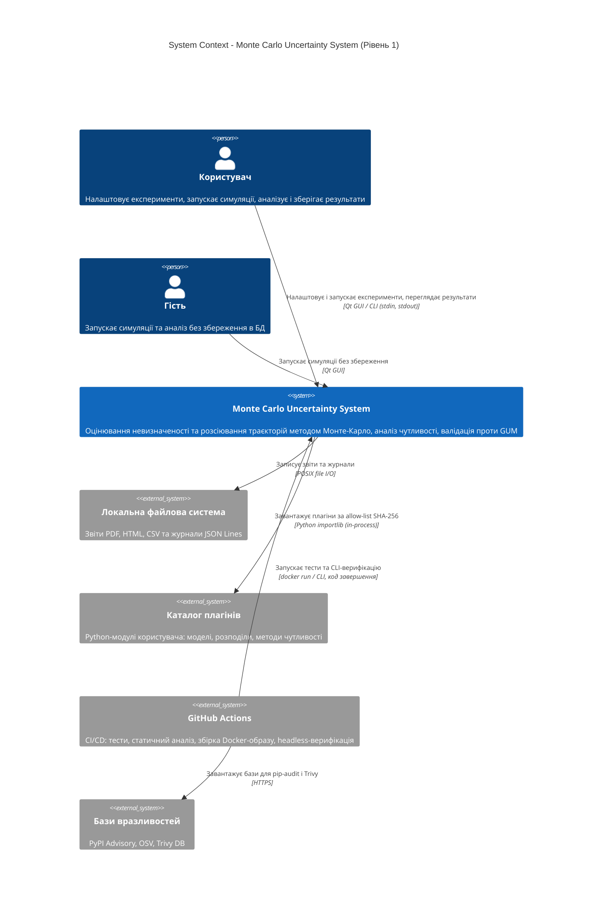
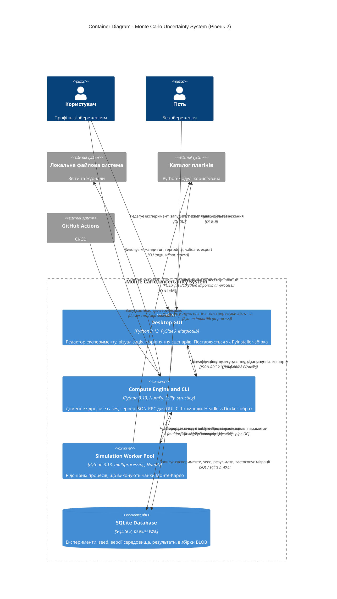
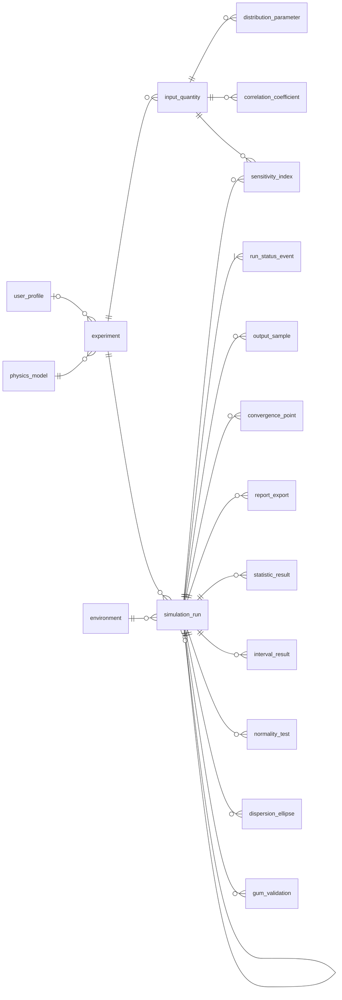
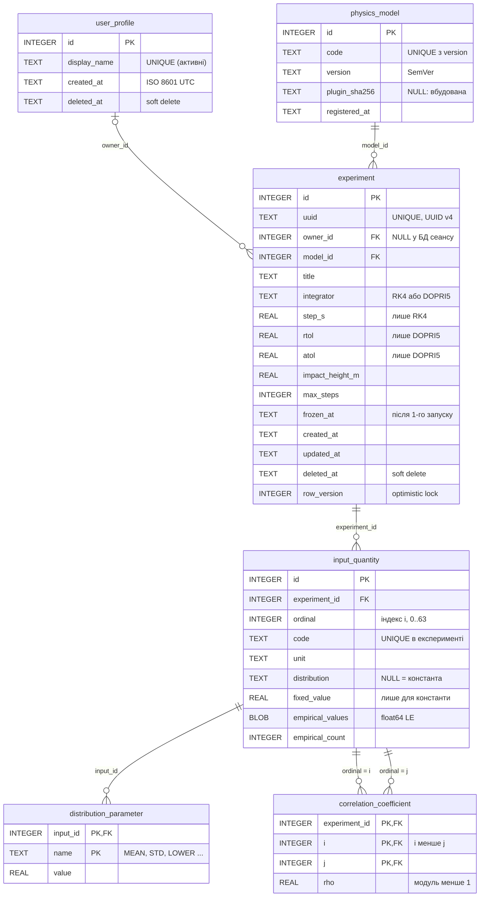
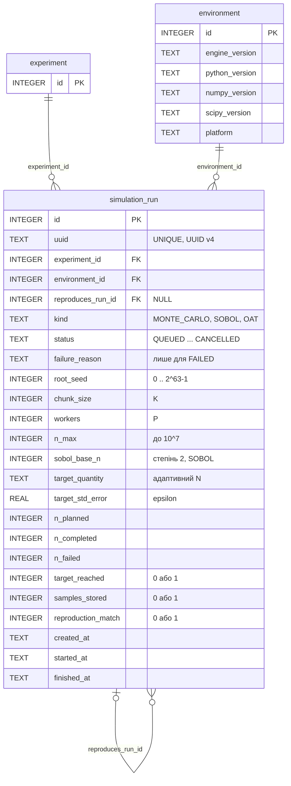
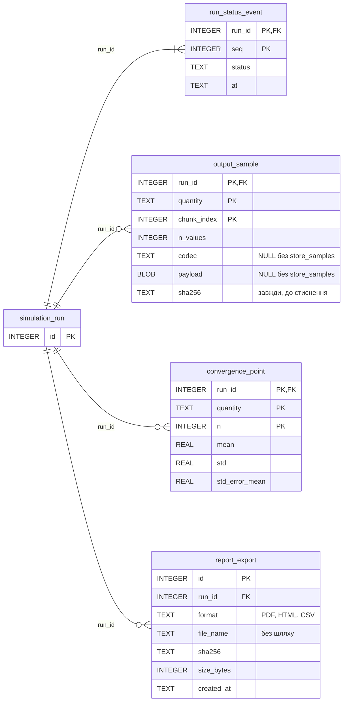
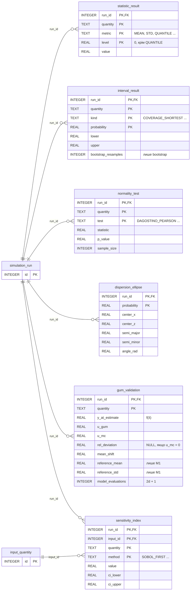
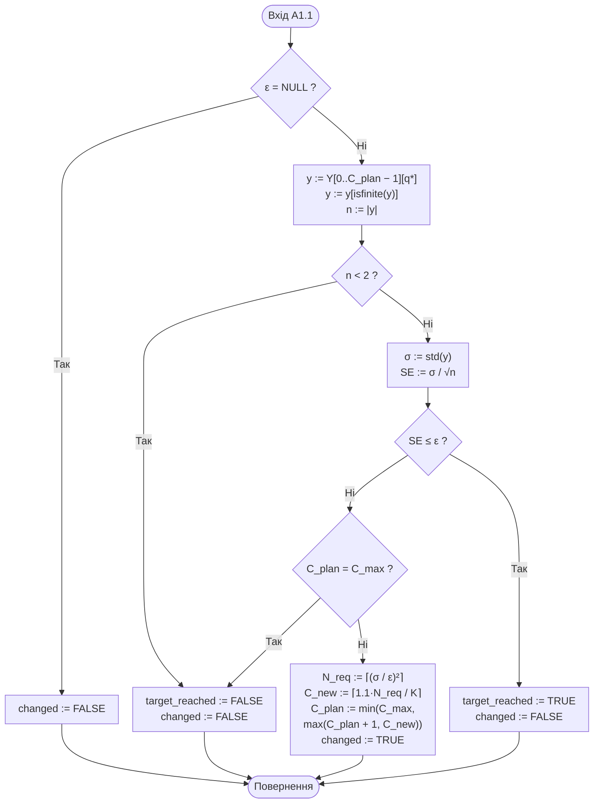
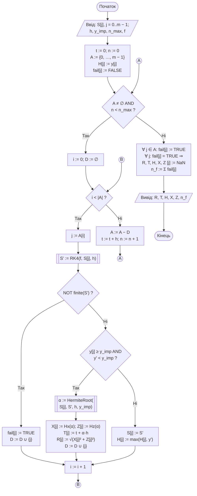

# Розділ 2. Проєктування архітектури системи

Документ містить архітектурні діаграми C4 Model (рівні 1–3), схему даних, міжсервісні контракти, алгоритми критичних вузлів і звіт інтеграційного аудиту у форматі Docs-as-Code (Mermaid, SQL, proto3) з трасуванням до вимог [srs.md](./srs.md) і рішення [ADR-001](./adr/0001-choice-of-technology.md).

**Навігація:** [2.1 Context та Container](#21-контекстне-та-контейнерне-моделювання-системи-c4-model) · [2.2 Component](#22-компонентне-моделювання-критичного-сервісу-системи) · [2.3 ADR](#23-документування-архітектурних-рішень-architecture-decision-records) · [2.4 Дані](#24-проєктування-та-моделювання-баз-даних) · [2.5 API](#25-специфікація-міжсервісних-контрактів-api) · [2.6 Алгоритми](#26-моделювання-логіки-критичних-вузлів) · [2.7 Інтеграційний аудит](#27-інтеграційний-аудит-та-верифікація-цілісності-доменів) · [2.8 Матриця трасування](#28-матриця-трасування-вимоги--архітектура)

**Архітектурні принципи:** Hexagonal (Ports & Adapters): доменне ядро не залежить від GUI, СУБД, файлової системи та механізму паралелізму; залежності спрямовані до ядра (Dependency Inversion). Один процес Compute Engine обслуговує GUI та CLI; обчислення виконуються у відокремлених робочих процесах.

---

## 2.1 Контекстне та контейнерне моделювання системи (C4 Model)

<a id="diagram-level1"></a>

### Рівень 1. System Context



**Опис елементів**

| Елемент | Тип | Опис | Вимоги |
| --- | --- | --- | --- |
| Користувач | Person | Локальний профіль; збереження та відтворення експериментів | [SRS-FUN-46](./srs.md#srs-fun-46), [SRS-FUN-49](./srs.md#srs-fun-49), [SRS-FUN-51](./srs.md#srs-fun-51) |
| Гість | Person | Режим без запису в БД | [SRS-FUN-51](./srs.md#srs-fun-51) |
| Monte Carlo Uncertainty System | System | Усі функції [розділу 2 SRS](./srs.md#2-functional-requirements-функціональні-вимоги) | SRS-FUN-01…61 |
| Локальна файлова система | System_Ext | Приймач звітів PDF / HTML / CSV та журналів | [SRS-FUN-58](./srs.md#srs-fun-58), [SRS-FUN-59](./srs.md#srs-fun-59), [SRS-FUN-60](./srs.md#srs-fun-60), [SRS-FUN-61](./srs.md#srs-fun-61) |
| Каталог плагінів | System_Ext | Джерело користувацьких моделей, розподілів, методів чутливості | [SRS-FUN-09…13](./srs.md#srs-fun-09), [SRS-NFR-SEC-04](./srs.md#srs-nfr-sec-04) |
| GitHub Actions | System_Ext | Автоматична верифікація NFR | [SRS-NFR-DEPL-01](./srs.md#srs-nfr-depl-01), [SRS-NFR-PORT-01](./srs.md#srs-nfr-port-01), [SRS-NFR-QUAL-04](./srs.md#srs-nfr-qual-04) |
| Бази вразливостей | System_Ext | Дані для `pip-audit` і Trivy | [SRS-NFR-SEC-02](./srs.md#srs-nfr-sec-02), [SRS-NFR-SEC-06](./srs.md#srs-nfr-sec-06) |

**Опис зв’язків**

| № | Зв’язок | Протокол | Призначення |
| --- | --- | --- | --- |
| 1 | Користувач → Система | Qt GUI (події вводу) або CLI (argv, stdout) | [SRS-IF-01](./srs.md#1-system-context-контекст-системи), SRS-IF-02 |
| 2 | Гість → Система | Qt GUI | [SRS-FUN-51](./srs.md#srs-fun-51) |
| 3 | Система → Файлова система | Файловий ввід-вивід POSIX / Win32 | [SRS-IF-05](./srs.md#1-system-context-контекст-системи) |
| 4 | Система → Каталог плагінів | `importlib` (in-process) | [SRS-IF-06](./srs.md#1-system-context-контекст-системи) |
| 5 | CI → Система | `docker run`, код завершення | [SRS-IF-07](./srs.md#1-system-context-контекст-системи) |
| 6 | CI → Бази вразливостей | HTTPS | Сканування залежностей (поза межами системи) |

<a id="diagram-level2"></a>

### Рівень 2. Container



**Опис контейнерів**

| Контейнер | Технологія | Відповідальність | Розгортання | Вимоги |
| --- | --- | --- | --- | --- |
| Desktop GUI | Python 3.13, PySide6, Matplotlib | Редактор експерименту, гістограми, пучок траєкторій, порівняння сценаріїв, діаграма tornado і криві збіжності; не містить обчислювальної логіки; читає БД у режимі read-only | PyInstaller (Windows, Linux) | [SRS-FUN-52…56](./srs.md#srs-fun-52), [SRS-NFR-UI-01](./srs.md#srs-nfr-ui-01), [SRS-NFR-PORT-01](./srs.md#srs-nfr-port-01) |
| Compute Engine and CLI | Python 3.13, NumPy, SciPy, structlog | Єдина точка входу до доменного ядра: use cases, оркестрація Монте-Карло, аналіз, валідація проти GUM, збереження, експорт. Працює в двох режимах: `serve` (JSON-RPC для GUI) та `run` (CLI). Окремий процес ізолює GUI від GIL, відповідальність за [SRS-NFR-UI-01](./srs.md#srs-nfr-ui-01) | Docker-образ (non-root), процес поруч із GUI | [SRS-FUN-01…51](./srs.md#2-functional-requirements-функціональні-вимоги), [SRS-FUN-57…61](./srs.md#srs-fun-57), [SRS-NFR-SEC-06](./srs.md#srs-nfr-sec-06) |
| Simulation Worker Pool | Python 3.13, `ProcessPoolExecutor` (start method `spawn`), NumPy | Виконання чанків: генерація вибірки, інтегрування, повернення вихідних величин; не має доступу до БД | Дочірні процеси Compute Engine | [SRS-FUN-20…22](./srs.md#srs-fun-20), [SRS-NFR-PERF-01…02](./srs.md#srs-nfr-perf-01), [ADR-001](./adr/0001-choice-of-technology.md) |
| SQLite Database | SQLite 3, WAL | Сховище експериментів, seed, версій середовища, результатів; запис виконує лише Compute Engine | Файл у каталозі профілю користувача | [SRS-FUN-46…50](./srs.md#srs-fun-46), [SRS-NFR-REL-01](./srs.md#srs-nfr-rel-01), [SRS-NFR-SEC-01](./srs.md#srs-nfr-sec-01) |

Пакет `mcunc-core` (доменне ядро) є бібліотекою всередині контейнерів Compute Engine та Worker Pool і не є окремим контейнером; його внутрішня структура наведена на рівні 3.

**Опис зв’язків**

| № | Зв’язок | Протокол | Призначення | Вимоги |
| --- | --- | --- | --- | --- |
| 1 | Користувач → GUI, Гість → GUI | Qt GUI | Взаємодія з редактором і візуалізаціями | [SRS-IF-01](./srs.md#1-system-context-контекст-системи) |
| 2 | Користувач → Engine | CLI (argv, stdout, stderr) | Пакетні запуски | [SRS-FUN-57](./srs.md#srs-fun-57) |
| 3 | CI → Engine | `docker run`, код завершення | Автоматична верифікація | [SRS-IF-07](./srs.md#1-system-context-контекст-системи) |
| 4 | GUI → Engine | JSON-RPC 2.0 / stdio | Керування запуском | [SRS-FUN-24](./srs.md#srs-fun-24), [SRS-IF-03](./srs.md#1-system-context-контекст-системи) |
| 5 | Engine → GUI | JSON-RPC 2.0 notifications / stdio | Прогрес і статус | [SRS-FUN-25](./srs.md#srs-fun-25) |
| 6 | GUI → БД | SQL / `sqlite3`, `mode=ro` | Читання результатів для графіків | [SRS-FUN-53…56](./srs.md#srs-fun-53) |
| 7 | Engine → БД | SQL / `sqlite3`, WAL | Запис експериментів, міграції | [SRS-FUN-46…50](./srs.md#srs-fun-46) |
| 8 | Engine ↔ Workers | `multiprocessing`, pickle через pipe ОС | Розподіл чанків і збір результатів | [SRS-FUN-21](./srs.md#srs-fun-21), [ADR-001](./adr/0001-choice-of-technology.md) |
| 9 | Workers → Плагіни | `importlib` | Імпорт моделі-плагіна у кожному робочому процесі | [SRS-NFR-SEC-04](./srs.md#srs-nfr-sec-04) |
| 10 | Engine → Плагіни | `importlib` | Завантаження та реєстрація | [SRS-FUN-12](./srs.md#srs-fun-12) |
| 11 | Engine → Файлова система | Файловий ввід-вивід | Експорт звітів, журнали | [SRS-FUN-58…61](./srs.md#srs-fun-58) |

**Архітектурні рішення рівня 2:** вибір механізму паралелізму зафіксовано в [ADR-001](./adr/0001-choice-of-technology.md); результати великих вибірок передаються до GUI через БД, а не через JSON-RPC; JSON-RPC передає лише керуючі повідомлення та прогрес.

---

## 2.2 Компонентне моделювання критичного сервісу системи

Критичний контейнер — **Compute Engine and CLI**: містить усі обчислювальні та аналітичні алгоритми й визначає виконання [SRS-NFR-PERF-01…03](./srs.md#srs-nfr-perf-01), [SRS-NFR-REPR-01](./srs.md#srs-nfr-repr-01), [SRS-NFR-ACC-01…06](./srs.md#srs-nfr-acc-01).

<a id="diagram-level3"></a>

### Рівень 3. Component

```mermaid
C4Component
  title Component Diagram - Compute Engine and CLI (Рівень 3)

  System_Ext(ci, "GitHub Actions", "Запуск CLI у Docker")
  Container(gui, "Desktop GUI", "PySide6", "Клієнт JSON-RPC")
  Container(workers, "Simulation Worker Pool", "multiprocessing", "Виконує чанки")
  ContainerDb(db, "SQLite Database", "SQLite 3, WAL", "Експерименти та результати")
  System_Ext(fs, "Локальна файлова система", "Звіти та журнали")
  System_Ext(plug, "Каталог плагінів", "Python-модулі")

  Container_Boundary(engine, "Compute Engine and CLI") {
    Component(cli, "CliController", "argparse", "Команди run, reproduce, validate, export")
    Component(rpc, "RpcServer", "JSON-RPC 2.0 / stdio", "Запити GUI, нотифікації прогресу")
    Component(val, "RequestValidator", "Middleware, dataclasses", "Валідація DTO: N, P, діапазони, матриця кореляцій")
    Component(guard, "AccessPolicyGuard", "Middleware", "Режим Гість: заборона запису в БД")
    Component(bus, "CommandBus", "Command, Mediator", "Маршрутизація команд до use cases")
    Component(err, "GlobalErrorHandler", "Exception mapping", "Доменні винятки до кодів помилок")
    Component(root, "CompositionRoot", "Dependency Injection", "Складання об'єктів і впровадження залежностей")
    Component(loader, "PluginLoader", "importlib, hashlib", "Allow-list SHA-256, перевірка інтерфейсу")

    Component(ucRun, "RunExperimentUseCase", "Application service", "Конвеєр: вибірка, MC, аналіз, GUM, збереження")
    Component(ucRepro, "ReproduceExperimentUseCase", "Application service", "Відтворення за збереженим seed")
    Component(ucVal, "ValidateAgainstGumUseCase", "Application service", "Окрема валідація проти GUM")
    Component(ucExp, "ExportReportUseCase", "Application service", "Експорт PDF, HTML, CSV")
    Component(logger, "StructuredLogger", "structlog", "Журнал JSON Lines")
    Component(prog, "ProgressPublisher", "Observer", "Прогрес і статус підписникам")

    Component(reg, "PluginRegistry", "Registry, Strategy", "Моделі, розподіли, методи чутливості")
    Component(gen, "SampleGenerator", "Factory, Strategy", "Розподіли та гауссова копула")
    Component(seed, "SeedManager", "numpy SeedSequence", "Потік випадкових чисел на чанк")
    Component(mc, "MonteCarloCoordinator", "Domain service", "Чанки, адаптивний N, скасування, невдалі траєкторії")
    Component(models, "TrajectoryModels", "Strategy", "M1, M2, M3")
    Component(integ, "OdeIntegrators", "Strategy", "RK4, Dormand-Prince, подія падіння")
    Component(stats, "StatisticsAnalyzer", "scipy.stats", "Статистики, інтервали, нормальність, збіжність")
    Component(sens, "SensitivityAnalyzer", "scipy.stats.sobol_indices", "Соболь, SRC, one-at-a-time")
    Component(gum, "GumValidator", "Domain service", "Лінеаризація JCGM 100, аналітика M1")

    Component(pExec, "ExecutorPort", "Interface", "submit(chunks), cancel()")
    Component(pRepo, "RepositoryPort", "Interface", "save, load, list")
    Component(pRep, "ReportRendererPort", "Interface", "render(experiment, format)")

    Component(exec, "ProcessPoolExecutorAdapter", "concurrent.futures, spawn", "Реалізація ExecutorPort")
    Component(repo, "SqliteExperimentRepository", "sqlite3, WAL", "Реалізація RepositoryPort, міграції")
    Component(rend, "ReportRenderers", "ReportLab, Jinja2, csv", "Реалізація ReportRendererPort")
  }

  Rel(ci, cli, "Команди run, reproduce, validate, export", "CLI argv / код завершення")
  Rel(gui, rpc, "Запити run, cancel, reproduce, export", "JSON-RPC 2.0 / stdio")
  Rel(rpc, gui, "Нотифікації прогресу та статусу", "JSON-RPC 2.0 / stdio")

  Rel(cli, val, "Передає DTO запиту", "in-process call")
  Rel(rpc, val, "Передає DTO запиту", "in-process call")
  Rel(val, guard, "Передає валідний запит", "middleware chain")
  Rel(guard, bus, "Передає дозволену команду", "interface call")
  Rel(val, err, "Повідомляє про відхилений запит", "exception")
  Rel(bus, err, "Передає необроблені винятки", "exception")
  Rel(err, logger, "Логує виняток", "in-process call")
  Rel(err, rpc, "Формує JSON-RPC error", "in-process call")
  Rel(err, cli, "Повертає код завершення та stderr", "in-process call")

  Rel(bus, ucRun, "Dispatch RunExperiment", "Mediator, interface call")
  Rel(bus, ucRepro, "Dispatch Reproduce", "Mediator, interface call")
  Rel(bus, ucVal, "Dispatch Validate", "Mediator, interface call")
  Rel(bus, ucExp, "Dispatch Export", "Mediator, interface call")

  Rel(ucRun, reg, "Отримує модель, розподіли, методи за іменем", "lookup")
  Rel(ucRun, gen, "Будує генератор вибірки", "Factory")
  Rel(ucRun, mc, "Запускає Монте-Карло", "interface call")
  Rel(ucRun, stats, "Запитує статистичний аналіз", "interface call")
  Rel(ucRun, sens, "Запитує аналіз чутливості", "interface call")
  Rel(ucRun, gum, "Запитує валідацію проти GUM", "interface call")
  Rel(ucRun, pRepo, "Зберігає експеримент і результати", "DIP, interface call")
  Rel(ucRun, prog, "Публікує прогрес і статус", "Observer")
  Rel(ucRun, logger, "Логує запуск", "in-process call")
  Rel(ucRepro, ucRun, "Повторний запуск за збереженим seed", "interface call")
  Rel(ucRepro, pRepo, "Читає збережений експеримент", "DIP, interface call")
  Rel(ucVal, gum, "Запитує валідацію", "interface call")
  Rel(ucVal, pRepo, "Читає та оновлює результати валідації", "DIP, interface call")
  Rel(ucExp, pRepo, "Читає експеримент", "DIP, interface call")
  Rel(ucExp, pRep, "Рендерить звіт", "DIP, interface call")

  Rel(mc, seed, "Отримує потік для індексу чанка", "spawn(chunk_index)")
  Rel(mc, pExec, "Передає чанки та скасування", "DIP, interface call")
  Rel(mc, models, "Передає модель для чанка", "Strategy")
  Rel(models, integ, "Інтегрує рівняння руху", "Strategy")
  Rel(gen, seed, "Бере генератор для чанка", "interface call")
  Rel(sens, mc, "Запитує оцінювання матриць A, B, AB_i", "interface call")
  Rel(gum, models, "Похідні та аналітика M1", "Strategy")
  Rel(prog, rpc, "Нотифікації прогресу", "Observer callback")

  Rel(exec, pExec, "Реалізує", "DIP")
  Rel(repo, pRepo, "Реалізує", "DIP")
  Rel(rend, pRep, "Реалізує", "DIP")
  Rel(exec, workers, "Submit чанків, збір результатів", "multiprocessing / pickle через pipe ОС")
  Rel(repo, db, "Запис і читання експериментів", "SQL / sqlite3, WAL")
  Rel(rend, fs, "Запис PDF, HTML, CSV", "POSIX file I/O")
  Rel(logger, fs, "Запис журналу", "structlog JSON Lines")

  Rel(loader, reg, "register(plugin)", "in-process call")
  Rel(loader, plug, "Завантаження модуля після перевірки хешу", "Python importlib")
  Rel(root, cli, "Створює та впроваджує залежності", "DI")
  Rel(root, rpc, "Створює та впроваджує залежності", "DI")
  Rel(root, loader, "Ініціалізує завантаження плагінів", "DI")

  UpdateLayoutConfig($c4ShapeInRow="4", $c4BoundaryInRow="1")
```



**Шари та правила залежностей**

| Шар | Компоненти | Правило |
| --- | --- | --- |
| Inbound (адаптери входу) | CliController, RpcServer | Не містять бізнес-логіки; передають DTO у ланцюг middleware |
| Middleware | RequestValidator, AccessPolicyGuard, GlobalErrorHandler | Валідація та дозволи виконуються до виклику use case; помилки перетворюються централізовано |
| Application | CommandBus, RunExperimentUseCase, ReproduceExperimentUseCase, ValidateAgainstGumUseCase, ExportReportUseCase, ProgressPublisher, StructuredLogger | Оркеструють домен; залежать лише від доменних сервісів і портів |
| Domain | PluginRegistry, SampleGenerator, SeedManager, MonteCarloCoordinator, TrajectoryModels, OdeIntegrators, StatisticsAnalyzer, SensitivityAnalyzer, GumValidator | Не імпортують `sqlite3`, `concurrent.futures`, PySide6, ReportLab |
| Ports | ExecutorPort, RepositoryPort, ReportRendererPort | Інтерфейси належать доменному / прикладному шару |
| Outbound (адаптери виходу) | ProcessPoolExecutorAdapter, SqliteExperimentRepository, ReportRenderers | Реалізують порти; єдині компоненти, що знають про технології |
| Bootstrap | CompositionRoot, PluginLoader | Єдине місце створення конкретних адаптерів і завантаження плагінів |

**Опис компонентів**

| Компонент | Роль | Патерн / технологія | Взаємодія | Вимоги |
| --- | --- | --- | --- | --- |
| CliController | Розбір команд `run`, `reproduce`, `validate`, `export`; код завершення | `argparse` | Викликає RequestValidator; отримує код від GlobalErrorHandler | [SRS-FUN-57](./srs.md#srs-fun-57) |
| RpcServer | Приймає запити GUI та надсилає нотифікації | JSON-RPC 2.0 / stdio | RequestValidator; підписується на ProgressPublisher | [SRS-FUN-24](./srs.md#srs-fun-24), [SRS-FUN-25](./srs.md#srs-fun-25) |
| RequestValidator | Перевіряє *N* ∈ [1; 10^7], *P*, діапазони параметрів, матрицю кореляцій | Middleware, dataclasses | Передає запит до AccessPolicyGuard; помилки — до GlobalErrorHandler | [SRS-FUN-17](./srs.md#srs-fun-17), [SRS-FUN-18](./srs.md#srs-fun-18), [SRS-FUN-19](./srs.md#srs-fun-19), [SRS-NFR-ROB-01](./srs.md#srs-nfr-rob-01) |
| AccessPolicyGuard | У режимі «Гість» відхиляє команди із записом у БД | Middleware | Передає команду до CommandBus | [SRS-FUN-51](./srs.md#srs-fun-51) |
| CommandBus | Маршрутизує команду до use case за типом | Command, Mediator | Викликає use cases через інтерфейс | — |
| GlobalErrorHandler | Відображає винятки на коди помилок JSON-RPC / CLI, логує | Exception mapping | StructuredLogger, RpcServer, CliController | [SRS-FUN-28](./srs.md#srs-fun-28), [SRS-FUN-29](./srs.md#srs-fun-29), [SRS-NFR-ROB-01](./srs.md#srs-nfr-rob-01) |
| CompositionRoot | Створює адаптери, впроваджує залежності через конструктори | Dependency Injection | Єдиний компонент, що імпортує конкретні адаптери | [SRS-NFR-EXT-01](./srs.md#srs-nfr-ext-01) |
| PluginLoader | Перевіряє SHA-256 за allow-list та інтерфейс; реєструє плагін | `importlib`, `hashlib` | Викликає `PluginRegistry.register`; ті самі перевірки виконуються у робочих процесах | [SRS-FUN-12](./srs.md#srs-fun-12), [SRS-FUN-13](./srs.md#srs-fun-13), [SRS-NFR-SEC-04](./srs.md#srs-nfr-sec-04) |
| RunExperimentUseCase | Конвеєр: вибірка → MC → статистика → чутливість → GUM → збереження | Application service | Домен, RepositoryPort, ProgressPublisher, StructuredLogger | [SRS-FUN-19…23](./srs.md#srs-fun-19), [SRS-FUN-30…45](./srs.md#srs-fun-30), [SRS-FUN-46…48](./srs.md#srs-fun-46) |
| ReproduceExperimentUseCase | Завантажує експеримент, повторює за seed, порівнює | Application service | RepositoryPort, RunExperimentUseCase | [SRS-FUN-49](./srs.md#srs-fun-49), [SRS-NFR-REPR-02](./srs.md#srs-nfr-repr-02) |
| ValidateAgainstGumUseCase | Окрема валідація проти GUM для збереженого експерименту | Application service | GumValidator, RepositoryPort | [SRS-FUN-43…45](./srs.md#srs-fun-43) |
| ExportReportUseCase | Експорт PDF, HTML, CSV | Application service | RepositoryPort, ReportRendererPort | [SRS-FUN-58…60](./srs.md#srs-fun-58) |
| StructuredLogger | Записи JSON Lines з обов’язковими полями | `structlog` | Викликається use cases та GlobalErrorHandler | [SRS-FUN-61](./srs.md#srs-fun-61), [SRS-NFR-OBS-01](./srs.md#srs-nfr-obs-01) |
| ProgressPublisher | Публікує прогрес і статус | Observer | RpcServer підписаний; CLI виводить прогрес у stderr | [SRS-FUN-25](./srs.md#srs-fun-25) |
| PluginRegistry | Реєстр моделей, розподілів, методів чутливості за іменем | Registry, Strategy | Наповнюється PluginLoader; читається use cases | [SRS-FUN-09…11](./srs.md#srs-fun-09) |
| SampleGenerator | Генерує вибірки розподілів; гауссова копула | Factory, Strategy | SeedManager | [SRS-FUN-14…16](./srs.md#srs-fun-14), [SRS-NFR-ACC-05](./srs.md#srs-nfr-acc-05) |
| SeedManager | Породжує потік випадкових чисел на чанк | `numpy.random.SeedSequence.spawn` | Викликається MonteCarloCoordinator та SampleGenerator | [SRS-FUN-22](./srs.md#srs-fun-22), [SRS-FUN-23](./srs.md#srs-fun-23) |
| MonteCarloCoordinator | Ділить *N* на чанки, керує адаптивним *N*, скасуванням, невдалими траєкторіями | Domain service | ExecutorPort, SeedManager, TrajectoryModels | [SRS-FUN-19…21](./srs.md#srs-fun-19), [SRS-FUN-24](./srs.md#srs-fun-24), [SRS-FUN-26…29](./srs.md#srs-fun-26), [ADR-001](./adr/0001-choice-of-technology.md) |
| TrajectoryModels | M1, M2, M3 за єдиним інтерфейсом моделі | Strategy | OdeIntegrators | [SRS-FUN-01…05](./srs.md#srs-fun-01) |
| OdeIntegrators | RK4, Dormand–Prince, подія перетину площини падіння | Strategy | Використовується моделями | [SRS-FUN-06…08](./srs.md#srs-fun-06) |
| StatisticsAnalyzer | Статистики, інтервали, еліпс, нормальність, покриття, збіжність | `scipy.stats` | Чисті функції над масивами | [SRS-FUN-30…38](./srs.md#srs-fun-30), [SRS-FUN-42](./srs.md#srs-fun-42) |
| SensitivityAnalyzer | Індекси Соболя, SRC, one-at-a-time | `scipy.stats.sobol_indices` | Використовує MonteCarloCoordinator для оцінювань моделі | [SRS-FUN-39…41](./srs.md#srs-fun-39), [SRS-NFR-ACC-04](./srs.md#srs-nfr-acc-04) |
| GumValidator | Лінеаризація JCGM 100; порівняння з MC; аналітика M1 | Domain service | TrajectoryModels | [SRS-FUN-43…45](./srs.md#srs-fun-43), [SRS-NFR-ACC-02](./srs.md#srs-nfr-acc-02) |
| ExecutorPort | Інтерфейс виконання чанків і скасування | Port | Реалізується ProcessPoolExecutorAdapter | [ADR-001](./adr/0001-choice-of-technology.md) |
| RepositoryPort | Інтерфейс збереження та читання експериментів | Port, Repository | Реалізується SqliteExperimentRepository | [SRS-FUN-46…48](./srs.md#srs-fun-46) |
| ReportRendererPort | Інтерфейс рендерингу звітів | Port | Реалізується ReportRenderers | [SRS-FUN-58…60](./srs.md#srs-fun-58) |
| ProcessPoolExecutorAdapter | Пул процесів зі start method `spawn`, скасування, завершення робочих процесів | `concurrent.futures` | Pickle через pipe ОС | [SRS-FUN-21](./srs.md#srs-fun-21), [SRS-FUN-29](./srs.md#srs-fun-29), [SRS-NFR-PERF-04](./srs.md#srs-nfr-perf-04), [SRS-NFR-RES-02](./srs.md#srs-nfr-res-02) |
| SqliteExperimentRepository | Параметризовані запити, транзакції, міграції, режим WAL | `sqlite3` | SQL / локальний файл SQLite (без мережевого сервера) | [SRS-FUN-46…50](./srs.md#srs-fun-46), [SRS-NFR-SEC-01](./srs.md#srs-nfr-sec-01), [SRS-NFR-REL-01](./srs.md#srs-nfr-rel-01), [SRS-NFR-DATA-01](./srs.md#srs-nfr-data-01) |
| ReportRenderers | PDF (ReportLab), HTML (Jinja2), CSV | ReportLab, Jinja2, `csv` | Файловий ввід-вивід | [SRS-FUN-58…60](./srs.md#srs-fun-58) |

**Примітки до рівня 3**

- Компоненти SampleGenerator, TrajectoryModels, OdeIntegrators і SeedManager є частиною того самого Python-пакета та імпортуються також у робочих процесах Worker Pool; вони не мають станів і доступу до портів БД та файлової системи.
- Залежності спрямовані до домену: адаптери (`exec`, `repo`, `rend`) реалізують порти, а не навпаки; CompositionRoot — єдиний компонент із залежністю на конкретні адаптери.
- Контролери (CliController, RpcServer) не мають прямих зв’язків з RepositoryPort і доменом; будь-який запит проходить ланцюг RequestValidator → AccessPolicyGuard → CommandBus.

---

## 2.3 Документування архітектурних рішень (Architecture Decision Records)

| ID | Рішення | Статус | Документ |
| --- | --- | --- | --- |
| ADR-001 | Механізм паралельного виконання Монте-Карло: `ProcessPoolExecutor` + векторизація NumPy | Approved | [0001-choice-of-technology.md](./adr/0001-choice-of-technology.md) |

Рішення визначає контейнер Simulation Worker Pool ([рівень 2](#diagram-level2)) та компоненти MonteCarloCoordinator, ExecutorPort, ProcessPoolExecutorAdapter, SeedManager ([рівень 3](#diagram-level3)), а також вимоги [SRS-FUN-20…22](./srs.md#srs-fun-20), [SRS-NFR-PERF-01…02](./srs.md#srs-nfr-perf-01), [SRS-NFR-REPR-01](./srs.md#srs-nfr-repr-01).

---

## 2.4. Проєктування та моделювання баз даних

Шар збереження реалізує компонент `SqliteExperimentRepository` ([рівень 3](#diagram-level3)) поверх SQLite 3 у режимі WAL. Повна фізична схема зафіксована як Data-as-Code у файлі [data/schema.sql](./data/schema.sql): 19 STRICT-таблиць, 9 індексів, 12 тригерів. Схема реалізує вимоги [SRS-FUN-46…51](./srs.md#srs-fun-46), [SRS-NFR-REL-01](./srs.md#srs-nfr-rel-01), [SRS-NFR-SEC-01](./srs.md#srs-nfr-sec-01), [SRS-NFR-DATA-01](./srs.md#srs-nfr-data-01).

**Файли БД.** Схема однакова для двох файлів: БД профілю (режим `ACCESS_MODE_USER`) і тимчасової БД сеансу (режим `ACCESS_MODE_GUEST`, видаляється при завершенні Compute Engine; [SRS-FUN-51](./srs.md#srs-fun-51)). Запис виконує лише Compute Engine; Desktop GUI відкриває файл з `mode=ro` та `PRAGMA query_only = ON`.

**Конвенції.** Час — `TEXT` ISO 8601 UTC з мілісекундами, канонічність перевіряє `CHECK (strftime(...) = значення)`. Публічні ідентифікатори — UUID v4 (`TEXT`, 36 символів); внутрішні `INTEGER PRIMARY KEY` назовні не передаються. Перелічення — `TEXT` + `CHECK IN (...)`, значення збігаються з іменами enum контракту без префікса (`RUN_STATUS_SUCCEEDED` → `'SUCCEEDED'`). Логічні значення — `INTEGER` 0/1. Параметри з'єднання: `foreign_keys = ON`, `journal_mode = WAL`, `synchronous = NORMAL`, `busy_timeout = 5000`.

<a id="diagram-erd-overview"></a>

### 2.4.1. Загальна ER-діаграма

Діаграма показує зв'язки 18 прикладних таблиць (службову `schema_migration` не наведено). Підписи зв'язків опущено, щоб діаграма читалася без масштабування; імена зовнішніх ключів і атрибути наведено на детальних діаграмах 2.4.2–2.4.4.



<a id="diagram-erd-config"></a>

### 2.4.2. Підобласть «Конфігурація експерименту»



**user_profile** — локальний профіль користувача (лише БД профілю; персональні дані, крім імені, не зберігаються).

| Поле | Тип | Обмеження | Опис |
| --- | --- | --- | --- |
| id | INTEGER | PK | Внутрішній ключ |
| display_name | TEXT | NOT NULL, 1–64 символи, COLLATE NOCASE; UNIQUE серед активних (частковий індекс) | Ім'я профілю |
| created_at | TEXT | NOT NULL, ISO 8601 UTC | Час створення |
| deleted_at | TEXT | NULL, ISO 8601 UTC | Soft delete |

**physics_model** — зареєстровані версії фізичних моделей, зокрема плагінів.

| Поле | Тип | Обмеження | Опис |
| --- | --- | --- | --- |
| id | INTEGER | PK | Внутрішній ключ |
| code | TEXT | NOT NULL, `^[a-z][a-z0-9_]{1,63}$`; UNIQUE (code, version) | `m1_vacuum`, `m2_drag`, `m3_isa_wind` або ім'я плагіна |
| version | TEXT | NOT NULL, 5–32 символи | Версія SemVer |
| plugin_sha256 | TEXT | NULL, 64 hex | SHA-256 модуля плагіна (allow-list, [SRS-FUN-12](./srs.md#srs-fun-12)) |
| registered_at | TEXT | NOT NULL, ISO 8601 UTC | Час реєстрації |

**experiment** — конфігурація експерименту; після першого запуску змінювані поля конфігурації заморожуються тригером.

| Поле | Тип | Обмеження | Опис |
| --- | --- | --- | --- |
| id | INTEGER | PK | Внутрішній ключ |
| uuid | TEXT | NOT NULL, UNIQUE, UUID v4 | Публічний ідентифікатор (`experiments/{uuid}`) |
| owner_id | INTEGER | FK → user_profile.id, ON DELETE RESTRICT, NULL у БД сеансу | Власник |
| model_id | INTEGER | NOT NULL, FK → physics_model.id, ON DELETE RESTRICT | Модель і версія |
| title | TEXT | NOT NULL, 1–200 символів | Назва |
| integrator | TEXT | NOT NULL, `RK4` або `DOPRI5` | Метод інтегрування |
| step_s | REAL | 0 < h ≤ 1; обов'язкове лише для RK4 | Крок h, с |
| rtol, atol | REAL | > 0; обов'язкові лише для DOPRI5 | Допуски Dormand–Prince |
| impact_height_m | REAL | NOT NULL, типово 0 | Висота площини падіння y_imp, м |
| max_steps | INTEGER | NOT NULL, 100…10^7 | Ліміт кроків n_max для траєкторії |
| frozen_at | TEXT | NULL, ISO 8601 UTC | Час першого запуску; після нього конфігурація незмінна |
| created_at, updated_at | TEXT | NOT NULL, ISO 8601 UTC; updated_at ≥ created_at | Аудит змін |
| deleted_at | TEXT | NULL | Soft delete (`DeleteExperiment`) |
| row_version | INTEGER | NOT NULL ≥ 1 | Оптимістичне блокування (`Experiment.etag`) |

**input_quantity** — вхідна величина моделі: стала або випадкова з розподілом.

| Поле | Тип | Обмеження | Опис |
| --- | --- | --- | --- |
| id | INTEGER | PK | Внутрішній ключ |
| experiment_id | INTEGER | NOT NULL, FK → experiment.id, ON DELETE CASCADE | Експеримент |
| ordinal | INTEGER | NOT NULL, 0…63; UNIQUE (experiment_id, ordinal) | Індекс i у векторі x |
| code | TEXT | NOT NULL, `^[a-z][a-z0-9_]{0,31}$`; UNIQUE (experiment_id, code) | Код величини (`v0`, `elevation`, …) |
| unit | TEXT | NOT NULL, 1–16 символів | Одиниця SI |
| distribution | TEXT | NULL або одне з 7 значень | Розподіл; NULL — стала величина |
| fixed_value | REAL | обов'язкове тоді й лише тоді, коли distribution IS NULL | Значення сталої |
| empirical_values | BLOB | лише для EMPIRICAL; довжина = 8 · empirical_count | Вибірка float64 little-endian |
| empirical_count | INTEGER | 2…10^6 | Кількість значень вибірки |

**distribution_parameter** — параметри розподілу (по одному рядку на параметр).

| Поле | Тип | Обмеження | Опис |
| --- | --- | --- | --- |
| input_id | INTEGER | PK, FK → input_quantity.id, ON DELETE CASCADE | Вхідна величина |
| name | TEXT | PK; MEAN, STD, LOWER, UPPER, MODE, SHAPE, SCALE, LOCATION, LOG_MEAN, LOG_STD | Ім'я параметра |
| value | REAL | NOT NULL | Значення |

Набори параметрів: NORMAL {MEAN, STD}; UNIFORM {LOWER, UPPER}; TRIANGULAR {LOWER, MODE, UPPER}; TRUNCATED_NORMAL {MEAN, STD, LOWER, UPPER}; LOGNORMAL {LOG_MEAN, LOG_STD}; WEIBULL {SHAPE, SCALE, LOCATION}; EMPIRICAL — без параметрів. Повноту набору та співвідношення меж перевіряє `RequestValidator` за правилами контракту ([2.5](#25-специфікація-міжсервісних-контрактів-api)).

**correlation_coefficient** — ненульові коефіцієнти верхнього трикутника кореляційної матриці (діагональ дорівнює 1).

| Поле | Тип | Обмеження | Опис |
| --- | --- | --- | --- |
| experiment_id | INTEGER | PK; FK (experiment_id, i) та (experiment_id, j) → input_quantity (experiment_id, ordinal) | Експеримент |
| i, j | INTEGER | PK; i < j | Індекси пари величин |
| rho | REAL | NOT NULL; −1 < rho < 1; rho ≠ 0 | Коефіцієнт кореляції |

Складені зовнішні ключі гарантують, що обидві величини пари належать тому самому експерименту. Додатну визначеність матриці перевіряє `RequestValidator` (розклад Холецького, [SRS-FUN-17](./srs.md#srs-fun-17)).

<a id="diagram-erd-run"></a>

### 2.4.3. Підобласть «Запуск»

**Частина 1. Запуск і середовище**



**Частина 2. Сирі результати запуску**



**environment** — версії середовища, в якому виконано запуск (нормалізовано; [SRS-FUN-46](./srs.md#srs-fun-46)).

| Поле | Тип | Обмеження | Опис |
| --- | --- | --- | --- |
| id | INTEGER | PK | Внутрішній ключ |
| engine_version, python_version, numpy_version, scipy_version | TEXT | NOT NULL, 5–32 символи | Версії компонентів |
| platform | TEXT | NOT NULL, 1–128 символів | ОС і архітектура |
| — | — | UNIQUE за всіма п'ятьма полями | Один рядок на унікальне середовище |

**simulation_run** — запуск Монте-Карло, Соболя або OAT.

| Поле | Тип | Обмеження | Опис |
| --- | --- | --- | --- |
| id | INTEGER | PK | Внутрішній ключ |
| uuid | TEXT | NOT NULL, UNIQUE, UUID v4 | `experiments/{e}/runs/{uuid}` |
| experiment_id | INTEGER | NOT NULL, FK → experiment.id, ON DELETE CASCADE | Експеримент |
| environment_id | INTEGER | NOT NULL, FK → environment.id, ON DELETE RESTRICT | Середовище |
| reproduces_run_id | INTEGER | NULL, FK → simulation_run.id, ON DELETE SET NULL | Запуск-джерело для `ReproduceRun` |
| kind | TEXT | NOT NULL: MONTE_CARLO, SOBOL, OAT | Тип запуску |
| status | TEXT | NOT NULL: QUEUED, RUNNING, SUCCEEDED, FAILED, CANCELLED; переходи контролює тригер | Статус |
| failure_reason | TEXT | обов'язкове тоді й лише тоді, коли status = FAILED | Причина відмови |
| root_seed | INTEGER | NOT NULL, 0…2^63 − 1 | Кореневий seed s |
| chunk_size | INTEGER | NOT NULL, 1…10^6 | K |
| workers | INTEGER | NOT NULL, 1…256 | P |
| n_max | INTEGER | NOT NULL, 1…10^7 | N_max |
| sobol_base_n | INTEGER | степінь 2; обов'язкове тоді й лише тоді, коли kind = SOBOL | Базовий об'єм n |
| target_quantity, target_std_error | TEXT, REAL | обидва NULL або обидва задані; ε > 0 | Параметри адаптивного N |
| n_planned, n_completed, n_failed | INTEGER | n_failed ≤ n_completed ≤ n_planned ≤ n_max | Лічильники траєкторій |
| target_reached | INTEGER | NULL, 0 або 1; лише для адаптивного запуску | Досягнення порогу ε |
| samples_stored | INTEGER | NOT NULL, 0 або 1 | Наявність payload у output_sample |
| reproduction_match | INTEGER | NULL, 0 або 1; лише якщо reproduces_run_id задано | Бітовий збіг із джерелом |
| created_at, started_at, finished_at | TEXT | ISO 8601 UTC; finished_at задано тоді й лише тоді, коли статус термінальний | Часові мітки |

**run_status_event** — журнал змін статусу (заповнюється тригерами).

| Поле | Тип | Обмеження | Опис |
| --- | --- | --- | --- |
| run_id | INTEGER | PK, FK → simulation_run.id, ON DELETE CASCADE | Запуск |
| seq | INTEGER | PK, ≥ 1 | Порядковий номер події |
| status | TEXT | NOT NULL, ті самі 5 значень | Новий статус |
| at | TEXT | NOT NULL, ISO 8601 UTC | Час зміни |

**output_sample** — вибірка вихідної величини по чанках.

| Поле | Тип | Обмеження | Опис |
| --- | --- | --- | --- |
| run_id | INTEGER | PK, FK → simulation_run.id, ON DELETE CASCADE | Запуск |
| quantity | TEXT | PK: RANGE, TIME_OF_FLIGHT, MAX_HEIGHT, IMPACT_X, IMPACT_Z | Вихідна величина |
| chunk_index | INTEGER | PK, ≥ 0 | Індекс чанка k |
| n_values | INTEGER | NOT NULL, 1…10^6 | Кількість значень (NaN для невдалих траєкторій) |
| codec | TEXT | NULL або ZLIB_F64LE, RAW_F64LE; NULL тоді й лише тоді, коли payload NULL | Кодування |
| payload | BLOB | NULL без `store_samples` | Значення float64 little-endian |
| sha256 | TEXT | NOT NULL, 64 hex | Дайджест нестиснених байтів; записується завжди для `ReproduceRun` |

**convergence_point** — точки кривих збіжності ([SRS-FUN-42](./srs.md#srs-fun-42)).

| Поле | Тип | Обмеження | Опис |
| --- | --- | --- | --- |
| run_id, quantity, n | INTEGER, TEXT, INTEGER | PK; n ≥ 2 | Запуск, величина, об'єм кумулятивної вибірки |
| mean, std, std_error_mean | REAL | std ≥ 0; std_error_mean ≥ 0 | Оцінки на об'ємі n |

**report_export** — журнал експортованих звітів.

| Поле | Тип | Обмеження | Опис |
| --- | --- | --- | --- |
| id | INTEGER | PK | Внутрішній ключ |
| run_id | INTEGER | NOT NULL, FK → simulation_run.id, ON DELETE CASCADE | Запуск |
| format | TEXT | NOT NULL: PDF, HTML, CSV | Формат |
| file_name | TEXT | 1–255 символів без `/` та `\` | Ім'я файлу (шлях не зберігається) |
| sha256, size_bytes | TEXT, INTEGER | 64 hex; ≥ 0 | Цілісність файлу |
| created_at | TEXT | NOT NULL, ISO 8601 UTC | Час експорту |

<a id="diagram-erd-results"></a>

### 2.4.4. Підобласть «Результати аналізу»



| Таблиця | Ключ | Поля даних | Обмеження | Вимоги |
| --- | --- | --- | --- | --- |
| statistic_result | (run_id, quantity, metric, level) | value REAL | metric: MEAN, MEDIAN, VARIANCE, STD, SKEWNESS, KURTOSIS, STD_ERROR_MEAN, QUANTILE; level > 0 тоді й лише тоді, коли metric = QUANTILE (інакше 0) | [SRS-FUN-30…32](./srs.md#srs-fun-30) |
| interval_result | (run_id, quantity, kind, probability) | lower, upper REAL; bootstrap_resamples INTEGER | kind: COVERAGE_SHORTEST, CI_MEAN_STUDENT, CI_BOOTSTRAP_PERCENTILE; lower ≤ upper; 0 < p < 1; B ∈ [100; 10^5] лише для bootstrap | [SRS-FUN-33…35](./srs.md#srs-fun-33) |
| normality_test | (run_id, quantity, test) | statistic, p_value REAL; sample_size INTEGER | test: DAGOSTINO_PEARSON, SHAPIRO_WILK; 0 ≤ p ≤ 1; n ≥ 8; для SHAPIRO_WILK n ≤ 5000 | [SRS-FUN-37](./srs.md#srs-fun-37) |
| dispersion_ellipse | (run_id, probability) | center_x, center_z, semi_major, semi_minor, angle_rad REAL | semi_minor ≤ semi_major; кут у (−π/2; π/2] | [SRS-FUN-36](./srs.md#srs-fun-36) |
| sensitivity_index | (run_id, input_id, quantity, method) | value, ci_lower, ci_upper REAL | method: SOBOL_FIRST, SOBOL_TOTAL, SRC, OAT, GUM_COEFFICIENT; межі CI обидві NULL або lower ≤ upper; тригер перевіряє, що input_id належить експерименту запуску | [SRS-FUN-39…41](./srs.md#srs-fun-39), [SRS-FUN-43](./srs.md#srs-fun-43) |
| gum_validation | (run_id, quantity) | y_at_estimate, u_gum, u_mc, rel_deviation, mean_shift, reference_mean, reference_std REAL; model_evaluations INTEGER | u ≥ 0; rel_deviation та mean_shift NULL тоді й лише тоді, коли u_mc = 0; reference_* лише для M1 | [SRS-FUN-43…45](./srs.md#srs-fun-43) |
| schema_migration | version | applied_at TEXT, checksum TEXT | checksum — SHA-256 скрипту міграції; дублюється в `PRAGMA user_version` | [SRS-FUN-50](./srs.md#srs-fun-50) |

### 2.4.5. Обґрунтування типів даних

| Рішення | Обґрунтування |
| --- | --- |
| STRICT-таблиці | SQLite за замовчуванням дозволяє зберегти рядок у колонці INTEGER; STRICT відхиляє невідповідний тип (перевірено: seed 2^63 відхилено) |
| UUID як TEXT(36), а не BLOB(16) | Читабельність у журналах і SQL-консолі; кількість експериментів і запусків — тисячі рядків, економія 20 байт на рядок не суттєва |
| Час як TEXT ISO 8601 з `CHECK (strftime(...) = значення)` | SQLite не має типу дати; лексикографічний порядок збігається з хронологічним, тому індекс за created_at придатний для сортування й пагінації |
| root_seed INTEGER 0…2^63 − 1 | Діапазон signed int64 SQLite і int64 контракту; ентропію генерує `secrets.randbits(63)` |
| Вибірки float64 BLOB по чанках | 10^7 значень = 80 МБ на величину; рядок на чанк обмежує пам'ять при читанні ([SRS-NFR-RES-01](./srs.md#srs-nfr-res-01)) і дає SHA-256 на чанк для порівняння при відтворенні |
| Параметри розподілу окремою таблицею, а не JSON | Атомарні значення (1NF), CHECK на імена параметрів, без парсингу JSON у шарі даних |
| Результати статистики у «довгому» форматі | Нові метрики та рівні квантилів додаються рядками без міграції схеми |

<a id="index-plan"></a>

### 2.4.6. План індексування

SQLite підтримує лише індекси B-tree (зокрема часткові та за виразами); індекси PRIMARY KEY та UNIQUE створюються автоматично. План запитів перевірено командою `EXPLAIN QUERY PLAN` на схемі з тестовими даними.

| Індекс | Колонки | Операція (метод контракту) | План запиту |
| --- | --- | --- | --- |
| ux_user_profile_active_name | display_name WHERE deleted_at IS NULL (UNIQUE, частковий) | Унікальність імені серед активних профілів | — (обмеження) |
| ix_experiment_owner_created | owner_id, created_at DESC, id DESC | `ListExperiments`, keyset-пагінація; FK owner_id | SEARCH USING INDEX (owner_id=? AND created_at<?) |
| sqlite_autoindex (experiment.uuid) | uuid | `GetExperiment`, розбір імені ресурсу | SEARCH USING INDEX (uuid=?) |
| ix_experiment_model | model_id | FK RESTRICT при видаленні моделі | — |
| ix_run_experiment_created | experiment_id, created_at DESC | Перелік запусків експерименту | SEARCH USING INDEX (experiment_id=?) |
| ix_run_active | status WHERE status IN ('QUEUED', 'RUNNING') (частковий) | Обмеження «один активний запуск» (`CreateRun`), відновлення після аварії | SEARCH USING COVERING INDEX (status=?) |
| ix_run_environment, ix_run_reproduces | environment_id; reproduces_run_id (частковий) | FK RESTRICT / SET NULL | — |
| PK output_sample | run_id, quantity, chunk_index | Потокове читання вибірки по чанках (GUI, звіти) | SEARCH USING INDEX (run_id=? AND quantity=?) |
| PK statistic_result та інших таблиць результатів | run_id, … | `GetRunResult` | SEARCH USING PRIMARY KEY (run_id=?) |
| ix_sensitivity_input, ix_report_run | input_id; run_id | FK CASCADE | — |

### 2.4.7. Цілісність і нормалізація

| Тригер | Подія | Правило |
| --- | --- | --- |
| trg_run_freeze_experiment | AFTER INSERT simulation_run | Записує experiment.frozen_at при першому запуску |
| trg_experiment_frozen, trg_input_frozen_*, trg_param_frozen_*, trg_corr_frozen_* | BEFORE INSERT/UPDATE конфігурації | Забороняє зміну конфігурації після першого запуску (умова відтворюваності, [SRS-NFR-REPR-02](./srs.md#srs-nfr-repr-02)) |
| trg_sensitivity_same_experiment | BEFORE INSERT sensitivity_index | Вхідна величина належить експерименту запуску |
| trg_run_status_event_ins, trg_run_status_event_upd | AFTER INSERT / UPDATE OF status | Журнал змін статусу |
| trg_run_status_transition | BEFORE UPDATE OF status | Дозволені переходи: QUEUED → RUNNING, CANCELLED, FAILED; RUNNING → SUCCEEDED, FAILED, CANCELLED |

Схема відповідає 3NF: неключові атрибути залежать лише від повного ключа; похідні величини (тривалість запуску, x̂ та u(x) вхідних величин, обсяг вибірки величини = n_completed − n_failed) не зберігаються. Перевірку обмежень виконано скриптом на 30 некоректних вставках: усі відхилені; каскадне видалення експерименту видаляє запуски, вибірки, результати та кореляції; `PRAGMA integrity_check = ok`, `PRAGMA foreign_key_check` порожній.

---

## 2.5. Специфікація міжсервісних контрактів (API)

Контракти зафіксовано за підходом API-First у форматі gRPC Protocol Buffers (proto3) та перевірено автоматично. Деталізовану специфікацію методів, повідомлень і правил валідації наведено у файлах:

- [api/mcunc/v1/compute_engine.proto](./api/mcunc/v1/compute_engine.proto) — `ComputeEngineService` (Desktop GUI → Compute Engine);
- [api/mcunc/v1/chunk_executor.proto](./api/mcunc/v1/chunk_executor.proto) — `ChunkExecutorService` (Compute Engine → Simulation Worker Pool);
- [api/mcunc/v1/types.proto](./api/mcunc/v1/types.proto) — спільні типи (вхідні величини, розподіли, кореляції, інтегратори);
- [api/buf.yaml](./api/buf.yaml) — конфігурація `buf lint` і залежність `protovalidate`.

| Інтерфейс | Контейнери ([рівень 2](#diagram-level2)) | Транспорт | Контракт | Вимоги |
| --- | --- | --- | --- | --- |
| IF-A | Desktop GUI → Compute Engine | JSON-RPC 2.0 / stdio; тіла повідомлень у ProtoJSON | `ComputeEngineService`, 13 RPC | [SRS-IF-03](./srs.md#1-system-context-контекст-системи), [SRS-FUN-24…26](./srs.md#srs-fun-24), [SRS-FUN-49](./srs.md#srs-fun-49), [SRS-FUN-52…60](./srs.md#srs-fun-52) |
| IF-B | Compute Engine → Simulation Worker Pool | `ProcessPoolExecutor`, байти `SerializeToString` через pipe ОС | `ChunkExecutorService.ExecuteChunk` | [SRS-FUN-20…22](./srs.md#srs-fun-20), [ADR-001](./adr/0001-choice-of-technology.md) |

Вибір proto3 як мови опису інтерфейсів при транспорті JSON-RPC обумовлено обмеженнями попередніх рішень: Compute Engine не відкриває мережевих портів ([SRS-NFR-SEC-05](./srs.md#srs-nfr-sec-05)), тому gRPC поверх HTTP/2 не застосовується, а OpenAPI описує HTTP-ресурси, яких у системі немає. Protobuf дає строгі типи, генерацію Python-класів (`protoc --python_out`) і декларативну валідацію (`buf.validate`); ProtoJSON задає однозначне відображення на JSON-RPC.

### 2.5.1. ComputeEngineService (IF-A)

Ресурси: `experiments/{experiment}`, `experiments/{experiment}/runs/{run}`, де `{experiment}` і `{run}` — UUID v4 (`experiment.uuid`, `simulation_run.uuid`).

| RPC | Запит → відповідь | Мін. режим | Коди помилок (ErrorInfo.reason) | SRS |
| --- | --- | --- | --- | --- |
| GetEngineInfo | GetEngineInfoRequest → EngineInfo | GUEST | UNAVAILABLE | [FUN-09](./srs.md#srs-fun-09), [FUN-52](./srs.md#srs-fun-52) |
| CreateExperiment | CreateExperimentRequest → Experiment | GUEST | INVALID_ARGUMENT (порушення правил полів; CORRELATION_NOT_POSITIVE_DEFINITE), FAILED_PRECONDITION (MODEL_NOT_REGISTERED), ALREADY_EXISTS | [FUN-14…18](./srs.md#srs-fun-14), [FUN-46](./srs.md#srs-fun-46) |
| GetExperiment | GetExperimentRequest → Experiment | GUEST | INVALID_ARGUMENT, NOT_FOUND | [FUN-52](./srs.md#srs-fun-52) |
| ListExperiments | ListExperimentsRequest → ListExperimentsResponse | GUEST | INVALID_ARGUMENT (page_token) | [FUN-55](./srs.md#srs-fun-55) |
| DeleteExperiment | DeleteExperimentRequest → Experiment | GUEST | NOT_FOUND, ABORTED (etag), FAILED_PRECONDITION (RUN_ACTIVE) | — (soft delete) |
| CreateRun | CreateRunRequest → Run | GUEST | INVALID_ARGUMENT (SOBOL_BUDGET_EXCEEDS_N_MAX), NOT_FOUND, RESOURCE_EXHAUSTED (RUN_ACTIVE; RetryInfo), FAILED_PRECONDITION (EXPERIMENT_DELETED) | [FUN-19…23](./srs.md#srs-fun-19), [FUN-26](./srs.md#srs-fun-26) |
| GetRun | GetRunRequest → Run | GUEST | INVALID_ARGUMENT, NOT_FOUND | [FUN-25](./srs.md#srs-fun-25) |
| CancelRun | CancelRunRequest → Run | GUEST | NOT_FOUND, FAILED_PRECONDITION (RUN_TERMINAL) | [FUN-24](./srs.md#srs-fun-24), [NFR-PERF-04](./srs.md#srs-nfr-perf-04) |
| WatchRun | WatchRunRequest → stream RunEvent | GUEST | NOT_FOUND | [FUN-25](./srs.md#srs-fun-25) |
| ReproduceRun | ReproduceRunRequest → Run | USER | NOT_FOUND, PERMISSION_DENIED, FAILED_PRECONDITION (SOURCE_RUN_NOT_SUCCEEDED), RESOURCE_EXHAUSTED | [FUN-49](./srs.md#srs-fun-49), [NFR-REPR-02](./srs.md#srs-nfr-repr-02) |
| GetRunResult | GetRunResultRequest → RunResult | GUEST | NOT_FOUND, FAILED_PRECONDITION (RUN_NOT_SUCCEEDED) | [FUN-30…45](./srs.md#srs-fun-30) |
| GetTrajectoryBundle | GetTrajectoryBundleRequest → TrajectoryBundle | GUEST | INVALID_ARGUMENT (SAMPLE_INDEX_OUT_OF_RANGE), NOT_FOUND, FAILED_PRECONDITION | [FUN-54](./srs.md#srs-fun-54) |
| ExportReport | ExportReportRequest → ExportReportResponse | GUEST | INVALID_ARGUMENT, NOT_FOUND, FAILED_PRECONDITION (RUN_NOT_SUCCEEDED; OUTPUT_DIR_NOT_WRITABLE), ALREADY_EXISTS | [FUN-58…60](./srs.md#srs-fun-58) |

**Прив'язка до JSON-RPC 2.0.** Кадрування — один об'єкт JSON на рядок UTF-8; `method` = ім'я RPC; `params` і `result` — повідомлення у ProtoJSON (імена полів lowerCamelCase, int64 — рядок, enum — ім'я значення, Timestamp — RFC 3339 UTC). Потік `WatchRun` передається нотифікаціями `RunEvent` без `id`.

```json
{"jsonrpc": "2.0", "id": 7, "method": "CreateRun", "params": {
  "parent": "experiments/9b2e6f3a-4c1d-4e8b-a7f2-3d5c8e1b0a94",
  "requestId": "c1d7e2a4-5b6f-4a3c-9d8e-7f6a5b4c3d2e",
  "run": {"kind": "RUN_KIND_MONTE_CARLO", "chunkSize": 10000, "workers": 2, "nMax": 1000000,
          "adaptive": {"quantity": "QUANTITY_RANGE", "targetStdError": 0.5},
          "analysis": {"quantileLevels": [0.025, 0.975], "coverageProbability": 0.95,
                       "bootstrapResamples": 2000, "validateAgainstGum": true, "storeSamples": false}}}}

{"jsonrpc": "2.0", "id": 7, "result": {
  "name": "experiments/9b2e6f3a-4c1d-4e8b-a7f2-3d5c8e1b0a94/runs/5e8a1c2d-3b4f-4d6e-8a9b-0c1d2e3f4a5b",
  "kind": "RUN_KIND_MONTE_CARLO", "rootSeed": "6125418871043912337", "status": "RUN_STATUS_QUEUED",
  "createTime": "2026-11-18T13:05:10.112Z"}}

{"jsonrpc": "2.0", "method": "RunEvent", "params": {
  "run": "experiments/9b2e6f3a-4c1d-4e8b-a7f2-3d5c8e1b0a94/runs/5e8a1c2d-3b4f-4d6e-8a9b-0c1d2e3f4a5b",
  "status": "RUN_STATUS_RUNNING",
  "progress": {"completedChunks": 3, "plannedChunks": 4, "maxChunks": 100,
               "nCompleted": "30000", "nFailed": "2", "fraction": 0.75},
  "eventTime": "2026-11-18T13:05:12.345Z"}}
```

**Модель помилок.** Помилки протоколу повертаються стандартними кодами JSON-RPC; помилки застосунку несуть `google.rpc.Status` у полі `error.data`.

| Канонічний код | error.code JSON-RPC | Деталі | Приклад |
| --- | --- | --- | --- |
| — (синтаксис, структура) | −32700, −32600, −32601 | — | Некоректний JSON, невідомий метод |
| INVALID_ARGUMENT | −32602 | `google.rpc.BadRequest.field_violations[]` | `run.n_max`: значення поза [1; 10^7] |
| NOT_FOUND, ALREADY_EXISTS, ABORTED, FAILED_PRECONDITION, PERMISSION_DENIED | −32000 | `google.rpc.ErrorInfo` (reason, domain = mcunc) | RUN_TERMINAL, SOURCE_RUN_NOT_SUCCEEDED |
| RESOURCE_EXHAUSTED | −32000 | ErrorInfo + `google.rpc.RetryInfo` | RUN_ACTIVE, retryDelay 5 s |
| UNAVAILABLE, INTERNAL | −32000 | ErrorInfo | Завершення роботи ядра |

```json
{"jsonrpc": "2.0", "id": 9, "error": {"code": -32602, "message": "INVALID_ARGUMENT: request validation failed",
  "data": {"code": 3, "message": "request validation failed", "details": [
    {"@type": "type.googleapis.com/google.rpc.BadRequest", "fieldViolations": [
      {"field": "run.n_max", "description": "value must be greater than or equal to 1 and less than or equal to 10000000"}]}]}}}
```

**Модель безпеки.** Автентифікація токенами (JWT, OAuth2) не застосовується: канал stdio успадковується лише батьківським процесом GUI, мережевих портів немає ([SRS 1.6](./srs.md#1-system-context-контекст-системи)). Авторизація реалізована режимом доступу `AccessMode`, що фіксується аргументом запуску процесу; мінімальний режим кожного RPC задано власною опцією методу `(mcunc.v1.required_access_mode)`, яку компонент `AccessPolicyGuard` зчитує з дескриптора, тож правило доступу існує в одному місці — у контракті. Вхідні повідомлення перевіряє `RequestValidator` за правилами `buf.validate`: діапазони чисел, регулярні вирази для імен ресурсів та кодів, `finite` для дійсних чисел, CEL-правила на рівні повідомлень (неперервність ordinal, посилання кореляцій лише на випадкові величини, унікальність пар (i, j), умова Соболя). Ключ `request_id` (UUID v4) робить `CreateExperiment`, `CreateRun`, `ReproduceRun` ідемпотентними.

### 2.5.2. ChunkExecutorService (IF-B)

`ExecuteChunk(ExecuteChunkRequest) → ExecuteChunkResponse`. Запит містить `root_seed` та `chunk_index`, з яких робочий процес відтворює генератор `PCG64(SeedSequence(root_seed, spawn_key = (chunk_index,)))`; спосіб вибірки — `oneof sampling`: випадкова вибірка (вхідні величини та множник Холецького L) або готова матриця плану для Соболя/OAT. Відповідь містить масиви `values_f64le` для кожної величини (NaN для невдалих траєкторій) і `n_failed`. Робочий процес не повертає `google.rpc.Status`: аварія процесу або перевищення `timeout_s` перетворюються адаптером на `FAILURE_REASON_WORKER_CRASHED` / `FAILURE_REASON_CHUNK_TIMEOUT` в алгоритмі A1 ([2.6.1](#261-a1-паралельний-метод-монте-карло-з-адаптивним-вибором-n)).

### 2.5.3. Верифікація контрактів

| Перевірка | Інструмент | Результат |
| --- | --- | --- |
| Синтаксис і компіляція | `protoc` (grpcio-tools), генерація `*_pb2.py` | 3 файли скомпільовано без помилок |
| Стиль (Google API Style Guide) | `buf lint` (STANDARD, крім RPC_REQUEST_RESPONSE_UNIQUE та RPC_RESPONSE_STANDARD_NAME — стандартні методи повертають ресурс за AIP-131/133) | 0 зауважень |
| Правила валідації | `protovalidate` на 27 тестових повідомленнях (коректні та некоректні) | 27 з 27 очікуваних результатів |
| Відповідність схемі БД | Скрипт порівняння 14 пар перелічень і 7 числових діапазонів | 0 розбіжностей ([2.7](#27-інтеграційний-аудит-та-верифікація-цілісності-доменів)) |

---

## 2.6. Моделювання логіки критичних вузлів

Обрано три алгоритми, що визначають коректність і відтворюваність результатів: координацію паралельного методу Монте-Карло (компонент `MonteCarloCoordinator`), інтегрування траєкторій з подією падіння (`OdeIntegrators`) та валідацію проти GUM (`GumValidator`) ([рівень 3](#diagram-level3)).

**Нотація.** `:=` — присвоювання; `=`, `≠`, `<`, `≤` — порівняння; `AND`, `OR`, `NOT` — логічні операції; `X[i]` — i-й елемент масиву (індексація з 0); `|F|` — потужність множини; `⌈x⌉` — округлення вгору; `∅` — порожня множина. Блок-схеми виконано за ISO 5807:1985 (ГОСТ 19.701-90): термінатор — овал, процес — прямокутник, рішення — ромб, дані — паралелограм, визначений процес — прямокутник з подвійними боковими лініями, з'єднувач — коло з літерою.

### 2.6.1. A1. Паралельний метод Монте-Карло з адаптивним вибором N

Вимоги: [SRS-FUN-19…29](./srs.md#srs-fun-19), [SRS-NFR-REPR-01](./srs.md#srs-nfr-repr-01), [SRS-NFR-PERF-04](./srs.md#srs-nfr-perf-04); рішення [ADR-001](./adr/0001-choice-of-technology.md).

Вхід: s — кореневий seed; K — розмір чанка; P — кількість процесів; N_max — межа обчислень; ε — поріг стандартної похибки середнього (NULL — фіксований N); q\* — цільова величина; φ := 0,01 — допустима частка невдалих траєкторій; T_c — ліміт часу чанка (конфігурація ядра, 300 с); N_0 := 2·10^4 — пілотний об'єм; N_start := N_max, якщо ε = NULL, інакше N_start := min(N_0, N_max).

1. C_max := ⌈N_max / K⌉; C_plan := ⌈N_start / K⌉; W := 2·P; k := 0; F := ∅; n_ok := 0; n_f := 0.
2. Поки k < C_plan AND |F| < W: m := min(K, N_max − k·K); F := F ∪ {ExecuteChunk(s, k, m)}; k := k + 1. Генератор чанка k: `PCG64(SeedSequence(s, spawn_key = (k,)))`.
3. Якщо |F| = 0 — перехід до кроку 7. Інакше (j, res) := wait_first(F, 0,5 с).
4. Якщо cancel = TRUE: terminate(pool); status := CANCELLED; результати не записуються.
5. Якщо crashed(j) OR t(j) > T_c: terminate(pool); status := FAILED; reason := WORKER_CRASHED або CHUNK_TIMEOUT.
6. Y[j] := res.y; n_ok := n_ok + res.n_ok; n_f := n_f + res.n_f; ρ := n_f / (n_ok + n_f); F := F − {j}; publish(completed, C_plan, C_max). Якщо n_ok + n_f ≥ 10^4 AND ρ > φ: terminate(pool); status := FAILED; reason := FAILURE_RATE_EXCEEDED (раннє припинення). Інакше — до кроку 2.
7. changed := plan(Y, C_plan) (підалгоритм A1.1). Якщо changed = TRUE — до кроку 2.
8. Якщо ρ > φ: status := FAILED, reason := FAILURE_RATE_EXCEEDED; інакше status := SUCCEEDED. Вивід: Y[0..C_plan − 1] у порядку k.

**A1.1. Планування N.** Якщо ε = NULL: changed := FALSE. Інакше y := Y[0..C_plan − 1][q\*]; y := y[isfinite(y)]; n := |y|. Якщо n < 2: target_reached := FALSE; changed := FALSE. Інакше σ := std(y); SE := σ / √n. Якщо SE ≤ ε: target_reached := TRUE; changed := FALSE. Якщо SE > ε AND C_plan = C_max: target_reached := FALSE; changed := FALSE. Інакше N_req := ⌈(σ / ε)²⌉; C_plan := min(C_max, max(C_plan + 1, ⌈1,1·N_req / K⌉)); changed := TRUE.

Детермінованість: рішення A1.1 приймається лише після завершення всіх чанків 0..C_plan − 1 і обчислюється над Y у порядку індексів, тому результат не залежить від P і порядку завершення процесів.

<a id="diagram-alg-a1"></a>


<a id="diagram-alg-a11"></a>



### 2.6.2. A2. Пакетне інтегрування RK4 з подією падіння

Вимоги: [SRS-FUN-06](./srs.md#srs-fun-06), [SRS-FUN-08](./srs.md#srs-fun-08), [SRS-FUN-27](./srs.md#srs-fun-27), [SRS-NFR-ACC-01](./srs.md#srs-nfr-acc-01). Виконується в робочому процесі для m траєкторій чанка; цикл за i у реалізації векторизовано (NumPy), блок-схема показує логіку для одного елемента.

Вхід: стани S[j] = (x[j], y[j], z[j], v_x[j], v_y[j], v_z[j]), j = 0..m − 1; крок h; висота площини падіння y_imp; ліміт кроків n_max; права частина f моделі (M2 або M3).

1. t := 0; n := 0; A := {0, …, m − 1}; H[j] := y[j]; fail[j] := FALSE.
2. Поки A ≠ ∅ AND n < n_max: i := 0; D := ∅; для кожного j := A[i]:
   - S' := RK4(f, S[j], h), де k1 := f(S[j]); k2 := f(S[j] + h/2·k1); k3 := f(S[j] + h/2·k2); k4 := f(S[j] + h·k3); S' := S[j] + h/6·(k1 + 2·k2 + 2·k3 + k4);
   - якщо NOT finite(S'): fail[j] := TRUE; D := D ∪ {j};
   - якщо y[j] ≥ y_imp AND y' < y_imp: α := HermiteRoot(S[j], S', h, y_imp) — корінь кубічного полінома Ерміта за y та v_y на [0; 1], 3 ітерації Ньютона від α_0 := (y[j] − y_imp) / (y[j] − y'), обмеження α ∈ [0; 1]; X[j] := Hx(α); Z[j] := Hz(α); T[j] := t + α·h; R[j] := √(X[j]² + Z[j]²); D := D ∪ {j};
   - інакше S[j] := S'; H[j] := max(H[j], y');
   - i := i + 1.
   Після перебору A: A := A − D; t := t + h; n := n + 1.
3. Для j ∈ A: fail[j] := TRUE (ліміт кроків). Для fail[j] = TRUE: R, T, H, X, Z [j] := NaN; n_f := Σ fail[j].

Знаменник y[j] − y' у α_0 додатний за умовою перетину, тому ділення на нуль неможливе. Кубічна інтерполяція Ерміта замінила лінійну за результатами аудиту: на сітці v0 ∈ [50; 400] м/с × θ ∈ [10°; 80°] (64 траєкторії, h = 0,05 с) максимальна відносна похибка дальності вакуумної моделі становить 1,93·10^-4 для лінійної інтерполяції (порушує [SRS-NFR-ACC-01](./srs.md#srs-nfr-acc-01)) та 2,4·10^-14 для інтерполяції Ерміта.

<a id="diagram-alg-a2"></a>



### 2.6.3. A3. Валідація методу Монте-Карло проти GUM

Вимоги: [SRS-FUN-43…45](./srs.md#srs-fun-43), [SRS-NFR-ACC-02](./srs.md#srs-nfr-acc-02). Виконується після A1, якщо `AnalysisOptions.validate_against_gum = TRUE`.

Вхід: x̂[i] := E[X_i] та u[i] := √Var[X_i] для i = 0..d − 1 (обчислюються з параметрів розподілу; для сталої u[i] := 0); r[i][j] — кореляційна матриця (r[i][i] = 1); ȳ_MC[q], u_MC[q] — середнє та стандартне відхилення вибірки A1 для q ∈ Q; κ := 10^-2; dist[i] — відстань від x̂[i] до межі носія розподілу (∞ для необмеженого).

1. X[0] := x̂; b := 1. Для i := 0..d − 1: якщо u[i] = 0 — c[i][q] := 0 для всіх q, row[i] := −1; інакше h[i] := min(κ·u[i], dist[i] / 2); X[b] := x̂ + h[i]·e[i]; X[b + 1] := x̂ − h[i]·e[i]; row[i] := b; b := b + 2.
2. (Y, n_f) := A2(X[0..b − 1]) — один пакет з b = 2·d_r + 1 траєкторій.
3. Якщо n_f > 0: status := FAILED; reason := DERIVATIVE_FAILED.
4. Для row[i] ≥ 0: c[i][q] := (Y[row[i]][q] − Y[row[i] + 1][q]) / (2·h[i]).
5. Для q := 0..|Q| − 1: u² := Σ_i Σ_j c[i][q]·c[j][q]·u[i]·u[j]·r[i][j]; u_GUM[q] := √max(u², 0). Якщо u_MC[q] = 0: δ[q] := NULL; shift[q] := NULL. Інакше δ[q] := |u_MC[q] − u_GUM[q]| / u_MC[q]; shift[q] := |ȳ_MC[q] − Y[0][q]| / u_MC[q].
6. Вивід: c (зберігається в `sensitivity_index` з method = GUM_COEFFICIENT), u_GUM, δ, shift, evals := b.

Для моделі M1 додатково обчислюються аналітичні reference_mean та reference_std (за наявності замкненого виразу для заданих розподілів).

<a id="diagram-alg-a3"></a>


### 2.6.4. Обробка виняткових ситуацій

| ID | Ситуація | Алгоритм | Обробка |
| --- | --- | --- | --- |
| EC-01 | Команда скасування | A1 | Перевірка після кожного очікування з тайм-аутом 0,5 с; terminate(pool); статус CANCELLED; запис у БД не виконується |
| EC-02 | Аварійне завершення робочого процесу | A1 | crashed(j) = TRUE; FAILED / WORKER_CRASHED; решта процесів завершується ([SRS-FUN-29](./srs.md#srs-fun-29)) |
| EC-03 | Зависання чанка | A1 | t(j) > T_c; FAILED / CHUNK_TIMEOUT |
| EC-04 | Частка невдалих траєкторій > 1 % | A1 | Раннє припинення після 10^4 траєкторій або фінальна перевірка; FAILED / FAILURE_RATE_EXCEEDED |
| EC-05 | Поріг ε недосяжний | A1.1 | Зупинка на C_max; target_reached := FALSE; статус SUCCEEDED |
| EC-06 | Порожня вибірка (n < 2) | A1.1 | Без оцінки SE; target_reached := FALSE; статус визначає перевірка ρ > φ |
| EC-07 | Нечислове значення стану (NaN, ∞) | A2 | fail[j] := TRUE; траєкторія виключається з аналізу |
| EC-08 | Траєкторія не досягає площини падіння | A2 | Ліміт n_max; fail[j] := TRUE |
| EC-09 | Старт нижче горизонту (θ ≤ 0) | A2 | Перетин на першому кроці; R[j] = 0, T[j] = 0 |
| EC-10 | Стала вхідна величина (u[i] = 0) | A3 | Виключається з похідних; c[i][q] := 0 |
| EC-11 | Крок різниці виходить за носій розподілу | A3 | h[i] := min(κ·u[i], dist[i] / 2) |
| EC-12 | Нульова невизначеність виходу (u_MC = 0) | A3 | δ, shift := NULL (узгоджено з CHECK у `gum_validation`) |
| EC-13 | Нечислове значення моделі в точках різниць | A3 | FAILED / DERIVATIVE_FAILED |

### 2.6.5. Перевірка алгоритмів прототипом

Логіку A1–A3 перевірено прототипом на Python 3.13.18, NumPy 2.5.3, 2 ядрах (модель з квадратичним опором і вітром, 8 джерел невизначеності, кореляція v0 та кута 0,3):

| Перевірка | Результат |
| --- | --- |
| A1: адаптивний запуск, ε = 1 м, K = 5000, P = 1 та P = 2 | SHA-256 вибірок однаковий; C_plan = 4, N = 20 000, target_reached = TRUE |
| A2: ліміт кроків, нечислові стани, θ < 0 | fail = TRUE, R = NaN; R = 0, T = 0 для θ < 0 |
| A2: вакуумна модель, 64 траєкторії | відносна похибка дальності 2,4·10^-14 (інтерполяція Ерміта) |
| A3: лінійна модель y = 2·x1 − 3·x2, r = 0,4, N = 10^6 | δ = 0,072 % (вимога ≤ 1 %, [SRS-NFR-ACC-02](./srs.md#srs-nfr-acc-02)) |

---

## 2.7. Інтеграційний аудит та верифікація цілісності доменів

**Обсяг.** Перехресна перевірка трьох артефактів: схеми даних ([2.4](#24-проєктування-та-моделювання-баз-даних), [schema.sql](./data/schema.sql)), контрактів ([2.5](#25-специфікація-міжсервісних-контрактів-api), [api/](./api/)) і алгоритмів ([2.6](#26-моделювання-логіки-критичних-вузлів)), а також їх відповідності [srs.md](./srs.md).

**Метод.** (1) Автоматична звірка: скрипт порівнює множини значень 14 пар «колонка `CHECK IN` ↔ enum / oneof контракту» та 7 числових діапазонів «`CHECK BETWEEN` ↔ правило `buf.validate`»; (2) ручна звірка змінних алгоритмів з полями БД та повідомлень; (3) повторний запуск тестів схеми (30 некоректних вставок) і контрактів (27 повідомлень) після виправлень.

### 2.7.1. Виявлені розбіжності та їх усунення

| ID | Тип | Розбіжність | Виправлення | Файли |
| --- | --- | --- | --- | --- |
| IM-01 | Logic → Data | A1 встановлював status := FAILED без причини, а `simulation_run` вимагає `failure_reason` для FAILED (CHECK) | Блок відмови A1 присвоює reason := cause(j, ρ): WORKER_CRASHED, CHUNK_TIMEOUT або FAILURE_RATE_EXCEEDED | 2_design.md (A1) |
| IM-02 | API → Data | `root_seed`: SeedSequence за замовчуванням генерує 128-бітну ентропію, SQLite INTEGER і int64 вміщують 63 біти | Діапазон [0; 2^63 − 1] у SRS, БД і контракті; генерація `secrets.randbits(63)` | srs.md (FUN-23), schema.sql, compute_engine.proto |
| IM-03 | Logic → API | Прогрес як «частка завершених чанків» невизначений при адаптивному N: знаменник змінюється | `RunProgress` містить completed_chunks, planned_chunks, max_chunks; A1 публікує прогрес після кожного чанка | srs.md (FUN-25), compute_engine.proto |
| IM-04 | Architecture → Data | Режим «Гість» забороняв запис у БД, але GUI читає результати лише з БД (C4, рівень 2) — гостьові результати не можна було б показати | Тимчасова БД сеансу з тією самою схемою; `owner_id` NULL; `EngineInfo.database_uri` вказує файл для GUI | srs.md (FUN-51), schema.sql, compute_engine.proto |
| IM-05 | Logic → Data | `ReproduceRun` порівнює вибірки за SHA-256, але при `store_samples = FALSE` рядки `output_sample` не записувались | `payload` і `codec` допускають NULL; `sha256` записується завжди | srs.md (FUN-48), schema.sql |
| IM-06 | SRS → API/Data | Для пучка траєкторій ([SRS-FUN-54](./srs.md#srs-fun-54)) не було ні таблиці, ні методу | RPC `GetTrajectoryBundle`: детермінований перерахунок за root_seed і індексом чанка без зберігання | srs.md (FUN-54), compute_engine.proto |
| IM-07 | API → Logic | `CorrelationEntry` використовує ordinal усіх величин, а множник Холецького будується лише для випадкових (d_r × d_r) | Правило відображення в контракті: рядок r — r-та випадкова величина за зростанням ordinal; відсутні пари мають r = 0 | chunk_executor.proto |
| IM-08 | API → Data | Для SOBOL бюджет 2^m · (d + 2) може перевищити n_max, що порушує CHECK n_planned ≤ n_max | Помилка INVALID_ARGUMENT / SOBOL_BUDGET_EXCEEDS_N_MAX у `CreateRun` | compute_engine.proto |
| IM-09 | Logic → Data | A2 присвоював NaN лише дальності R, а `output_sample` зберігає 5 величин | Для невдалих траєкторій R, T, H, X, Z := NaN | 2_design.md (A2) |
| IM-10 | API → Data | Timestamp у контракті має наносекундну точність, БД — мілісекундну | Усічення до мс при записі; порівняння часу не використовується для логіки (етаг — row_version) | 2_design.md (2.4) |

### 2.7.2. Відображення сутностей між шарами

| Алгоритм (2.6) | Контракт (2.5) | БД (2.4) |
| --- | --- | --- |
| s, K, P, N_max, ε, q\* | Run.root_seed, chunk_size, workers, n_max, adaptive.target_std_error, adaptive.quantity | simulation_run.root_seed, chunk_size, workers, n_max, target_std_error, target_quantity |
| C_plan, completed, n_ok + n_f, n_f | RunProgress.planned_chunks, completed_chunks, n_completed, n_failed | simulation_run.n_planned (= C_plan · K, обмежено N_max), n_completed, n_failed |
| status, reason, target_reached | Run.status, failure_reason, target_reached | simulation_run.status, failure_reason, target_reached; run_status_event |
| Y[k] (R, T, H, X, Z) | ExecuteChunkResponse.outputs[].values_f64le (Quantity) | output_sample (quantity, chunk_index, payload, sha256) |
| x̂[i], u[i] | InputQuantity.distribution (oneof параметрів) | input_quantity, distribution_parameter |
| r[i][j] | Experiment.correlations[] (i < j, rho) | correlation_coefficient (i < j, rho) |
| c[i][q] | SensitivityIndex (method = GUM_COEFFICIENT) | sensitivity_index |
| u_GUM, δ, shift, evals | GumValidation.u_gum, rel_deviation, mean_shift, model_evaluations | gum_validation.u_gum, rel_deviation, mean_shift, model_evaluations |
| h, y_imp, n_max (A2) | Rk4Settings.step_s, Experiment.impact_height_m, max_steps | experiment.step_s, impact_height_m, max_steps |

### 2.7.3. Production Readiness Report

| Критерій | Стан |
| --- | --- |
| Перелічення БД ↔ контракт (14 пар) | Збігаються повністю |
| Числові діапазони БД ↔ правила валідації (7 полів) | Збігаються |
| Змінні алгоритмів A1–A3 ↔ поля контракту та БД | Відображення повне (2.7.2) |
| Стани NULL і виняткові ситуації (EC-01…EC-13) ↔ обмеження БД | Узгоджено (CHECK для FAILED, u_mc = 0, payload NULL) |
| Вимоги SRS, зачеплені змінами | SRS оновлено до версії 1.1 |
| Компіляція, лінтинг, валідація контрактів | protoc — OK; buf lint — 0 зауважень; protovalidate — 27 / 27 |
| Тести схеми | 30 / 30 некоректних вставок відхилено; integrity_check = ok |
| Діаграми | ER-діаграми та блок-схеми відрендерено в Notion і Mermaid 11 (dagre, як на GitHub): 0 накладань, 0 ребер через вузли, 0 переносів тексту в блоках, 0 перетинів ребер у блок-схемах; ширина кожної діаграми в Notion ≤ 891 px |

**Висновок.** Критичних блокерів (showstoppers) для передачі специфікацій у реалізацію (Розділ 3) не виявлено; 10 розбіжностей усунено до фіксації. Залишкові ризики, що не блокують реалізацію: (1) значення T_c = 300 с і K підлягають калібруванню бенчмарками ([ADR-001](./adr/0001-choice-of-technology.md), наслідок 3); (2) аналітичні reference_mean / reference_std для M1 існують лише для частини комбінацій розподілів; (3) прискорення ≥ 1,8× потребує повторного вимірювання з коректною базовою лінією ([SRS-NFR-PERF-02](./srs.md#srs-nfr-perf-02)).

---

## 2.8 Матриця трасування вимоги → архітектура

| Вимоги SRS | Контейнер (рівень 2) | Компоненти (рівень 3) | Дані (2.4) | API (2.5) | Алгоритм (2.6) |
| --- | --- | --- | --- | --- | --- |
| [SRS-FUN-01…08](./srs.md#srs-fun-01) | Compute Engine, Worker Pool | TrajectoryModels, OdeIntegrators | experiment (integrator, step_s, max_steps) | IntegratorSettings, ExecuteChunk | A2 |
| [SRS-FUN-09…13](./srs.md#srs-fun-09) | Compute Engine, Worker Pool | PluginRegistry, PluginLoader | physics_model | GetEngineInfo, ModelRef | — |
| [SRS-FUN-14…18](./srs.md#srs-fun-14) | Compute Engine, Worker Pool | SampleGenerator, RequestValidator | input_quantity, distribution_parameter, correlation_coefficient | Distribution, CorrelationEntry (buf.validate) | — |
| [SRS-FUN-19…29](./srs.md#srs-fun-19) | Compute Engine, Worker Pool | MonteCarloCoordinator, SeedManager, ExecutorPort, ProcessPoolExecutorAdapter, ProgressPublisher, GlobalErrorHandler | simulation_run, run_status_event, output_sample | CreateRun, CancelRun, WatchRun, ExecuteChunk | A1, A1.1 |
| [SRS-FUN-30…42](./srs.md#srs-fun-30) | Compute Engine | StatisticsAnalyzer, SensitivityAnalyzer | statistic_result, interval_result, normality_test, dispersion_ellipse, sensitivity_index, convergence_point | GetRunResult | — |
| [SRS-FUN-43…45](./srs.md#srs-fun-43) | Compute Engine | GumValidator, ValidateAgainstGumUseCase | gum_validation, sensitivity_index (GUM_COEFFICIENT) | GumValidation | A3 |
| [SRS-FUN-46…51](./srs.md#srs-fun-46) | Compute Engine, SQLite Database | RepositoryPort, SqliteExperimentRepository, ReproduceExperimentUseCase, AccessPolicyGuard | environment, schema_migration, тригери заморожування | ReproduceRun, AccessMode | A1 (SHA-256 чанків) |
| [SRS-FUN-52…56](./srs.md#srs-fun-52) | Desktop GUI, SQLite Database | — (поза рівнем 3 Compute Engine) | читання `mode=ro` | GetExperiment, ListExperiments, GetTrajectoryBundle | A2 (перерахунок траєкторій) |
| [SRS-FUN-57](./srs.md#srs-fun-57) | Compute Engine | CliController | — | ті самі use cases | — |
| [SRS-FUN-58…60](./srs.md#srs-fun-58) | Compute Engine | ExportReportUseCase, ReportRendererPort, ReportRenderers | report_export | ExportReport | — |
| [SRS-FUN-61](./srs.md#srs-fun-61), [SRS-NFR-OBS-01](./srs.md#srs-nfr-obs-01) | Compute Engine | StructuredLogger | run_status_event | — | A1 (publish) |
| [SRS-NFR-PERF-01…04](./srs.md#srs-nfr-perf-01), [SRS-NFR-RES-01…02](./srs.md#srs-nfr-res-01) | Compute Engine, Worker Pool | MonteCarloCoordinator, ProcessPoolExecutorAdapter | output_sample по чанках | ExecuteChunk (bytes f64le) | A1 (вікно W := 2·P) |
| [SRS-NFR-UI-01](./srs.md#srs-nfr-ui-01) | Desktop GUI, Compute Engine | RpcServer (виділення обчислень в окремий процес) | — | WatchRun (нотифікації) | — |
| [SRS-NFR-ACC-01…05](./srs.md#srs-nfr-acc-01) | Compute Engine, Worker Pool | OdeIntegrators, GumValidator, SensitivityAnalyzer | — | — | A2 (Ерміт), A3 |
| [SRS-NFR-REPR-01…02](./srs.md#srs-nfr-repr-01) | Compute Engine, Worker Pool | SeedManager, MonteCarloCoordinator | root_seed, chunk_size, environment, output_sample.sha256 | Run.root_seed, ReproduceRun | A1, A1.1 |
| [SRS-NFR-SEC-01…07](./srs.md#srs-nfr-sec-01) | Compute Engine, SQLite Database | SqliteExperimentRepository, PluginLoader, RequestValidator, AccessPolicyGuard | CHECK-обмеження, параметризовані запити | buf.validate, required_access_mode | — |
| [SRS-NFR-REL-01…02](./srs.md#srs-nfr-rel-01), [SRS-NFR-DATA-01](./srs.md#srs-nfr-data-01) | Compute Engine, SQLite Database | SqliteExperimentRepository, ProcessPoolExecutorAdapter | WAL, транзакції, schema_migration | — | A1 (EC-02, EC-03) |
| [SRS-NFR-EXT-01](./srs.md#srs-nfr-ext-01) | Compute Engine | PluginRegistry, CompositionRoot | physics_model | GetEngineInfo | — |
