# Розділ 2. Обґрунтування архітектурних рішень та проєктування системи

Розділ обґрунтовує архітектурну структуру Monte Carlo Uncertainty System і фіксує її специфікацію у форматі Docs-as-Code: модель C4 (рівні 1–3), опис серверного ядра та контуру безпеки, контракти й топологію інтерфейсів, сценарії прецедентів, модель даних і звіт інтеграційного аудиту з трасуванням до вимог [srs.md](./srs.md) та рішення [ADR-001](./adr/0001-choice-of-technology.md).

**Навігація:** [2.1 Стиль і патерни](#21-обґрунтування-архітектурної-структури-системи) · [2.2 C4: рівні 1–2](#22-контекстне-та-контейнерне-моделювання-системи-c4-model-рівні-12) · [2.3 C4: рівень 3 і ядро](#23-компонентне-моделювання-та-опис-серверного-ядра-c4-model-рівень-3) · [2.4 AppSec](#24-контур-безпеки-програмного-рішення-application-security) · [2.5 API і топологія](#25-специфікація-міжсервісних-контрактів-та-топологія-api-маршрутів) · [2.6 Прецеденти](#26-моделювання-користувацького-досвіду-та-транзакційних-сценаріїв) · [2.7 Дані](#27-проєктування-та-документування-моделей-даних-erd) · [2.8 Аудит і трасування](#28-інтеграційний-аудит-та-висновок-про-готовність-архітектури-до-реалізації) · [Висновки](#висновки-до-розділу-2)

---

## 2.1. Обґрунтування архітектурної структури системи

### 2.1.1. Глобальний архітектурний стиль

Система побудована як **модульний моноліт із гексагональною архітектурою (Ports & Adapters)**, розгорнутий на одній робочій станції у вигляді трьох типів процесів ОС: процес Desktop GUI, один процес Compute Engine на сеанс і пул із *P* робочих процесів, де *P* дорівнює кількості фізичних ядер (на референсній конфігурації *P* = 2). Доменне ядро `mcunc-core` є бібліотекою всередині Compute Engine та робочих процесів; воно не імпортує `sqlite3`, `concurrent.futures`, PySide6 і ReportLab, а залежить лише від портів `ExecutorPort`, `RepositoryPort`, `ReportRendererPort` ([рівень 3](#diagram-level3)). Межі модулів (Inbound, Middleware, Application, Domain, Ports, Outbound, Bootstrap) перевіряються контрактом `import-linter` у CI: імпорт адаптера з доменного пакета завершує збірку помилкою.

Вибір стилю визначається п'ятьма вимогами, які він виконує конкретними механізмами:

| Вимога | Механізм стилю | Числове обґрунтування |
| --- | --- | --- |
| [SRS-NFR-PERF-01](./srs.md#srs-nfr-perf-01): 10^6 траєкторій M2 за ≤ 60 с на *P* = 2 | Обчислення виконуються в окремих процесах (обхід GIL, [ADR-001](./adr/0001-choice-of-technology.md)); у межах чанка — векторизований NumPy | Запит чанка містить seed та індекс, а не вибірку: < 2 КБ для *d* = 8. Відповідь: *K* · 5 величин · 8 Б = 400 КБ при *K* = 10^4; на весь запуск — 100 чанків, 40 МБ. Навіть за пропускної здатності pipe 100 МБ/с це 0,4 с, тобто < 1 % бюджету 60 с |
| [SRS-NFR-UI-01](./srs.md#srs-nfr-ui-01): затримка event loop GUI p95 ≤ 100 мс | Compute Engine — окремий процес, тому GIL ядра не блокує потік Qt; JSON-RPC передає лише керуючі повідомлення та прогрес, а великі масиви GUI читає з БД (`mode=ro`) | Запит `CreateRun` повертає `RUN_STATUS_QUEUED` до початку обчислень; на запуск із 100 чанків припадає ≤ 100 подій прогресу по ≈ 300 Б, не частіше 10 подій/с |
| [SRS-NFR-REPR-01](./srs.md#srs-nfr-repr-01): бітова ідентичність при *P* ∈ {1, 2, 4} | Один координатор у процесі Compute Engine; генератор чанка `SeedSequence(root_seed, spawn_key = (k,))` залежить лише від індексу чанка | Порядок завершення чанків і *P* не впливають на результат: агрегація виконується за індексом *k* (алгоритм A1, [2.3.4](#234-a1-паралельний-метод-монте-карло-з-адаптивним-вибором-n)) |
| [SRS-NFR-SEC-05](./srs.md#srs-nfr-sec-05): жодних мережевих портів і з'єднань | Міжпроцесна взаємодія — лише stdio та анонімні pipe, які успадковує батьківський процес | 0 відкритих сокетів; у CI перевіряється `pytest-socket` і `docker run --network none` |
| [SRS-NFR-EXT-01](./srs.md#srs-nfr-ext-01): нова модель без змін ядра | Порти та реєстр стратегій: модель, розподіл і метод чутливості підключаються як плагіни | 0 змінених файлів ядра; 1 новий модуль і рядок SHA-256 в allow-list |

#### Відхилені альтернативи

- *Мікросервіси.* Розподілене виконання на кількох вузлах виведено за межі системи ([SRS, 1.2](./srs.md#12-поза-межами-системи-out-of-scope)), а мережеві порти заборонені ([SRS-NFR-SEC-05](./srs.md#srs-nfr-sec-05)). Окремі сервіси з власними сховищами вимагали б розподіленої транзакції для [SRS-FUN-47](./srs.md#srs-fun-47) і серіалізації вибірок через мережу, тоді як зараз запис результатів — одна локальна транзакція SQLite.
- *Класична шарова архітектура (n-tier).* У ній бізнес-шар залежить від шару доступу до даних, тобто від `sqlite3`. Гексагональна архітектура дає два вхідні адаптери (CLI для CI/CD та JSON-RPC для GUI) до тих самих прикладних сервісів і дозволяє тестувати домен із підставними адаптерами: `SequentialExecutor` в одному процесі відтворює ті самі потоки випадкових чисел, тому [SRS-NFR-REPR-01](./srs.md#srs-nfr-repr-01) перевіряється без пулу процесів.
- *Подієво-орієнтована архітектура.* Обчислення — пакетний конвеєр зі строгим порядком агрегації, а асинхронна доставка подій не дає гарантій порядку, потрібних для детермінізму. Подієвий механізм (Observer) застосовано лише до некритичних даних — повідомлень про прогрес.

Масштабування лише вертикальне: прискорення обмежене кількістю фізичних ядер (теоретична межа — *P*×), що зафіксовано в [ADR-001](./adr/0001-choice-of-technology.md) як свідомий компроміс. Хмарні витрати відсутні (FinOps: 0 одиниць вартості інфраструктури); єдиний витратний ресурс — хвилини GitHub Actions, тому в pull request виконується масштабований смоук-тест, а повні бенчмарки — у nightly-конвеєрі ([SRS-NFR-DEPL-01](./srs.md#srs-nfr-depl-01)).

### 2.1.2. Патерни мікрорівня

| Патерн | Компонент | Яку проблему зв'язності або ізоляції вирішує | Контроль |
| --- | --- | --- | --- |
| Ports & Adapters + Dependency Injection | `CompositionRoot`, порти `ExecutorPort`, `RepositoryPort`, `ReportRendererPort` | Домен не залежить від інфраструктури; адаптер замінюється без змін use case (наприклад, `ProcessPoolExecutorAdapter` → `SequentialExecutor` у тестах) | `import-linter`; впровадження лише через конструктор, без глобальних об'єктів |
| Repository з явною межею транзакції | `SqliteExperimentRepository` | Use case не знає SQL; метод `save_run_results(run, results)` виконує `BEGIN IMMEDIATE … COMMIT` і записує результати, дайджести та статус атомарно ([SRS-FUN-47](./srs.md#srs-fun-47)) | Тест `SIGKILL` під час запису: `PRAGMA integrity_check = ok` ([SRS-NFR-REL-01](./srs.md#srs-nfr-rel-01)) |
| Strategy + Registry | `PluginRegistry`, `TrajectoryModels`, `OdeIntegrators`, `SensitivityAnalyzer` | Відкритість до розширення без змін ядра ([SRS-NFR-EXT-01](./srs.md#srs-nfr-ext-01)); вибір реалізації за кодом із запиту | Тестовий плагін; відхилення плагіна без обов'язкового методу ([SRS-FUN-13](./srs.md#srs-fun-13)) |
| Factory | `SampleGenerator` | Створення генератора вибірки за типом розподілу та гауссовою копулою без умовних розгалужень у use case | Тест Спірмена ([SRS-NFR-ACC-05](./srs.md#srs-nfr-acc-05)) |
| Command + Mediator | `CommandBus` | CLI та RPC перетворюють запит на команду; один обробник на команду; контролер не знає use case | Тест: кожен RPC контракту має обробник |
| Chain of Responsibility (middleware) | `RequestValidator` → `AccessPolicyGuard` → `CommandBus`; `GlobalErrorHandler` | Валідація і контроль доступу виконуються до будь-якого use case в одному місці | Hypothesis: ≥ 10^4 некоректних запитів без необроблених винятків ([SRS-NFR-ROB-01](./srs.md#srs-nfr-rob-01)) |
| Observer з обмеженою чергою | `ProgressPublisher` | Координатор не залежить від транспорту прогресу; черга підписника місткістю 1 подія (остання перезаписує попередню), тож повільний GUI не блокує обчислення | Тест із підписником, що не читає події |
| Idempotent Receiver | `CreateExperiment`, `CreateRun`, `ReproduceRun` (`request_id`) | Повтор запиту після тайм-ауту не створює дубль запуску | Тест повтору з тим самим `request_id` |
| Optimistic Locking | `DeleteExperiment` (`etag` = `row_version`) | Видалення застарілої версії експерименту з іншого вікна | Код `ABORTED` при розбіжності `etag` |

**Свідомо не застосовано.** *CQRS* — окремої моделі читання немає: GUI читає ту саму схему через з'єднання `mode=ro` і `PRAGMA query_only = ON`; це спільна БД двох контейнерів, і її ризик (зв'язність GUI зі схемою) обмежено так: GUI і Compute Engine постачаються одним релізом, GUI читає лише через модуль `mcunc.readmodel` із фіксованим набором запитів і перед читанням звіряє `schema_migration.version` з очікуваною; за розбіжності GUI не відкриває БД і повідомляє про несумісність. *Singleton* — замінено одним екземпляром на сеанс, створеним у `CompositionRoot`: з'єднання SQLite належить потоку обробки команд, тож глобального стану немає, а тести створюють власні екземпляри. *Saga* — розподілених транзакцій немає. *Circuit Breaker* — віддалених викликів немає; аналогічну роль для робочих процесів виконують тайм-аут чанка *T_c* та негайне завершення пулу при аварії (fail-fast).

### 2.1.3. Надійність, відмови та консистентність

- **Аварія робочого процесу (зокрема, через плагін).** Збій ізольований процесом: `BrokenProcessPool` переводить запуск у `FAILED / WORKER_CRASHED` не пізніше ніж за 5 с ([SRS-NFR-REL-02](./srs.md#srs-nfr-rel-02)), решта робочих процесів завершується, часткові результати не записуються ([SRS-FUN-29](./srs.md#srs-fun-29)).
- **Єдина точка відмови — Compute Engine.** Аварія ядра не пошкоджує БД (WAL, одна транзакція на результати). GUI виявляє EOF у stdio, повідомляє користувача і перезапускає ядро; при старті ядро переводить «осиротілі» запуски зі статусами `QUEUED` і `RUNNING` у `FAILED / INTERNAL` (перехід дозволений тригером `trg_run_status_transition`). Повторний запуск із тим самим seed дає бітово той самий результат, тож втрачається лише час.
- **Каскадне навантаження.** Одночасно в обробці перебуває не більше *W* = 2*P* чанків (A1), а добуток `workers × chunk_size` обмежено так, щоб масиви чанків, що одночасно перебувають в обробці, не перевищували 256 МіБ (2.5.6); у сеансі дозволено один активний запуск (`RESOURCE_EXHAUSTED / RUN_ACTIVE`).
- **Консистентність.** Записує лише Compute Engine (один записувач SQLite); GUI бачить або попередній, або повний стан запуску, оскільки результати і статус `SUCCEEDED` фіксуються однією транзакцією.

Рішення щодо механізму паралелізму зафіксовано в [ADR-001](./adr/0001-choice-of-technology.md) (2.1.4).

### 2.1.4. Зафіксовані архітектурні рішення (ADR)

| ID | Рішення | Статус | Документ |
| --- | --- | --- | --- |
| ADR-001 | Механізм паралельного виконання Монте-Карло: `ProcessPoolExecutor` + векторизація NumPy | Approved | [0001-choice-of-technology.md](./adr/0001-choice-of-technology.md) |

Рішення визначає контейнер Simulation Worker Pool ([рівень 2](#diagram-level2)) та компоненти MonteCarloCoordinator, ExecutorPort, ProcessPoolExecutorAdapter, SeedManager ([рівень 3](#diagram-level3)), а також вимоги [SRS-FUN-20…22](./srs.md#srs-fun-20), [SRS-NFR-PERF-01…02](./srs.md#srs-nfr-perf-01), [SRS-NFR-REPR-01](./srs.md#srs-nfr-repr-01).

---

## 2.2. Контекстне та контейнерне моделювання системи (C4 Model: рівні 1–2)

<a id="diagram-level1"></a>

### 2.2.1. Рівень 1. System Context

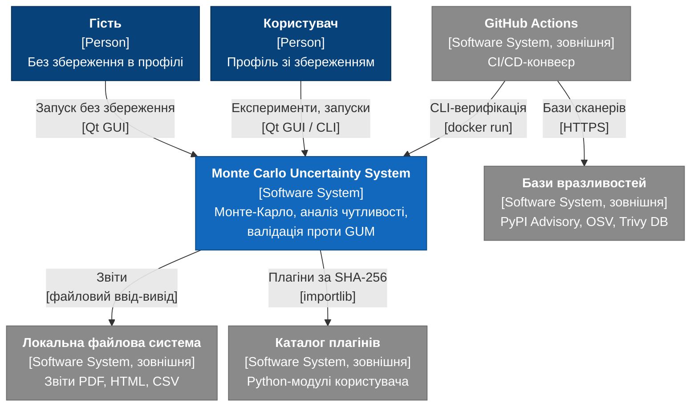

#### Опис елементів

| Елемент | Тип | Опис | Вимоги |
| --- | --- | --- | --- |
| Користувач | Person | Локальний профіль; збереження та відтворення експериментів | [SRS-FUN-46](./srs.md#srs-fun-46), [SRS-FUN-49](./srs.md#srs-fun-49), [SRS-FUN-51](./srs.md#srs-fun-51) |
| Гість | Person | Режим без запису в БД | [SRS-FUN-51](./srs.md#srs-fun-51) |
| Monte Carlo Uncertainty System | System | Усі функції [розділу 2 SRS](./srs.md#2-functional-requirements-функціональні-вимоги) | SRS-FUN-01…61 |
| Локальна файлова система | System_Ext | Приймач звітів PDF / HTML / CSV та журналів | [SRS-FUN-58](./srs.md#srs-fun-58), [SRS-FUN-59](./srs.md#srs-fun-59), [SRS-FUN-60](./srs.md#srs-fun-60), [SRS-FUN-61](./srs.md#srs-fun-61) |
| Каталог плагінів | System_Ext | Джерело користувацьких моделей, розподілів, методів чутливості | [SRS-FUN-09…13](./srs.md#srs-fun-09), [SRS-NFR-SEC-04](./srs.md#srs-nfr-sec-04) |
| GitHub Actions | System_Ext | Автоматична верифікація NFR | [SRS-NFR-DEPL-01](./srs.md#srs-nfr-depl-01), [SRS-NFR-PORT-01](./srs.md#srs-nfr-port-01), [SRS-NFR-QUAL-04](./srs.md#srs-nfr-qual-04) |
| Бази вразливостей | System_Ext | Дані для `pip-audit` і Trivy | [SRS-NFR-SEC-02](./srs.md#srs-nfr-sec-02), [SRS-NFR-SEC-06](./srs.md#srs-nfr-sec-06) |

#### Опис зв’язків

| № | Зв’язок | Протокол | Призначення |
| --- | --- | --- | --- |
| 1 | Користувач → Система | Qt GUI (події вводу) або CLI (argv, stdout) | [SRS-IF-01](./srs.md#1-system-context-контекст-системи), SRS-IF-02 |
| 2 | Гість → Система | Qt GUI | [SRS-FUN-51](./srs.md#srs-fun-51) |
| 3 | Система → Файлова система | Файловий ввід-вивід POSIX / Win32 | [SRS-IF-05](./srs.md#1-system-context-контекст-системи) |
| 4 | Система → Каталог плагінів | `importlib` (in-process) | [SRS-IF-06](./srs.md#1-system-context-контекст-системи) |
| 5 | CI → Система | `docker run`, код завершення | [SRS-IF-07](./srs.md#1-system-context-контекст-системи) |
| 6 | CI → Бази вразливостей | HTTPS | Сканування залежностей (поза межами системи) |

<a id="diagram-level2"></a>

### 2.2.2. Рівень 2. Container

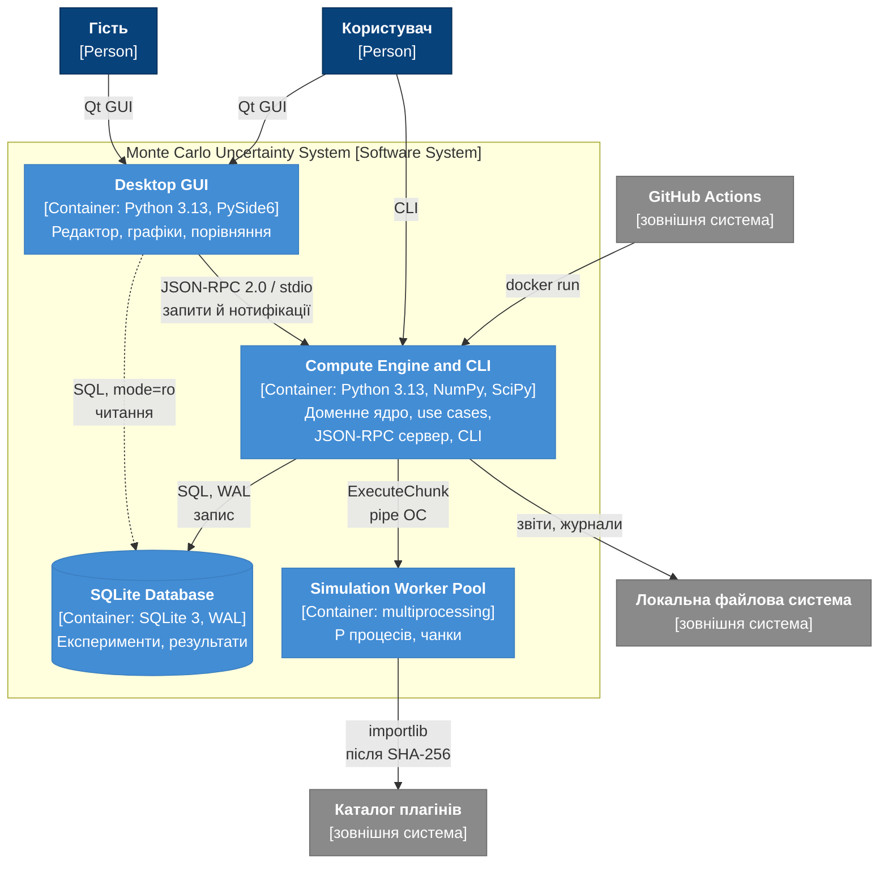

#### Опис контейнерів

| Контейнер | Технологія | Відповідальність | Розгортання | Вимоги |
| --- | --- | --- | --- | --- |
| Desktop GUI | Python 3.13, PySide6, Matplotlib | Редактор експерименту, гістограми, пучок траєкторій, порівняння сценаріїв, діаграма tornado і криві збіжності; не містить обчислювальної логіки; читає БД у режимі read-only | PyInstaller (Windows, Linux) | [SRS-FUN-52…56](./srs.md#srs-fun-52), [SRS-NFR-UI-01](./srs.md#srs-nfr-ui-01), [SRS-NFR-PORT-01](./srs.md#srs-nfr-port-01) |
| Compute Engine and CLI | Python 3.13, NumPy, SciPy, structlog | Єдина точка входу до доменного ядра: use cases, оркестрація Монте-Карло, аналіз, валідація проти GUM, збереження, експорт. Працює в двох режимах: `serve` (JSON-RPC для GUI) та `run` (CLI). Окремий процес ізолює GUI від GIL, відповідальність за [SRS-NFR-UI-01](./srs.md#srs-nfr-ui-01) | Docker-образ (non-root), процес поруч із GUI | [SRS-FUN-01…51](./srs.md#2-functional-requirements-функціональні-вимоги), [SRS-FUN-57…61](./srs.md#srs-fun-57), [SRS-NFR-SEC-06](./srs.md#srs-nfr-sec-06) |
| Simulation Worker Pool | Python 3.13, `ProcessPoolExecutor` (start method `spawn`), NumPy | Виконання чанків: генерація вибірки, інтегрування, повернення вихідних величин; не має доступу до БД | Дочірні процеси Compute Engine | [SRS-FUN-20…22](./srs.md#srs-fun-20), [SRS-NFR-PERF-01…02](./srs.md#srs-nfr-perf-01), [ADR-001](./adr/0001-choice-of-technology.md) |
| SQLite Database | SQLite 3, WAL | Сховище експериментів, seed, версій середовища, результатів; запис виконує лише Compute Engine | Файл у каталозі профілю користувача | [SRS-FUN-46…50](./srs.md#srs-fun-46), [SRS-NFR-REL-01](./srs.md#srs-nfr-rel-01), [SRS-NFR-SEC-01](./srs.md#srs-nfr-sec-01) |

Пакет `mcunc-core` (доменне ядро) є бібліотекою всередині контейнерів Compute Engine та Worker Pool і не є окремим контейнером; його внутрішня структура наведена на рівні 3.

#### Опис зв’язків

| № | Зв’язок | Протокол | Призначення | Вимоги |
| --- | --- | --- | --- | --- |
| 1 | Користувач → GUI, Гість → GUI | Qt GUI | Взаємодія з редактором і візуалізаціями | [SRS-IF-01](./srs.md#1-system-context-контекст-системи) |
| 2 | Користувач → Engine | CLI (argv, stdout, stderr) | Пакетні запуски | [SRS-FUN-57](./srs.md#srs-fun-57) |
| 3 | CI → Engine | `docker run`, код завершення | Автоматична верифікація | [SRS-IF-07](./srs.md#1-system-context-контекст-системи) |
| 4 | GUI → Engine | JSON-RPC 2.0 / stdio | Керування запуском | [SRS-FUN-24](./srs.md#srs-fun-24), [SRS-IF-03](./srs.md#1-system-context-контекст-системи) |
| 5 | Engine → GUI | JSON-RPC 2.0 notifications / stdio | Прогрес і статус | [SRS-FUN-25](./srs.md#srs-fun-25) |
| 6 | GUI → БД | SQL / `sqlite3`, `mode=ro` | Читання результатів для графіків | [SRS-FUN-53…56](./srs.md#srs-fun-53) |
| 7 | Engine → БД | SQL / `sqlite3`, WAL | Запис експериментів, міграції | [SRS-FUN-46…50](./srs.md#srs-fun-46) |
| 8 | Engine ↔ Workers | `multiprocessing`, pickle через pipe ОС | Розподіл чанків і збір результатів | [SRS-FUN-21](./srs.md#srs-fun-21), [ADR-001](./adr/0001-choice-of-technology.md) |
| 9 | Workers → Плагіни | `importlib` | Імпорт моделі-плагіна у кожному робочому процесі | [SRS-NFR-SEC-04](./srs.md#srs-nfr-sec-04) |
| 10 | Engine → Плагіни | `importlib` | Завантаження та реєстрація | [SRS-FUN-12](./srs.md#srs-fun-12) |
| 11 | Engine → Файлова система | Файловий ввід-вивід | Експорт звітів, журнали | [SRS-FUN-58…61](./srs.md#srs-fun-58) |

**Архітектурні рішення рівня 2:** вибір механізму паралелізму зафіксовано в [ADR-001](./adr/0001-choice-of-technology.md); результати великих вибірок передаються до GUI через БД, а не через JSON-RPC; JSON-RPC передає лише керуючі повідомлення та прогрес.

---

## 2.3. Компонентне моделювання та опис серверного ядра (C4 Model: рівень 3)

Критичний контейнер — **Compute Engine and CLI**: містить усі обчислювальні та аналітичні алгоритми й визначає виконання [SRS-NFR-PERF-01…03](./srs.md#srs-nfr-perf-01), [SRS-NFR-REPR-01](./srs.md#srs-nfr-repr-01), [SRS-NFR-ACC-01…06](./srs.md#srs-nfr-acc-01).

<a id="diagram-level3"></a>

### 2.3.1. Діаграми компонентів Compute Engine and CLI

Рівень 3 подано трьома представленнями одного контейнера, щоб кожна діаграма читалася без масштабування: (а) обробка запиту від адаптерів входу до прикладних сервісів; (б) доменне ядро; (в) порти, адаптери виходу та bootstrap. Нотація C4: синій — компонент, світлий пунктир — порт (інтерфейс), темно-синій — контейнер, сірий — зовнішня система.

#### (а) Обробка запиту

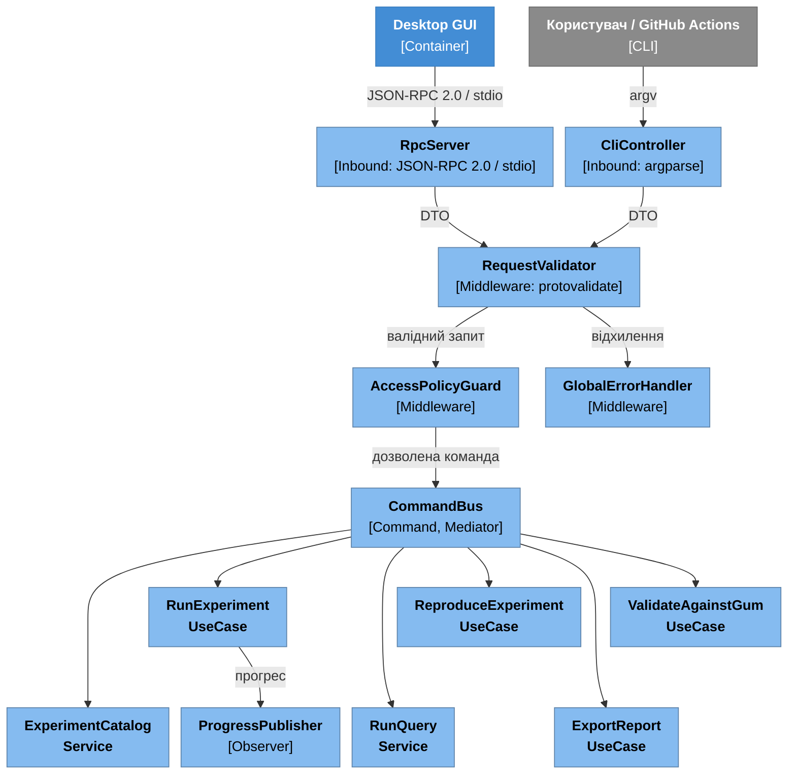

#### (б) Доменне ядро

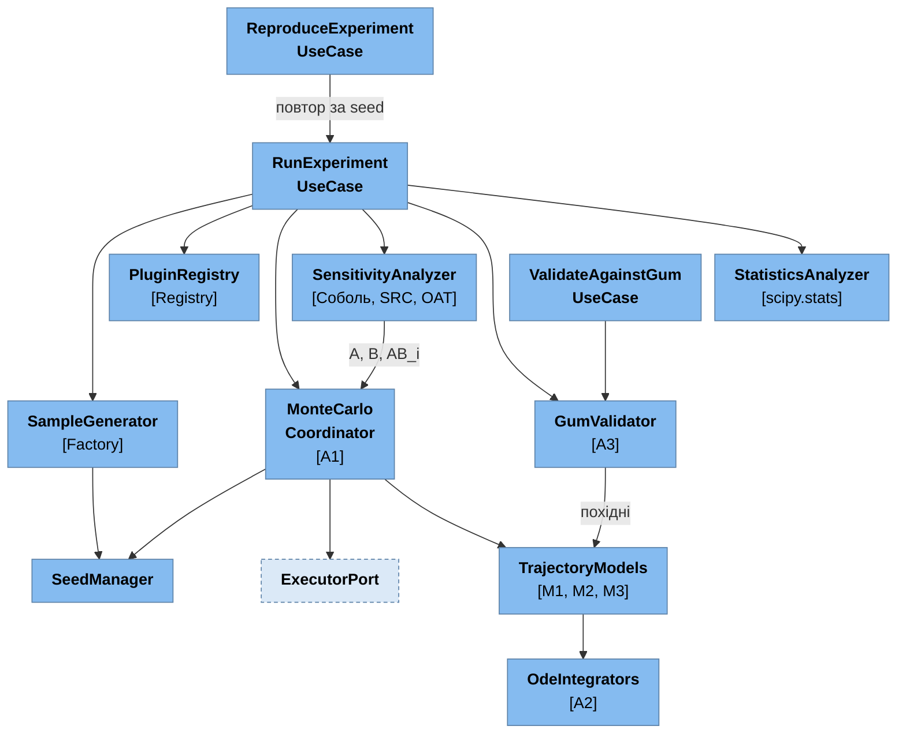

#### (в) Порти, адаптери виходу та bootstrap

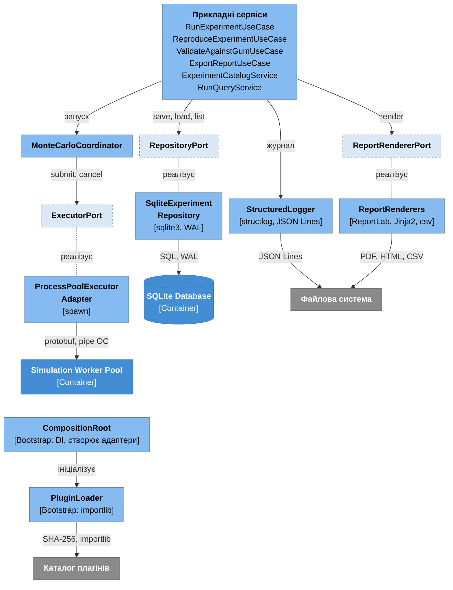

#### Шари та правила залежностей

| Шар | Компоненти | Правило |
| --- | --- | --- |
| Inbound (адаптери входу) | CliController, RpcServer | Не містять бізнес-логіки; передають DTO у ланцюг middleware |
| Middleware | RequestValidator, AccessPolicyGuard, GlobalErrorHandler | Валідація та дозволи виконуються до виклику use case; помилки перетворюються централізовано |
| Application | CommandBus, RunExperimentUseCase, ReproduceExperimentUseCase, ValidateAgainstGumUseCase, ExportReportUseCase, ExperimentCatalogService, RunQueryService, ProgressPublisher | Оркеструють домен; залежать лише від доменних сервісів і портів |
| Domain | PluginRegistry, SampleGenerator, SeedManager, MonteCarloCoordinator, TrajectoryModels, OdeIntegrators, StatisticsAnalyzer, SensitivityAnalyzer, GumValidator | Не імпортують `sqlite3`, `concurrent.futures`, PySide6, ReportLab |
| Ports | ExecutorPort, RepositoryPort, ReportRendererPort | Інтерфейси належать доменному / прикладному шару |
| Outbound (адаптери виходу) | ProcessPoolExecutorAdapter, SqliteExperimentRepository, ReportRenderers, StructuredLogger | Реалізують порти; єдині компоненти, що знають про технології |
| Bootstrap | CompositionRoot, PluginLoader | Єдине місце створення конкретних адаптерів і завантаження плагінів |

#### Опис компонентів

| Компонент | Роль | Патерн / технологія | Взаємодія | Вимоги |
| --- | --- | --- | --- | --- |
| CliController | Розбір команд `run`, `reproduce`, `validate`, `export`; код завершення | `argparse` | Викликає RequestValidator; отримує код від GlobalErrorHandler | [SRS-FUN-57](./srs.md#srs-fun-57) |
| RpcServer | Приймає запити GUI та надсилає нотифікації | JSON-RPC 2.0 / stdio | RequestValidator; підписується на ProgressPublisher | [SRS-FUN-24](./srs.md#srs-fun-24), [SRS-FUN-25](./srs.md#srs-fun-25) |
| RequestValidator | Перевіряє *N* ∈ [1; 10^7], *P*, діапазони параметрів, матрицю кореляцій | Middleware, dataclasses | Передає запит до AccessPolicyGuard; помилки — до GlobalErrorHandler | [SRS-FUN-17](./srs.md#srs-fun-17), [SRS-FUN-18](./srs.md#srs-fun-18), [SRS-FUN-19](./srs.md#srs-fun-19), [SRS-NFR-ROB-01](./srs.md#srs-nfr-rob-01) |
| AccessPolicyGuard | У режимі «Гість» відхиляє команди із записом у БД | Middleware | Передає команду до CommandBus | [SRS-FUN-51](./srs.md#srs-fun-51) |
| CommandBus | Маршрутизує команду до use case за типом | Command, Mediator | Викликає use cases через інтерфейс | — |
| GlobalErrorHandler | Відображає винятки на коди помилок JSON-RPC / CLI, логує | Exception mapping | StructuredLogger, RpcServer, CliController | [SRS-FUN-28](./srs.md#srs-fun-28), [SRS-FUN-29](./srs.md#srs-fun-29), [SRS-NFR-ROB-01](./srs.md#srs-nfr-rob-01) |
| CompositionRoot | Створює адаптери, впроваджує залежності через конструктори | Dependency Injection | Єдиний компонент, що імпортує конкретні адаптери | [SRS-NFR-EXT-01](./srs.md#srs-nfr-ext-01) |
| PluginLoader | Перевіряє SHA-256 за allow-list та інтерфейс; реєструє плагін | `importlib`, `hashlib` | Викликає `PluginRegistry.register`; ті самі перевірки виконуються у робочих процесах | [SRS-FUN-12](./srs.md#srs-fun-12), [SRS-FUN-13](./srs.md#srs-fun-13), [SRS-NFR-SEC-04](./srs.md#srs-nfr-sec-04) |
| RunExperimentUseCase | Конвеєр: вибірка → MC → статистика → чутливість → GUM → збереження | Application service | Домен, RepositoryPort, ProgressPublisher, StructuredLogger | [SRS-FUN-19…23](./srs.md#srs-fun-19), [SRS-FUN-30…45](./srs.md#srs-fun-30), [SRS-FUN-46…48](./srs.md#srs-fun-46) |
| ReproduceExperimentUseCase | Завантажує експеримент, повторює за seed, порівнює | Application service | RepositoryPort, RunExperimentUseCase | [SRS-FUN-49](./srs.md#srs-fun-49), [SRS-NFR-REPR-02](./srs.md#srs-nfr-repr-02) |
| ValidateAgainstGumUseCase | Окрема валідація проти GUM для збереженого експерименту | Application service | GumValidator, RepositoryPort | [SRS-FUN-43…45](./srs.md#srs-fun-43) |
| ExportReportUseCase | Експорт PDF, HTML, CSV | Application service | RepositoryPort, ReportRendererPort | [SRS-FUN-58…60](./srs.md#srs-fun-58) |
| ExperimentCatalogService | CreateExperiment, GetExperiment, ListExperiments (keyset), DeleteExperiment (soft delete, etag), GetEngineInfo | Application service | RepositoryPort, PluginRegistry | [SRS-FUN-46](./srs.md#srs-fun-46), [SRS-FUN-52](./srs.md#srs-fun-52), [SRS-FUN-55](./srs.md#srs-fun-55) |
| RunQueryService | GetRun, WatchRun (підписка на ProgressPublisher), GetRunResult, GetTrajectoryBundle (перерахунок за seed, ≤ 16 МіБ) | Application service | RepositoryPort, TrajectoryModels, ProgressPublisher | [SRS-FUN-25](./srs.md#srs-fun-25), [SRS-FUN-30…45](./srs.md#srs-fun-30), [SRS-FUN-54](./srs.md#srs-fun-54) |
| StructuredLogger | Записи JSON Lines з обов’язковими полями | `structlog` | Викликається use cases та GlobalErrorHandler | [SRS-FUN-61](./srs.md#srs-fun-61), [SRS-NFR-OBS-01](./srs.md#srs-nfr-obs-01) |
| ProgressPublisher | Публікує прогрес і статус | Observer | RpcServer підписаний; CLI виводить прогрес у stderr | [SRS-FUN-25](./srs.md#srs-fun-25) |
| PluginRegistry | Реєстр моделей, розподілів, методів чутливості за іменем | Registry, Strategy | Наповнюється PluginLoader; читається use cases | [SRS-FUN-09…11](./srs.md#srs-fun-09) |
| SampleGenerator | Генерує вибірки розподілів; гауссова копула | Factory, Strategy | SeedManager | [SRS-FUN-14…16](./srs.md#srs-fun-14), [SRS-NFR-ACC-05](./srs.md#srs-nfr-acc-05) |
| SeedManager | Породжує потік випадкових чисел на чанк | `numpy.random.SeedSequence.spawn` | Викликається MonteCarloCoordinator та SampleGenerator | [SRS-FUN-22](./srs.md#srs-fun-22), [SRS-FUN-23](./srs.md#srs-fun-23) |
| MonteCarloCoordinator | Ділить *N* на чанки, керує адаптивним *N*, скасуванням, невдалими траєкторіями | Domain service | ExecutorPort, SeedManager, TrajectoryModels | [SRS-FUN-19…21](./srs.md#srs-fun-19), [SRS-FUN-24](./srs.md#srs-fun-24), [SRS-FUN-26…29](./srs.md#srs-fun-26), [ADR-001](./adr/0001-choice-of-technology.md) |
| TrajectoryModels | M1, M2, M3 за єдиним інтерфейсом моделі | Strategy | OdeIntegrators | [SRS-FUN-01…05](./srs.md#srs-fun-01) |
| OdeIntegrators | RK4, Dormand–Prince, подія перетину площини падіння | Strategy | Використовується моделями | [SRS-FUN-06…08](./srs.md#srs-fun-06) |
| StatisticsAnalyzer | Статистики, інтервали, еліпс, нормальність, покриття, збіжність | `scipy.stats` | Чисті функції над масивами | [SRS-FUN-30…38](./srs.md#srs-fun-30), [SRS-FUN-42](./srs.md#srs-fun-42) |
| SensitivityAnalyzer | Індекси Соболя, SRC, one-at-a-time | `scipy.stats.sobol_indices` | Використовує MonteCarloCoordinator для оцінювань моделі | [SRS-FUN-39…41](./srs.md#srs-fun-39), [SRS-NFR-ACC-04](./srs.md#srs-nfr-acc-04) |
| GumValidator | Лінеаризація JCGM 100; порівняння з MC; аналітика M1 | Domain service | TrajectoryModels | [SRS-FUN-43…45](./srs.md#srs-fun-43), [SRS-NFR-ACC-02](./srs.md#srs-nfr-acc-02) |
| ExecutorPort | Інтерфейс виконання чанків і скасування | Port | Реалізується ProcessPoolExecutorAdapter | [ADR-001](./adr/0001-choice-of-technology.md) |
| RepositoryPort | Інтерфейс збереження та читання експериментів | Port, Repository | Реалізується SqliteExperimentRepository | [SRS-FUN-46…48](./srs.md#srs-fun-46) |
| ReportRendererPort | Інтерфейс рендерингу звітів | Port | Реалізується ReportRenderers | [SRS-FUN-58…60](./srs.md#srs-fun-58) |
| ProcessPoolExecutorAdapter | Пул процесів зі start method `spawn`, скасування, завершення робочих процесів | `concurrent.futures` | Pickle через pipe ОС | [SRS-FUN-21](./srs.md#srs-fun-21), [SRS-FUN-29](./srs.md#srs-fun-29), [SRS-NFR-PERF-04](./srs.md#srs-nfr-perf-04), [SRS-NFR-RES-02](./srs.md#srs-nfr-res-02) |
| SqliteExperimentRepository | Параметризовані запити, транзакції, міграції, режим WAL | `sqlite3` | SQL / локальний файл SQLite (без мережевого сервера) | [SRS-FUN-46…50](./srs.md#srs-fun-46), [SRS-NFR-SEC-01](./srs.md#srs-nfr-sec-01), [SRS-NFR-REL-01](./srs.md#srs-nfr-rel-01), [SRS-NFR-DATA-01](./srs.md#srs-nfr-data-01) |
| ReportRenderers | PDF (ReportLab), HTML (Jinja2), CSV | ReportLab, Jinja2, `csv` | Файловий ввід-вивід | [SRS-FUN-58…60](./srs.md#srs-fun-58) |

#### Примітки до рівня 3

- Компоненти SampleGenerator, TrajectoryModels, OdeIntegrators і SeedManager є частиною того самого Python-пакета та імпортуються також у робочих процесах Worker Pool; вони не мають станів і доступу до портів БД та файлової системи.
- Залежності спрямовані до домену: адаптери (`exec`, `repo`, `rend`) реалізують порти, а не навпаки; CompositionRoot — єдиний компонент із залежністю на конкретні адаптери.
- Контролери (CliController, RpcServer) не мають прямих зв’язків з RepositoryPort і доменом; будь-який запит проходить ланцюг RequestValidator → AccessPolicyGuard → CommandBus.
- ExperimentCatalogService і RunQueryService додано за результатами аудиту ЛР №7: у версії ЛР №5 дев’ять із 13 RPC контракту не мали компонента-обробника.

### 2.3.2. Шлях запиту через серверне ядро: Inbound → Core → Outbound

Критичний контейнер — **Compute Engine and CLI**. Будь-який запит проходить три шари; компонент шару не викликає компоненти шару вище, а доменні компоненти не мають доступу до вводу-виводу. Шари і межі модулів перевіряє контракт `import-linter` у CI.

#### 1. Inbound Layer (адаптери входу)

- `RpcServer` читає stdin процесу рядками (≤ 16 МіБ на кадр), відхиляє JSON глибиною понад 32, дублікати ключів, токени NaN / Infinity і перетворює `params` у повідомлення proto без невідомих полів. Обробка команд послідовна, в одному потоці команд; черга — не більше 32 непрочитаних запитів. Кеш ідемпотентності сеансу зберігає до 1024 пар `requestId` → (SHA-256 тіла, ім'я ресурсу). Окремий потік запису надсилає відповіді та нотифікації `RunEvent`. Під час старту в режимі `serve` перевіряється, що stdin — анонімний pipe батьківського процесу.
- `CliController` розбирає argv (`argparse`), читає файл конфігурації ProtoJSON (≤ 16 МіБ) і повертає коди завершення 0 / 2 / 3 / 4 / 70 (2.5.4).

#### 2. Middleware

- `RequestValidator` виконує правила `buf.validate` (діапазони, шаблони імен ресурсів, `finite`, CEL), відхиляє задані клієнтом вихідні поля і виконує серверні перевірки, недоступні декларативним правилам: додатну визначеність кореляційної матриці (розклад Холецького), `workers ≤ maxWorkers`, бюджет Соболя, розмір матриці плану ≤ 64 МіБ.
- `AccessPolicyGuard` читає опцію `required_access_mode` з дескриптора RPC. Під час старту ядро перевіряє, що опцію мають усі 13 методів; метод без опції блокує старт (default deny).
- `GlobalErrorHandler` перетворює винятки на `google.rpc.Status` (JSON-RPC) або код завершення (CLI); клієнт отримує канонічний код, reason і ідентифікатор помилки, але не stack trace; повний виняток записує `StructuredLogger`.

#### 3. Core Layer (прикладні сервіси та домен)

- `CommandBus` зіставляє тип команди з обробником; реєстр обробників формується під час старту, невідомий метод → −32601.
- Прикладні сервіси визначають межі транзакцій і оркеструють домен: `RunExperimentUseCase`, `ReproduceExperimentUseCase`, `ValidateAgainstGumUseCase`, `ExportReportUseCase`, `ExperimentCatalogService` (CreateExperiment, GetExperiment, ListExperiments, DeleteExperiment, GetEngineInfo) і `RunQueryService` (GetRun, WatchRun, GetRunResult, GetTrajectoryBundle). Останні два сервіси додано за результатами аудиту ЛР №7: у ЛР №5 дев'ять із 13 RPC не мали компонента-обробника.
- Доменні компоненти (`MonteCarloCoordinator`, `SampleGenerator`, `SeedManager`, `TrajectoryModels`, `OdeIntegrators`, `StatisticsAnalyzer`, `SensitivityAnalyzer`, `GumValidator`, `PluginRegistry`) — чисті функції та об'єкти без вводу-виводу; результат детермінований за (root_seed, K, конфігурація). `ProgressPublisher` передає прогрес підписникам через чергу місткістю 1 подію.

#### 4. Outbound Layer (адаптери виходу, реалізують порти)

- `SqliteExperimentRepository` (`RepositoryPort`): єдине з'єднання на запис, що належить потоку команд; лише параметризовані запити; `BEGIN IMMEDIATE` для запису, `busy_timeout = 5000`, `foreign_keys = ON`, `trusted_schema = OFF`; міграції схеми під час старту ([SRS-FUN-50](./srs.md#srs-fun-50)) і відновлення «осиротілих» запусків (EF-02E).
- `ProcessPoolExecutorAdapter` (`ExecutorPort`): пул зі start method `spawn`; ініціалізатор робочого процесу прив'язує його життя до ядра (`PR_SET_PDEATHSIG` у Linux, Job Object у Windows) і перевіряє SHA-256 плагіна; не більше 2*P* чанків у роботі; тайм-аут *T_c*; при збої — `terminate`, через 2 с — `kill`.
- `ReportRenderers` (`ReportRendererPort`): Jinja2 з `autoescape=True`, нейтралізація формул у CSV, атомарний запис файлу з правами 0600.
- `StructuredLogger`: JSON Lines із ротацією 10 МіБ × 5 файлів; тіла запитів і значення вхідних величин у журнал не потрапляють.
- Bootstrap: `CompositionRoot` створює адаптери і впроваджує їх через конструктори; `PluginLoader` реєструє плагіни після перевірки allow-list.

| Компонент | Інваріант | Перевірка |
| --- | --- | --- |
| `RpcServer` | Жоден словник із JSON не передається в use case без перетворення на повідомлення proto і валідації | Hypothesis: ≥ 10^4 некоректних запитів, 0 необроблених винятків ([SRS-NFR-ROB-01](./srs.md#srs-nfr-rob-01)) |
| `AccessPolicyGuard` | Кожен RPC має опцію режиму; відсутність опції блокує старт | Тест дескриптора: 13 з 13 методів мають `required_access_mode` |
| Прикладні сервіси | Межа транзакції — метод сервісу; результати запуску і статус фіксуються разом | Тест `SIGKILL` під час запису: `PRAGMA integrity_check = ok` |
| Домен | Немає імпортів `sqlite3`, `concurrent.futures`, `socket`, PySide6, ReportLab | Контракт `import-linter` |
| `SqliteExperimentRepository` | 100 % параметризованих запитів; ORDER BY лише з білого списку | Bandit B608: 0; тест з ін'єкційними рядками |
| `ProcessPoolExecutorAdapter` | 0 осиротілих процесів після завершення, скасування чи аварії | Тест [SRS-NFR-RES-02](./srs.md#srs-nfr-res-02) з `psutil` |

### 2.3.3. Логіка критичних вузлів ядра

Обрано три алгоритми, що визначають коректність і відтворюваність результатів: координацію паралельного методу Монте-Карло (компонент `MonteCarloCoordinator`), інтегрування траєкторій з подією падіння (`OdeIntegrators`) та валідацію проти GUM (`GumValidator`) ([рівень 3](#diagram-level3)).

**Нотація.** `:=` — присвоювання; `=`, `≠`, `<`, `≤` — порівняння; `AND`, `OR`, `NOT` — логічні операції; `X[i]` — i-й елемент масиву (індексація з 0); `|F|` — потужність множини; `⌈x⌉` — округлення вгору; `∅` — порожня множина. Блок-схеми виконано за ISO 5807:1985 (ГОСТ 19.701-90): термінатор — овал, процес — прямокутник, рішення — ромб, дані — паралелограм, визначений процес — прямокутник з подвійними боковими лініями, з'єднувач — коло з літерою.

### 2.3.4. A1. Паралельний метод Монте-Карло з адаптивним вибором N

Вимоги: [SRS-FUN-19…29](./srs.md#srs-fun-19), [SRS-NFR-REPR-01](./srs.md#srs-nfr-repr-01), [SRS-NFR-PERF-04](./srs.md#srs-nfr-perf-04); рішення [ADR-001](./adr/0001-choice-of-technology.md).

Вхід: s — кореневий seed; K — розмір чанка; P — кількість процесів; N_max — межа обчислень; ε — поріг стандартної похибки середнього (NULL — фіксований N); q\* — цільова величина; φ := 0,01 — допустима частка невдалих траєкторій; T_c — ліміт часу чанка (конфігурація ядра, 300 с); N_0 := 2·10^4 — пілотний об'єм; N_start := N_max, якщо ε = NULL, інакше N_start := min(N_0, N_max).

1. C_max := ⌈N_max / K⌉; C_plan := ⌈N_start / K⌉; W := 2·P; k := 0; F := ∅; n_ok := 0; n_f := 0.
2. Поки k < C_plan AND |F| < W: m := min(K, N_max − k·K); F := F ∪ {ExecuteChunk(s, k, m)}; k := k + 1. Генератор чанка k: `PCG64(SeedSequence(s, spawn_key = (k,)))`.
3. Якщо |F| = 0 — перехід до кроку 7. Інакше (j, res) := wait_first(F, 0,5 с).
4. Якщо cancel = TRUE: terminate(pool); status := CANCELLED; результати не записуються.
5. Якщо crashed(j) OR t(j) > T_c: terminate(pool); status := FAILED; reason := WORKER_CRASHED або CHUNK_TIMEOUT.
6. Y[j] := res.y; n_ok := n_ok + res.n_ok; n_f := n_f + res.n_f; ρ := n_f / (n_ok + n_f); F := F − {j}; publish(completed, C_plan, C_max). Якщо n_ok + n_f ≥ 10^4 AND ρ > φ: terminate(pool); status := FAILED; reason := FAILURE_RATE_EXCEEDED (раннє припинення). Інакше — до кроку 2.
7. changed := plan(Y, C_plan) (підалгоритм A1.1). Якщо changed = TRUE — до кроку 2.
8. Якщо ρ > φ: status := FAILED, reason := FAILURE_RATE_EXCEEDED; інакше status := SUCCEEDED. Вивід: Y[0..C_plan − 1] у порядку k.

**A1.1. Планування N.** Якщо ε = NULL: changed := FALSE. Інакше y := Y[0..C_plan − 1]\[q\*]; y := y[isfinite(y)]; n := |y|. Якщо n < 2: target_reached := FALSE; changed := FALSE. Інакше σ := std(y); SE := σ / √n. Якщо SE ≤ ε: target_reached := TRUE; changed := FALSE. Якщо SE > ε AND C_plan = C_max: target_reached := FALSE; changed := FALSE. Інакше N_req := ⌈(σ / ε)²⌉; C_plan := min(C_max, max(C_plan + 1, ⌈1,1·N_req / K⌉)); changed := TRUE.

Детермінованість: рішення A1.1 приймається лише після завершення всіх чанків 0..C_plan − 1 і обчислюється над Y у порядку індексів, тому результат не залежить від P і порядку завершення процесів.

<a id="diagram-alg-a1"></a>

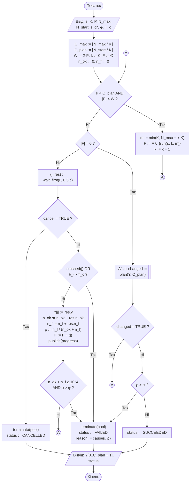

<a id="diagram-alg-a11"></a>


### 2.3.5. A2. Пакетне інтегрування RK4 з подією падіння

Вимоги: [SRS-FUN-06](./srs.md#srs-fun-06), [SRS-FUN-08](./srs.md#srs-fun-08), [SRS-FUN-27](./srs.md#srs-fun-27), [SRS-NFR-ACC-01](./srs.md#srs-nfr-acc-01). Виконується в робочому процесі для m траєкторій чанка; цикл за i у реалізації векторизовано (NumPy), блок-схема показує логіку для одного елемента.

Вхід: стани S[j] = (x[j], y[j], z[j], v_x[j], v_y[j], v_z[j]), j = 0..m − 1; крок h; висота площини падіння y_imp; ліміт кроків n_max; права частина f моделі (M2 або M3).

1. t := 0; n := 0; A := {0, …, m − 1}; H[j] := y[j]; fail[j] := FALSE.
2. Поки A ≠ ∅ AND n < n_max: i := 0; D := ∅; для кожного j := A[i]:
   - S' := RK4(f, S[j], h), де k1 := f(S[j]); k2 := f(S[j] + h/2·k1); k3 := f(S[j] + h/2·k2); k4 := f(S[j] + h·k3); S' := S[j] + h/6·(k1 + 2·k2 + 2·k3 + k4);
   - якщо NOT finite(S'): fail[j] := TRUE; D := D ∪ {j};
   - якщо y[j] ≥ y_imp AND y' < y_imp: α := HermiteRoot(S[j], S', h, y_imp) — корінь кубічного полінома Ерміта за y та v_y на [0; 1], 3 ітерації Ньютона від α_0 := (y[j] − y_imp) / (y[j] − y'), обмеження α ∈ [0; 1]; X[j] := Hx(α); Z[j] := Hz(α); T[j] := t + α·h; R[j] := √(X[j]² + Z[j]²); D := D ∪ {j};
   - інакше S[j] := S'; H[j] := max(H[j], y');
   - i := i + 1.
   Після перебору A: A := A − D; t := t + h; n := n + 1.
3. Для j ∈ A: fail[j] := TRUE (ліміт кроків). Для fail[j] = TRUE: R, T, H, X, Z [j] := NaN; n_f := Σ fail[j].

Знаменник y[j] − y' у α_0 додатний за умовою перетину, тому ділення на нуль неможливе. Кубічна інтерполяція Ерміта замінила лінійну за результатами аудиту: на сітці v0 ∈ [50; 400] м/с × θ ∈ [10°; 80°] (64 траєкторії, h = 0,05 с) максимальна відносна похибка дальності вакуумної моделі становить 1,93·10^-4 для лінійної інтерполяції (порушує [SRS-NFR-ACC-01](./srs.md#srs-nfr-acc-01)) та 2,4·10^-14 для інтерполяції Ерміта.

<a id="diagram-alg-a2"></a>


### 2.3.6. A3. Валідація методу Монте-Карло проти GUM

Вимоги: [SRS-FUN-43…45](./srs.md#srs-fun-43), [SRS-NFR-ACC-02](./srs.md#srs-nfr-acc-02). Виконується після A1, якщо `AnalysisOptions.validate_against_gum = TRUE`.

Вхід: x̂[i] := E[X_i] та u[i] := √Var[X_i] для i = 0..d − 1 (обчислюються з параметрів розподілу; для сталої u[i] := 0); r[i]\[j] — кореляційна матриця (r[i]\[i] = 1); ȳ_MC[q], u_MC[q] — середнє та стандартне відхилення вибірки A1 для q ∈ Q; κ := 10^-2; dist[i] — відстань від x̂[i] до межі носія розподілу (∞ для необмеженого).

1. X[0] := x̂; b := 1. Для i := 0..d − 1: якщо u[i] = 0 — c[i]\[q] := 0 для всіх q, row[i] := −1; інакше h[i] := min(κ·u[i], dist[i] / 2); X[b] := x̂ + h[i]·e[i]; X[b + 1] := x̂ − h[i]·e[i]; row[i] := b; b := b + 2.
2. (Y, n_f) := A2(X[0..b − 1]) — один пакет з b = 2·d_r + 1 траєкторій.
3. Якщо n_f > 0: status := FAILED; reason := DERIVATIVE_FAILED.
4. Для row[i] ≥ 0: c[i]\[q] := (Y[row[i]]\[q] − Y[row[i] + 1]\[q]) / (2·h[i]).
5. Для q := 0..|Q| − 1: u² := Σ_i Σ_j c[i]\[q]·c[j]\[q]·u[i]·u[j]·r[i]\[j]; u_GUM[q] := √max(u², 0). Якщо u_MC[q] = 0: δ[q] := NULL; shift[q] := NULL. Інакше δ[q] := |u_MC[q] − u_GUM[q]| / u_MC[q]; shift[q] := |ȳ_MC[q] − Y[0]\[q]| / u_MC[q].
6. Вивід: c (зберігається в `sensitivity_index` з method = GUM_COEFFICIENT), u_GUM, δ, shift, evals := b.

Для моделі M1 додатково обчислюються аналітичні reference_mean та reference_std (за наявності замкненого виразу для заданих розподілів).

<a id="diagram-alg-a3"></a>

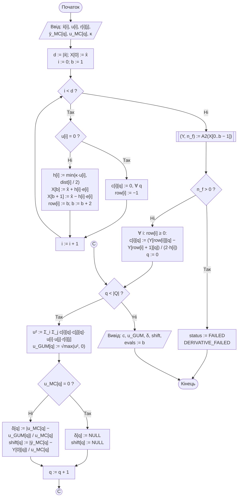

### 2.3.7. Обробка виняткових ситуацій

| ID | Ситуація | Алгоритм | Обробка |
| --- | --- | --- | --- |
| EC-01 | Команда скасування | A1 | Перевірка після кожного очікування з тайм-аутом 0,5 с; terminate(pool); статус CANCELLED; запис у БД не виконується |
| EC-02 | Аварійне завершення робочого процесу | A1 | crashed(j) = TRUE; FAILED / WORKER_CRASHED; решта процесів завершується ([SRS-FUN-29](./srs.md#srs-fun-29)) |
| EC-03 | Зависання чанка | A1 | t(j) > T_c; FAILED / CHUNK_TIMEOUT |
| EC-04 | Частка невдалих траєкторій > 1 % | A1 | Раннє припинення після 10^4 траєкторій або фінальна перевірка; FAILED / FAILURE_RATE_EXCEEDED |
| EC-05 | Поріг ε недосяжний | A1.1 | Зупинка на C_max; target_reached := FALSE; статус SUCCEEDED |
| EC-06 | Порожня вибірка (n < 2) | A1.1 | Без оцінки SE; target_reached := FALSE; статус визначає перевірка ρ > φ |
| EC-07 | Нечислове значення стану (NaN, ∞) | A2 | fail[j] := TRUE; траєкторія виключається з аналізу |
| EC-08 | Траєкторія не досягає площини падіння | A2 | Ліміт n_max; fail[j] := TRUE |
| EC-09 | Старт нижче горизонту (θ ≤ 0) | A2 | Перетин на першому кроці; R[j] = 0, T[j] = 0 |
| EC-10 | Стала вхідна величина (u[i] = 0) | A3 | Виключається з похідних; c[i]\[q] := 0 |
| EC-11 | Крок різниці виходить за носій розподілу | A3 | h[i] := min(κ·u[i], dist[i] / 2) |
| EC-12 | Нульова невизначеність виходу (u_MC = 0) | A3 | δ, shift := NULL (узгоджено з CHECK у `gum_validation`) |
| EC-13 | Нечислове значення моделі в точках різниць | A3 | FAILED / DERIVATIVE_FAILED |

### 2.3.8. Перевірка алгоритмів прототипом

Логіку A1–A3 перевірено прототипом на Python 3.13.18, NumPy 2.5.3, 2 ядрах (модель з квадратичним опором і вітром, 8 джерел невизначеності, кореляція v0 та кута 0,3):

| Перевірка | Результат |
| --- | --- |
| A1: адаптивний запуск, ε = 1 м, K = 5000, P = 1 та P = 2 | SHA-256 вибірок однаковий; C_plan = 4, N = 20 000, target_reached = TRUE |
| A2: ліміт кроків, нечислові стани, θ < 0 | fail = TRUE, R = NaN; R = 0, T = 0 для θ < 0 |
| A2: вакуумна модель, 64 траєкторії | відносна похибка дальності 2,4·10^-14 (інтерполяція Ерміта) |
| A3: лінійна модель y = 2·x1 − 3·x2, r = 0,4, N = 10^6 | δ = 0,072 % (вимога ≤ 1 %, [SRS-NFR-ACC-02](./srs.md#srs-nfr-acc-02)) |

---

## 2.4. Контур безпеки програмного рішення (Application Security)

### 2.4.1. Модель загроз і межі довіри

Система працює на одній робочій станції від імені користувача ОС, не відкриває мережевих портів ([SRS-NFR-SEC-05](./srs.md#srs-nfr-sec-05)) і не зберігає персональних даних або секретів автентифікації. Тому захищаються передусім цілісність наукових результатів і доказів відтворюваності, файлова система користувача та БД профілю. Межі довіри:

| Межа | Хто з боку, якому не довіряють | Головні загрози (STRIDE) |
| --- | --- | --- |
| МД-1. Користувач → GUI / CLI | Файли конфігурації, введені значення | Tampering, Denial of Service (некоректні або надмірні параметри) |
| МД-2. GUI → Compute Engine (stdio) | Будь-який процес, що спробує стати джерелом stdin | Spoofing, Elevation of Privilege (обхід режиму Гість) |
| МД-3. Compute Engine → код плагіна | Сторонній Python-модуль із правами користувача | Elevation of Privilege, Tampering (виконання довільного коду) |
| МД-4. Compute Engine → файлова система | Каталог звітів, файл БД, каталог плагінів | Tampering, Information Disclosure (path traversal, перезапис, підміна файлів) |
| МД-5. Ланцюг постачання і CI | Залежності PyPI, GitHub Actions, базовий Docker-образ | Tampering (вразливі або підмінені пакети), витік секретів CI |

### 2.4.2. Інженерні засоби захисту

| № | Загроза (OWASP Top 10:2021) | Механізм і параметри | Компонент | Перевірка |
| --- | --- | --- | --- | --- |
| 1 | A03 Injection: SQL | Лише параметризовані запити `sqlite3` (`?`); ORDER BY і імена колонок — з білого списку enum; жодних f-рядків і конкатенації в SQL; `PRAGMA trusted_schema = OFF` | `SqliteExperimentRepository` | Bandit B608 = 0; тест: назва експерименту `'); DROP TABLE experiment;--` зберігається дослівно, схема не змінюється ([SRS-NFR-SEC-01](./srs.md#srs-nfr-sec-01)) |
| 2 | A03 Injection: звіти | HTML: Jinja2 `autoescape=True`, звіт без JavaScript, `Content-Security-Policy: default-src 'none'; style-src 'unsafe-inline'; img-src data:` у `<meta>`; CSV: значення, що починаються з `=`, `+`, `-`, `@`, табуляції або CR, отримують префікс `'` (CSV formula injection) | `ReportRenderers` | Тест: назва `<script>alert(1)</script>` відображається як текст; `=HYPERLINK(...)` у CSV не виконується |
| 3 | A08 Software and Data Integrity: виконання коду і десеріалізація | Заборона `eval`/`exec` ([SRS-NFR-SEC-03](./srs.md#srs-nfr-sec-03)); корисні дані між процесами — байти protobuf (`SerializeToString`), pickle застосовується лише внутрішнім механізмом `multiprocessing` між власними процесами і ніколи — до даних із БД чи файлів; `numpy.load(..., allow_pickle=False)` | `ProcessPoolExecutorAdapter`, `RpcServer` | Bandit B102, B301, B307, B403 = 0 |
| 4 | A08: цілісність плагінів | Allow-list `plugins.allow` (рядки `sha256 ім'я_файлу`); байти модуля читаються один раз, SHA-256 рахується саме від них, а модуль виконується з тих самих байтів через власний завантажувач `importlib` — вікна TOCTOU між перевіркою та імпортом немає; перевірка в головному і кожному робочому процесі ([SRS-NFR-SEC-04](./srs.md#srs-nfr-sec-04)); allow-list змінює лише команда `mcunc plugin trust <файл>` з показом хешу й підтвердженням; каталог плагінів і allow-list мають належати поточному користувачу й не бути доступними на запис іншим (POSIX: `st_mode & 0o022 = 0`; Windows: ACL без права запису для Users і Everyone), інакше плагіни не завантажуються. Залишковий ризик: дозволений плагін виконується з правами користувача без пісочниці | `PluginLoader`, ініціалізатор робочого процесу | 100 % відхилень у тестовому наборі: невідомий хеш, підміна файлу після перевірки, каталог із правом запису для інших |
| 5 | A01 Broken Access Control | `AccessPolicyGuard` за опцією методу, default deny (метод без опції блокує старт); режим фіксується аргументом `--access-mode` і не змінюється в сеансі; режим Гість відкриває лише БД сеансу в `tempfile.mkdtemp()` (права 0700), каталог видаляється при завершенні, а залишки попередніх сеансів старші за 24 год — під час наступного старту; ресурси адресуються UUID v4 | `AccessPolicyGuard`, `CompositionRoot` | Тест: `ReproduceRun` у режимі Гість → `PERMISSION_DENIED`; імена запусків профілю в режимі Гість → `NOT_FOUND` |
| 6 | A01: path traversal і перезапис файлів | `fileName` без роздільників (шаблон контракту), `outputDir` абсолютний; канонізація `realpath`, перевірка, що файл лежить у каталозі; на POSIX `O_NOFOLLOW`; тимчасовий файл 0600 → `fsync` → `os.replace`; без `overwrite` — `ALREADY_EXISTS` | `ExportReportUseCase`, `ReportRenderers` | Тест: `../x.pdf`, символьне посилання, неіснуючий каталог → `INVALID_ARGUMENT / PATH_NOT_ALLOWED` |
| 7 | A04 Insecure Design: Mass Assignment | DTO — повідомлення proto; вихідні поля (`name`, `status`, `progress`, `etag`, `frozen`, `environment`, `reproductionMatch`, `*Time`) у запиті відхиляються; невідомі поля заборонені; перетворення DTO → доменний об'єкт — явне, поле за полем | `RequestValidator` | Тест: `CreateRun` зі `status = SUCCEEDED` → −32602 |
| 8 | A04: відмова в обслуговуванні через ресурси | Кадр ≤ 16 МіБ, глибина JSON ≤ 32, черга ≤ 32 запити, 1 активний запуск, n_max ≤ 10^7, max_steps ≤ 10^7, workers × chunk_size ≤ 3 355 443, матриця плану ≤ 64 МіБ, пучок траєкторій ≤ 16 МіБ, bootstrap ≤ 10^5, тайм-аут чанка *T_c* (2.5.6) | `RpcServer`, `RequestValidator`, `MonteCarloCoordinator` | protovalidate: 31 з 31 тестових повідомлень; навантажувальний тест з кадром 17 МіБ → −32600 |
| 9 | A02 Cryptographic Failures | Секретів автентифікації немає, тому хешування паролів (Argon2id, bcrypt) не застосовується. Цілісність: SHA-256 (`hashlib`, FIPS 180-4) для плагінів, дайджестів чанків і файлів звітів; MD5 і SHA-1 заборонені. Конфіденційність БД профілю забезпечують права ОС (каталог профілю 0700 у POSIX, ACL `%APPDATA%` у Windows); шифрування диска (BitLocker, LUKS) — рекомендація користувачу, оскільки персональних даних немає ([SRS, 1.2](./srs.md#12-поза-межами-системи-out-of-scope)) | `SqliteExperimentRepository`, `PluginLoader` | Bandit B303, B324 = 0 |
| 10 | A05 Security Misconfiguration | GUI читає БД з `mode=ro` і `PRAGMA query_only = ON`; порожній allow-list за замовчуванням; Docker-образ: `USER 10001`, `--read-only`, `--cap-drop ALL`, `--security-opt no-new-privileges`, `--network none` у CI | `CompositionRoot`, Dockerfile | Trivy (image): 0 CRITICAL; UID ≠ 0 ([SRS-NFR-SEC-06](./srs.md#srs-nfr-sec-06)) |
| 11 | A06 Vulnerable and Outdated Components | `pip-compile --generate-hashes`, встановлення `pip install --require-hashes`; pip-audit і Trivy (fs) — 0 CRITICAL; Dependabot щотижня; GitHub Actions закріплені за SHA коміту; SBOM CycloneDX ([SRS-NFR-SEC-02](./srs.md#srs-nfr-sec-02), [SRS-NFR-SEC-07](./srs.md#srs-nfr-sec-07)) | CI/CD | Звіти pip-audit, Trivy у кожному pull request |
| 12 | A07 Identification and Authentication Failures | Мережевої автентифікації немає; ідентичність — обліковий запис ОС; ядро запускає лише GUI як дочірній процес, stdin повинен бути анонімним pipe (`S_ISFIFO` / `FILE_TYPE_PIPE`), тож сторонній процес не може підключитися до сеансу | `RpcServer` | Тест старту з TTY або файлом на stdin → код 64 |
| 13 | A09 Security Logging and Monitoring Failures | Події безпеки в JSON Lines: `PLUGIN_REJECTED` (ім'я, sha256), `ACCESS_DENIED` (метод, режим), `VALIDATION_FAILED` (метод і шляхи полів без значень), `PATH_NOT_ALLOWED`, `EXPORT_WRITTEN` (шлях, sha256), `ORPHAN_RUN_RECOVERED` (run_id); поля `timestamp` (UTC), `level`, `event`, `run_id`; рендерер JSON екранує CR/LF, тому підробити рядок журналу неможливо; ротація 10 МіБ × 5 | `StructuredLogger`, `GlobalErrorHandler` | Тест: кожна відмова з тестового набору дає рівно одну подію безпеки |
| 14 | A10 Server-Side Request Forgery і мережа | Мережевих викликів немає: `pytest-socket --disable-socket` у тестах, заборона імпортів `socket`, `http.client`, `urllib.request`, `requests` у пакетах ядра | `import-linter`, CI | 0 спроб з'єднання ([SRS-NFR-SEC-05](./srs.md#srs-nfr-sec-05)) |
| 15 | Секрети | Застосунок не має секретів; CI використовує лише `GITHUB_TOKEN` з `permissions: contents: read`; `gitleaks` сканує кожен pull request; `.env` у репозиторії відсутній і внесений у `.gitignore` | CI/CD | gitleaks: 0 знахідок |

### 2.4.3. Трасування засобів захисту на компоненти

Кожен механізм таблиці 2.4.2 належить компоненту рівня 3 (2.3.1): вхідні перевірки — `RpcServer` і `RequestValidator`; контроль доступу — `AccessPolicyGuard`; цілісність плагінів — `PluginLoader` та ініціалізатор пулу в `ProcessPoolExecutorAdapter`; захист файлової системи — `ExportReportUseCase` і `ReportRenderers`; SQL — `SqliteExperimentRepository`; журнал безпеки — `StructuredLogger`. Залишкові ризики: код дозволеного плагіна виконується без пісочниці; файл БД профілю не шифрується засобами застосунку.

---

## 2.5. Специфікація міжсервісних контрактів та топологія API-маршрутів

Контракти зафіксовано за підходом API-First у форматі gRPC Protocol Buffers (proto3) та перевірено автоматично. Деталізовану специфікацію методів, повідомлень і правил валідації наведено у файлах:

- [api/mcunc/v1/compute_engine.proto](./api/mcunc/v1/compute_engine.proto) — `ComputeEngineService` (Desktop GUI → Compute Engine);
- [api/mcunc/v1/chunk_executor.proto](./api/mcunc/v1/chunk_executor.proto) — `ChunkExecutorService` (Compute Engine → Simulation Worker Pool);
- [api/mcunc/v1/types.proto](./api/mcunc/v1/types.proto) — спільні типи (вхідні величини, розподіли, кореляції, інтегратори);
- [api/buf.yaml](./api/buf.yaml) — конфігурація `buf lint` і залежність `protovalidate`.

| Інтерфейс | Контейнери ([рівень 2](#diagram-level2)) | Транспорт | Контракт | Вимоги |
| --- | --- | --- | --- | --- |
| IF-A | Desktop GUI → Compute Engine | JSON-RPC 2.0 / stdio; тіла повідомлень у ProtoJSON | `ComputeEngineService`, 13 RPC | [SRS-IF-03](./srs.md#1-system-context-контекст-системи), [SRS-FUN-24…26](./srs.md#srs-fun-24), [SRS-FUN-49](./srs.md#srs-fun-49), [SRS-FUN-52…60](./srs.md#srs-fun-52) |
| IF-B | Compute Engine → Simulation Worker Pool | `ProcessPoolExecutor`, байти `SerializeToString` через pipe ОС | `ChunkExecutorService.ExecuteChunk` | [SRS-FUN-20…22](./srs.md#srs-fun-20), [ADR-001](./adr/0001-choice-of-technology.md) |

Вибір proto3 як мови опису інтерфейсів при транспорті JSON-RPC обумовлено обмеженнями попередніх рішень: Compute Engine не відкриває мережевих портів ([SRS-NFR-SEC-05](./srs.md#srs-nfr-sec-05)), тому gRPC поверх HTTP/2 не застосовується, а OpenAPI описує HTTP-ресурси, яких у системі немає. Protobuf дає строгі типи, генерацію Python-класів (`protoc --python_out`) і декларативну валідацію (`buf.validate`); ProtoJSON задає однозначне відображення на JSON-RPC.

### 2.5.1. ComputeEngineService (IF-A)

Ресурси: `experiments/{experiment}`, `experiments/{experiment}/runs/{run}`, де `{experiment}` і `{run}` — UUID v4 (`experiment.uuid`, `simulation_run.uuid`).

| RPC | Запит → відповідь | Мін. режим | Коди помилок (ErrorInfo.reason) | SRS |
| --- | --- | --- | --- | --- |
| GetEngineInfo | GetEngineInfoRequest → EngineInfo | GUEST | UNAVAILABLE | [FUN-09](./srs.md#srs-fun-09), [FUN-52](./srs.md#srs-fun-52) |
| CreateExperiment | CreateExperimentRequest → Experiment | GUEST | INVALID_ARGUMENT (порушення правил полів; задані вихідні поля; CORRELATION_NOT_POSITIVE_DEFINITE), FAILED_PRECONDITION (MODEL_NOT_REGISTERED), ALREADY_EXISTS | [FUN-14…18](./srs.md#srs-fun-14), [FUN-46](./srs.md#srs-fun-46) |
| GetExperiment | GetExperimentRequest → Experiment | GUEST | INVALID_ARGUMENT, NOT_FOUND | [FUN-52](./srs.md#srs-fun-52) |
| ListExperiments | ListExperimentsRequest → ListExperimentsResponse | GUEST | INVALID_ARGUMENT (page_token) | [FUN-55](./srs.md#srs-fun-55) |
| DeleteExperiment | DeleteExperimentRequest → Experiment | GUEST | NOT_FOUND, ABORTED (etag), FAILED_PRECONDITION (RUN_ACTIVE) | — (soft delete) |
| CreateRun | CreateRunRequest → Run | GUEST | INVALID_ARGUMENT (SOBOL_BUDGET_EXCEEDS_N_MAX; WORKERS_EXCEED_LIMIT; CHUNK_TOO_LARGE; CEL `run.in_flight_memory`), NOT_FOUND, RESOURCE_EXHAUSTED (RUN_ACTIVE; RetryInfo), FAILED_PRECONDITION (EXPERIMENT_DELETED; STORAGE_INSUFFICIENT) | [FUN-19…23](./srs.md#srs-fun-19), [FUN-26](./srs.md#srs-fun-26) |
| GetRun | GetRunRequest → Run | GUEST | INVALID_ARGUMENT, NOT_FOUND | [FUN-25](./srs.md#srs-fun-25) |
| CancelRun | CancelRunRequest → Run | GUEST | NOT_FOUND, FAILED_PRECONDITION (RUN_TERMINAL) | [FUN-24](./srs.md#srs-fun-24), [NFR-PERF-04](./srs.md#srs-nfr-perf-04) |
| WatchRun | WatchRunRequest → stream RunEvent | GUEST | NOT_FOUND, RESOURCE_EXHAUSTED (TOO_MANY_SUBSCRIBERS) | [FUN-25](./srs.md#srs-fun-25) |
| ReproduceRun | ReproduceRunRequest → Run | USER | NOT_FOUND, PERMISSION_DENIED (ACCESS_MODE_INSUFFICIENT), FAILED_PRECONDITION (SOURCE_RUN_NOT_SUCCEEDED; MODEL_VERSION_MISMATCH; SOURCE_DIGESTS_INCOMPLETE), RESOURCE_EXHAUSTED | [FUN-49](./srs.md#srs-fun-49), [NFR-REPR-02](./srs.md#srs-nfr-repr-02) |
| GetRunResult | GetRunResultRequest → RunResult | GUEST | NOT_FOUND, FAILED_PRECONDITION (RUN_NOT_SUCCEEDED) | [FUN-30…45](./srs.md#srs-fun-30) |
| GetTrajectoryBundle | GetTrajectoryBundleRequest → TrajectoryBundle | GUEST | INVALID_ARGUMENT (SAMPLE_INDEX_OUT_OF_RANGE), NOT_FOUND, FAILED_PRECONDITION, RESOURCE_EXHAUSTED (BUNDLE_TOO_LARGE) | [FUN-54](./srs.md#srs-fun-54) |
| ExportReport | ExportReportRequest → ExportReportResponse | GUEST | INVALID_ARGUMENT (PATH_NOT_ALLOWED), NOT_FOUND, FAILED_PRECONDITION (RUN_NOT_SUCCEEDED; OUTPUT_DIR_NOT_WRITABLE), ALREADY_EXISTS | [FUN-58…60](./srs.md#srs-fun-58) |

**Прив'язка до JSON-RPC 2.0.** Кадрування — один об'єкт JSON на рядок UTF-8; `method` = ім'я RPC; `params` і `result` — повідомлення у ProtoJSON (імена полів lowerCamelCase, int64 — рядок, enum — ім'я значення, Timestamp — RFC 3339 UTC). Потік `WatchRun` передається нотифікаціями `RunEvent` без `id`.

```json
{"jsonrpc": "2.0", "id": 7, "method": "CreateRun", "params": {
  "parent": "experiments/9b2e6f3a-4c1d-4e8b-a7f2-3d5c8e1b0a94",
  "requestId": "c1d7e2a4-5b6f-4a3c-9d8e-7f6a5b4c3d2e",
  "run": {"kind": "RUN_KIND_MONTE_CARLO", "chunkSize": 10000, "workers": 2, "nMax": 1000000,
          "adaptive": {"quantity": "QUANTITY_RANGE", "targetStdError": 0.5},
          "analysis": {"quantileLevels": [0.025, 0.975], "coverageProbability": 0.95,
                       "bootstrapResamples": 2000, "validateAgainstGum": true, "storeSamples": false}}}}

{"jsonrpc": "2.0", "id": 7, "result": {
  "name": "experiments/9b2e6f3a-4c1d-4e8b-a7f2-3d5c8e1b0a94/runs/5e8a1c2d-3b4f-4d6e-8a9b-0c1d2e3f4a5b",
  "kind": "RUN_KIND_MONTE_CARLO", "rootSeed": "6125418871043912337", "status": "RUN_STATUS_QUEUED",
  "createTime": "2026-11-18T13:05:10.112Z"}}

{"jsonrpc": "2.0", "method": "RunEvent", "params": {
  "run": "experiments/9b2e6f3a-4c1d-4e8b-a7f2-3d5c8e1b0a94/runs/5e8a1c2d-3b4f-4d6e-8a9b-0c1d2e3f4a5b",
  "status": "RUN_STATUS_RUNNING",
  "progress": {"completedChunks": 3, "plannedChunks": 4, "maxChunks": 100,
               "nCompleted": "30000", "nFailed": "2", "fraction": 0.75},
  "eventTime": "2026-11-18T13:05:12.345Z"}}
```

**Модель помилок.** Помилки протоколу повертаються стандартними кодами JSON-RPC; помилки застосунку несуть `google.rpc.Status` у полі `error.data`.

| Канонічний код | error.code JSON-RPC | Деталі | Приклад |
| --- | --- | --- | --- |
| — (синтаксис, структура) | −32700, −32600, −32601 | — | Некоректний JSON, невідомий метод |
| INVALID_ARGUMENT | −32602 | `google.rpc.BadRequest.field_violations[]` | `run.n_max`: значення поза [1; 10^7] |
| NOT_FOUND, ALREADY_EXISTS, ABORTED, FAILED_PRECONDITION, PERMISSION_DENIED | −32000 | `google.rpc.ErrorInfo` (reason, domain = mcunc) | RUN_TERMINAL, SOURCE_RUN_NOT_SUCCEEDED |
| RESOURCE_EXHAUSTED | −32000 | ErrorInfo + `google.rpc.RetryInfo` | RUN_ACTIVE, retryDelay 5 s |
| UNAVAILABLE, INTERNAL | −32000 | ErrorInfo | Завершення роботи ядра |

```json
{"jsonrpc": "2.0", "id": 9, "error": {"code": -32602, "message": "INVALID_ARGUMENT: request validation failed",
  "data": {"code": 3, "message": "request validation failed", "details": [
    {"@type": "type.googleapis.com/google.rpc.BadRequest", "fieldViolations": [
      {"field": "run.n_max", "description": "value must be greater than or equal to 1 and less than or equal to 10000000"}]}]}}}
```

**Модель безпеки.** Автентифікація токенами (JWT, OAuth2) не застосовується: канал stdio успадковується лише батьківським процесом GUI, мережевих портів немає ([SRS 1.6](./srs.md#1-system-context-контекст-системи)). Авторизація реалізована режимом доступу `AccessMode`, що фіксується аргументом запуску процесу; мінімальний режим кожного RPC задано власною опцією методу `(mcunc.v1.required_access_mode)`, яку компонент `AccessPolicyGuard` зчитує з дескриптора, тож правило доступу існує в одному місці — у контракті. Вхідні повідомлення перевіряє `RequestValidator` за правилами `buf.validate`: діапазони чисел, регулярні вирази для імен ресурсів та кодів, `finite` для дійсних чисел, CEL-правила на рівні повідомлень (неперервність ordinal, посилання кореляцій лише на випадкові величини, унікальність пар (i, j), умова Соболя). Ключ `request_id` (UUID v4) робить `CreateExperiment`, `CreateRun`, `ReproduceRun` ідемпотентними.

### 2.5.2. ChunkExecutorService (IF-B)

`ExecuteChunk(ExecuteChunkRequest) → ExecuteChunkResponse`. Запит містить `root_seed` та `chunk_index`, з яких робочий процес відтворює генератор `PCG64(SeedSequence(root_seed, spawn_key = (chunk_index,)))`; спосіб вибірки — `oneof sampling`: випадкова вибірка (вхідні величини та множник Холецького L) або готова матриця плану для Соболя/OAT. Відповідь містить масиви `values_f64le` для кожної величини (NaN для невдалих траєкторій) і `n_failed`. Робочий процес не повертає `google.rpc.Status`: аварія процесу або перевищення `timeout_s` перетворюються адаптером на `FAILURE_REASON_WORKER_CRASHED` / `FAILURE_REASON_CHUNK_TIMEOUT` в алгоритмі A1 ([2.3.4](#234-a1-паралельний-метод-монте-карло-з-адаптивним-вибором-n)).

### 2.5.3. Верифікація контрактів

| Перевірка | Інструмент | Результат |
| --- | --- | --- |
| Синтаксис і компіляція | `protoc` (grpcio-tools), генерація `*_pb2.py` | 3 файли скомпільовано без помилок |
| Стиль (Google API Style Guide) | `buf lint` (STANDARD, крім RPC_REQUEST_RESPONSE_UNIQUE та RPC_RESPONSE_STANDARD_NAME — стандартні методи повертають ресурс за AIP-131/133) | 0 зауважень |
| Правила валідації | `protovalidate` на 31 тестовому повідомленні (коректні та некоректні; у ЛР №7 додано 4 перевірки правила `run.in_flight_memory`) | 31 з 31 очікуваних результатів |
| Відповідність схемі БД | Скрипт порівняння 14 пар перелічень і 7 числових діапазонів | 0 розбіжностей ([2.8](#28-інтеграційний-аудит-та-висновок-про-готовність-архітектури-до-реалізації)) |

### 2.5.4. Карта інтерфейсних маршрутів системи

Топологію побудовано за контрактами [compute_engine.proto](./api/mcunc/v1/compute_engine.proto) і [chunk_executor.proto](./api/mcunc/v1/chunk_executor.proto): кожному RPC відповідає один рядок. HTTP-маршрутів у системі немає ([SRS-NFR-SEC-05](./srs.md#srs-nfr-sec-05)), тому графа «шлях» містить ім'я ресурсу за Google AIP-122, а метод — ім'я RPC JSON-RPC 2.0. Обробник вказано як «контейнер → компонент» ([рівень 2](#diagram-level2), [рівень 3](#diagram-level3)).

| ID | Метод | Ресурс (шлях) | Вхід → вихід (типи ProtoJSON) | Обробник | Режим | Обмеження |
| --- | --- | --- | --- | --- | --- | --- |
| API-RPC-01 | `GetEngineInfo` | — | `{}` → `EngineInfo{engineVersion, apiVersion, accessMode, databaseUri, profileName, models[], maxWorkers: int32}` | Compute Engine → `RpcServer` → `CommandBus` → `ExperimentCatalogService` | GUEST | Без звернень до БД на запис |
| API-RPC-02 | `CreateExperiment` | `experiments` | `{experiment: Experiment{title ≤ 200, model{code, version}, integrator{rk4 \| dopri5}, impactHeightM, maxSteps ∈ [100; 10^7], inputs[1..64], correlations[0..2016]}, requestId: uuid4}` → `Experiment{name, etag, createTime}` | `ExperimentCatalogService` → `RepositoryPort` | GUEST | Вихідні поля (`name`, `frozen`, `etag`, `*Time`) у запиті → `INVALID_ARGUMENT`; кадр ≤ 16 МіБ |
| API-RPC-03 | `GetExperiment` | `experiments/{experiment}` | `{name}` → `Experiment` | `ExperimentCatalogService` | GUEST | Ім'я — шаблон UUID v4 |
| API-RPC-04 | `ListExperiments` | `experiments` | `{pageSize ∈ [0; 100], pageToken ≤ 512, showDeleted}` → `{experiments[], nextPageToken}` | `ExperimentCatalogService` | GUEST | Keyset за (create_time DESC, id DESC); `pageSize = 0` → 50 |
| API-RPC-05 | `DeleteExperiment` | `experiments/{experiment}` | `{name, etag}` → `Experiment{deleteTime}` | `ExperimentCatalogService` | GUEST | Soft delete; `ABORTED` при розбіжності `etag`; `FAILED_PRECONDITION / RUN_ACTIVE` |
| API-RPC-06 | `CreateRun` | `experiments/{experiment}/runs` | `{parent, run: Run{kind, rootSeed?: int64, chunkSize ∈ [1; 10^6], workers ∈ [1; 256], nMax ∈ [1; 10^7], adaptive?, sobolLog2N ∈ [0; 20], analysis}, requestId}` → `Run{name, rootSeed, status = QUEUED}` | `RunExperimentUseCase` → `MonteCarloCoordinator`, `RepositoryPort` | GUEST | Один активний запуск (`RUN_ACTIVE`); workers ≤ maxWorkers; workers × chunkSize ≤ 3 355 443; перевірка місця на диску (`STORAGE_INSUFFICIENT`) |
| API-RPC-07 | `GetRun` | `experiments/{experiment}/runs/{run}` | `{name}` → `Run` | `RunQueryService` | GUEST | — |
| API-RPC-08 | `CancelRun` | `experiments/{experiment}/runs/{run}` | `{name}` → `Run{status = CANCELLED}` | `RunExperimentUseCase` → `MonteCarloCoordinator` | GUEST | Завершення робочих процесів ≤ 2 с; `RUN_TERMINAL` для завершених |
| API-RPC-09 | `WatchRun` | `experiments/{experiment}/runs/{run}` | `{name}` → потік `RunEvent{run, status, progress, eventTime}` (нотифікації `method = "RunEvent"` без `id`) | `RunQueryService` + `ProgressPublisher` | GUEST | ≤ 10 подій/с; черга підписника — 1 подія; ≤ 4 підписники на запуск |
| API-RPC-10 | `ReproduceRun` | `experiments/{experiment}/runs/{run}` (джерело) | `{name, requestId}` → `Run{reproducesRun, status = QUEUED}` | `ReproduceExperimentUseCase` → `RunExperimentUseCase` | **USER** | `SOURCE_RUN_NOT_SUCCEEDED`, `MODEL_VERSION_MISMATCH`, `SOURCE_DIGESTS_INCOMPLETE` |
| API-RPC-11 | `GetRunResult` | `experiments/{experiment}/runs/{run}` | `{name, quantities[]}` → `RunResult{statistics[], intervals[], normalityTests[], ellipses[], sensitivity[], gumValidations[], convergence[]}` | `RunQueryService` → `RepositoryPort` | GUEST | Вибірок не містить; розмір обмежений структурою (≤ 64 × 5 × 5 індексів чутливості) |
| API-RPC-12 | `GetTrajectoryBundle` | `experiments/{experiment}/runs/{run}` | `{name, sampleIndices[1..200], timeStepS ∈ (0; 1]}` → `TrajectoryBundle{trajectories[]{sampleIndex, pointsF64le: bytes, pointCount, failed}}` | `RunQueryService` → `TrajectoryModels`, `OdeIntegrators` | GUEST | Перерахунок за seed без запису в БД; відповідь ≤ 16 МіБ, інакше `RESOURCE_EXHAUSTED / BUNDLE_TOO_LARGE` |
| API-RPC-13 | `ExportReport` | `experiments/{experiment}/runs/{run}` | `{name, format ∈ {PDF, HTML, CSV}, outputDir: абсолютний шлях ≤ 4096, fileName: без роздільників ≤ 255, overwrite}` → `{path, sha256, sizeBytes}` | `ExportReportUseCase` → `ReportRenderers` → Файлова система | GUEST | Канонічний шлях; атомарний запис; права 0600 |
| API-NTF-01 | `RunEvent` (нотифікація) | — | `{run, status, progress{completedChunks, plannedChunks, maxChunks, nCompleted, nFailed, fraction}, eventTime}` | `ProgressPublisher` → `RpcServer` | — | Злиття подій: доставляється остання |
| API-IPC-01 | `ExecuteChunk` (IF-B) | — | `ExecuteChunkRequest{runId, chunkIndex, rootSeed, chunkLength ≤ 10^6, model, pluginSha256, integrator, impactHeightM, maxSteps, quantities[], random{inputs, choleskyLowerF64le} \| designMatrixF64le, timeoutS ≤ 3600}` → `ExecuteChunkResponse{chunkIndex, nValues, nFailed, outputs[]{quantity, valuesF64le}, wallTimeS}` | `ProcessPoolExecutorAdapter` → Simulation Worker Pool | — | Запит ≤ 64 МіБ (матриця плану); відповідь = m · 5 · 8 Б ≤ 40 МБ; ≤ 2P запитів у роботі |
| API-DB-01 | SQL `SELECT` (read model) | `file:<path>?mode=ro` | Запити модуля `mcunc.readmodel`: історія запусків, `output_sample.payload` | Desktop GUI | — | `PRAGMA query_only = ON`; keyset, 50 рядків; звірка версії схеми |
| API-CLI-01 | `mcunc run` | — | `--experiment <file.json> [--seed N] [--workers P] [--n-max N]` → код завершення, JSON-рядок `Run` у stdout | Compute Engine → `CliController` → `RunExperimentUseCase` | USER або GUEST (`--access-mode`) | Файл ≤ 16 МіБ |
| API-CLI-02 | `mcunc reproduce` | `experiments/{e}/runs/{r}` | `<run name>` → код завершення, `reproductionMatch` | `CliController` → `ReproduceExperimentUseCase` | USER | — |
| API-CLI-03 | `mcunc validate` | `experiments/{e}/runs/{r}` | `<run name>` → таблиця δ, shift | `CliController` → `ValidateAgainstGumUseCase` | GUEST | — |
| API-CLI-04 | `mcunc export` | `experiments/{e}/runs/{r}` | `<run name> --format pdf\|html\|csv --out <dir>` → шлях і SHA-256 | `CliController` → `ExportReportUseCase` | GUEST | Ті самі перевірки шляху, що й API-RPC-13 |

Коди завершення CLI ([SRS-FUN-57](./srs.md#srs-fun-57)): 0 — успіх; 2 — некоректні аргументи або `INVALID_ARGUMENT`; 3 — запуск завершився зі статусом FAILED або CANCELLED; 4 — `NOT_FOUND`, `FAILED_PRECONDITION`, `PERMISSION_DENIED`; 70 — `INTERNAL`.

### 2.5.5. Наскрізні потоки даних (Data Flows)

#### DF-01. Запуск і збереження результатів (UC-02)

1. GUI серіалізує `CreateRunRequest` у ProtoJSON і записує один рядок UTF-8 у stdin процесу Compute Engine (анонімний pipe, буфер ОС ≈ 64 КБ).
2. `RpcServer` читає рядок до `\n`, але не більше 16 МіБ; перевіряє JSON (глибина ≤ 32, без дублікатів ключів, без токенів NaN / Infinity) і перетворює `params` у повідомлення proto (`ignore_unknown_fields = False`). Помилки: −32700, −32600, −32602.
3. `RequestValidator` застосовує `buf.validate`, CEL-правила та серверні умови; `AccessPolicyGuard` читає опцію `required_access_mode` з дескриптора методу. Відхилений запит не доходить до use case.
4. `RunExperimentUseCase` виконує транзакцію `BEGIN IMMEDIATE … COMMIT` (≈ 1 мс на SSD) і повертає `Run` зі статусом QUEUED; відповідь — один рядок у stdout.
5. `MonteCarloCoordinator` формує `ExecuteChunkRequest` (для *d* = 8 — < 2 КБ: seed та індекс чанка, а не вибірка) і передає байти `SerializeToString` через pipe у робочий процес; одночасно в роботі не більше *W* = 2*P* чанків.
6. Робочий процес розбирає запит (`ParseFromString`), перевіряє його тими самими правилами `buf.validate`, звіряє SHA-256 плагіна з allow-list, відтворює генератор `PCG64(SeedSequence(root_seed, spawn_key = (k,)))` і повертає `ExecuteChunkResponse`: *m* · 5 · 8 Б = 400 КБ при *m* = 10^4.
7. Після останнього чанка результати аналізу, дайджести і статус SUCCEEDED записуються однією транзакцією; GUI отримує нотифікацію `RunEvent(SUCCEEDED)` і читає вибірки з БД у режимі `mode=ro`.

**DF-02. Потік прогресу та протидія перевантаженню (UC-02, кроки 5–7).** `ProgressPublisher` зберігає для кожного підписника лише останню подію (черга місткістю 1). Окремий потік запису в stdout надсилає подію не частіше ніж раз на 100 мс. Якщо GUI не читає stdout і буфер pipe заповнено, блокується лише потік запису, а координатор продовжує обчислення; GUI після відновлення отримує актуальний стан, а не чергу застарілих подій. Термінальна подія (SUCCEEDED, FAILED, CANCELLED) не перезаписується і доставляється завжди.

#### DF-03. Експорт звіту (UC-08)

1. Користувач обирає каталог у системному діалозі GUI; GUI передає `outputDir` (абсолютний шлях) і `fileName` окремими полями.
2. `RequestValidator`: `fileName` відповідає шаблону `^[^/\\:*?"<>|]{1,255}$`, `outputDir` — абсолютний шлях ≤ 4096 символів.
3. `ExportReportUseCase` канонізує каталог (`os.path.realpath`), перевіряє, що це наявний каталог із правом запису, і формує `path = join(realpath(outputDir), fileName)`; якщо після канонізації файл опиняється поза каталогом або є символьним посиланням — `INVALID_ARGUMENT / PATH_NOT_ALLOWED`.
4. `ReportRenderers` записує тимчасовий файл `<fileName>.<uuid>.tmp` у тому самому каталозі з правами 0600, виконує `fsync` і `os.replace` (атомарна заміна в межах тому). Без `overwrite` наявний файл не замінюється: `ALREADY_EXISTS`.
5. Обчислюється SHA-256 файлу, INSERT `report_export` (ім'я без шляху, sha256, size_bytes) і відповідь `{path, sha256, sizeBytes}`.

### 2.5.6. Мережеві інваріанти та обмеження

| Інваріант | Значення | Порушення → відповідь |
| --- | --- | --- |
| Розмір кадру JSON-RPC (обидва напрямки) | ≤ 16 МіБ (16 777 216 Б): вміщує CreateExperiment з емпіричними вибірками ≈ 1,5 · 10^6 значень у base64 | −32600, `ErrorInfo.reason = MESSAGE_TOO_LARGE`, `id = null` |
| Структура JSON | Глибина ≤ 32; без дублікатів ключів; без NaN / Infinity; невідомі поля ProtoJSON заборонені | −32700 або −32600; −32602 для невідомих полів |
| Вихідні поля (захист від Mass Assignment) | `name`, `status`, `progress`, `etag`, `frozen`, `environment`, `reproductionMatch`, `*Time` у запиті не приймаються | −32602 `INVALID_ARGUMENT`, `fieldViolations[].description = "output-only field"` |
| Черга запитів | ≤ 32 непрочитаних запити; обробка послідовна в потоці команд | −32000 `RESOURCE_EXHAUSTED / TOO_MANY_PENDING_REQUESTS` |
| Одночасні запуски | 1 активний запуск на сеанс | `RESOURCE_EXHAUSTED / RUN_ACTIVE`, `RetryInfo` 5 с |
| Пагінація | `ListExperiments` ≤ 100 (типово 50), keyset; історія запусків у read model — 50 рядків, keyset | −32602 для `pageSize > 100` або пошкодженого `pageToken` |
| Розмір відповідей | `GetTrajectoryBundle` ≤ 16 МіБ; `GetRunResult` — без вибірок | `RESOURCE_EXHAUSTED / BUNDLE_TOO_LARGE` |
| IF-B | Запит ≤ 64 МіБ (chunk_size · *d* · 8 Б для SOBOL і OAT); у роботі ≤ 2P чанків по *m* · 5 · 8 Б, тобто workers × chunk_size ≤ 3 355 443 (≤ 256 МіБ) | −32602 на етапі `CreateRun` |
| Тайм-аути | GUI: 10 с на унарний виклик; два тайм-аути поспіль → перезапуск ядра; IF-B: `timeout_s` чанка | EF-02B, EF-02E |
| Ідемпотентність | Кеш сеансу: до 1024 ключів `requestId` → (SHA-256 тіла, ім'я ресурсу); після перезапуску ядра GUI не повторює запити попереднього сеансу | Інше тіло з тим самим ключем → `ALREADY_EXISTS` |
| Походження запиту (аналог CORS) | HTTP і браузерного клієнта немає; у режимі `serve` stdin має бути анонімним pipe батьківського процесу (`S_ISFIFO` у POSIX, `FILE_TYPE_PIPE` у Windows) | Відмова запуску ядра з кодом 64; запобігає публікації ядра через `socat` / `netcat` |
| Обмеження навантаження (аналог Rate Limiting) | 1 активний запуск, черга ≤ 32 запити, ≤ 10 подій/с, ≤ 4 підписники `WatchRun` на запуск | `RESOURCE_EXHAUSTED` з відповідним reason |
| Об'єктний рівень доступу (IDOR) | Ресурси адресуються UUID v4 (122 випадкові біти); у режимі Гість відкрито лише БД сеансу, тому імена запусків профілю повертають `NOT_FOUND` | `NOT_FOUND`; `PERMISSION_DENIED` — лише для RPC з опцією USER |
| Конфіденційні дані | Паролів і токенів у параметрах немає; журнал містить метод, `id`, тривалість і код, але не тіла запитів і не значення вхідних величин | — |

---

## 2.6. Моделювання користувацького досвіду та транзакційних сценаріїв

### 2.6.1. Діаграма прецедентів

Діаграму побудовано в CASE-інструменті StarUML (нотація UML 2.5). Модель зберігається у файлі [uml/mcus_usecases.mdj](./uml/mcus_usecases.mdj), експорт — [img/uc_diagram.png](./img/uc_diagram.png).

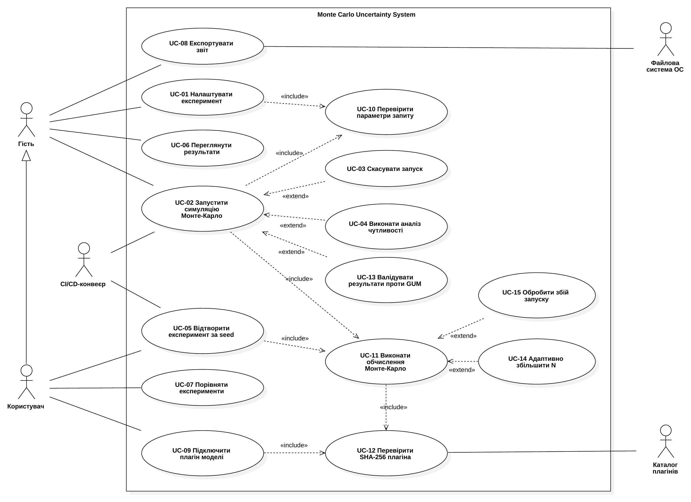

| Елемент | Склад |
| --- | --- |
| Межа системи (Subject) | Monte Carlo Uncertainty System |
| Первинні актори (ліворуч) | Гість (ACT-01); Користувач (ACT-02), узагальнення Користувач → Гість: успадковує всі прецеденти Гостя; CI/CD-конвеєр (ACT-03, CLI у Docker-образі) |
| Вторинні актори (праворуч) | Файлова система ОС (каталог звітів, обраний користувачем); Каталог плагінів (модулі та allow-list SHA-256) |
| «include» (обов'язкова спільна поведінка) | UC-01, UC-02 → UC-10 Перевірити параметри запиту; UC-02, UC-05 → UC-11 Виконати обчислення Монте-Карло; UC-09, UC-11 → UC-12 Перевірити SHA-256 плагіна |
| «extend» (умовна поведінка) | UC-03 Скасувати запуск → UC-02 [команда до термінального статусу]; UC-04 Виконати аналіз чутливості → UC-02 [kind ∈ {SOBOL, OAT}]; UC-13 Валідувати результати проти GUM → UC-02 [validate_against_gum = true]; UC-14 Адаптивно збільшити N → UC-11 [ε задано AND SE > ε AND C_plan < C_max]; UC-15 Обробити збій запуску → UC-11 [аварія робочого процесу OR тайм-аут чанка OR ρ > φ OR помилка запису БД] |

Ідентифікатори помилок у специфікаціях відповідають моделі `google.rpc.Status` контракту `compute_engine.proto` (2.5): `error.code` JSON-RPC, канонічний код і `ErrorInfo.reason`.

### 2.6.2. UC-02. Запуск симуляції Монте-Карло з адаптивним вибором N

| Поле | Значення |
| --- | --- |
| ID та назва | UC-02. Запуск симуляції Монте-Карло з адаптивним вибором N |
| Первинний актор | Гість (ACT-01) і, через узагальнення, Користувач (ACT-02); CI/CD-конвеєр (ACT-03) — командою `mcunc run` |
| Вторинні актори | Каталог плагінів — через включений UC-12, якщо модель експерименту є плагіном |
| Короткий опис | Оцінити невизначеність дальності *R*, часу польоту *T*, максимальної висоти *H* і точки падіння (*x*, *z*) для збереженої конфігурації експерименту з бітовою відтворюваністю за seed і зупинкою за порогом стандартної похибки ε ([SRS-FUN-19…29](./srs.md#srs-fun-19), [SRS-FUN-47](./srs.md#srs-fun-47)) |
| Передумови (продуктові) | П1. Експеримент `experiments/{e}` існує, не видалений, його конфігурація пройшла UC-10 під час UC-01 (1 ≤ *d* ≤ 64, кореляційна матриця додатно визначена). П2. Актор працює в режимі Гість або Користувач; відкрито вкладку «Запуск» цього експерименту. П3. У сеансі немає запуску зі статусом `QUEUED` або `RUNNING` |
| Передумови (технічні) | Т1. Процес Compute Engine запущено з `--access-mode`; `GetEngineInfo` повернув `apiVersion = "mcunc.v1"` і `maxWorkers`. Т2. БД відкрита з `journal_mode = WAL`, `foreign_keys = ON`, версія `schema_migration` підтримувана ([SRS-FUN-50](./srs.md#srs-fun-50)); у режимі Гість — тимчасова БД сеансу. Т3. Модель зареєстрована в `PluginRegistry`; для плагіна його SHA-256 присутній в allow-list. Т4. Пул робочих процесів зі start method `spawn` створено або може бути створено |

#### Main Success Scenario

| Крок | Дія актора | Реакція та відповідь системи |
| --- | --- | --- |
| 1 | Відкриває експеримент і вкладку «Запуск» | GUI викликає `GetExperiment(name)`; Compute Engine читає `experiment`, `input_quantity`, `distribution_parameter`, `correlation_coefficient` в одній транзакції читання і повертає `Experiment` з `etag`; значення `maxWorkers` GUI бере з `GetEngineInfo` |
| 2 | Задає тип «Монте-Карло», N_max = 10^6, K = 10^4, P = 2, поріг ε = 0,5 м для *R*, рівні квантилів, B = 2000, валідацію проти GUM; поле seed залишає порожнім | GUI формує `CreateRunRequest` у ProtoJSON з новим `requestId` (UUID v4) і `analysis.storeSamples = true` (потрібно для гістограм) |
| 3 | Натискає «Запустити» | `RpcServer` читає рядок JSON-RPC (≤ 16 МіБ). `RequestValidator` перевіряє правила `buf.validate` (n_max ∈ [1; 10^7], chunk_size ∈ [1; 10^6], workers ∈ [1; 256], ε > 0 і скінченне, B = 0 або ≥ 100) та серверні умови (workers ≤ maxWorkers; workers × chunk_size ≤ 3 355 443). `AccessPolicyGuard` порівнює режим процесу з опцією `required_access_mode = GUEST`. `CommandBus` передає команду в `RunExperimentUseCase` (UC-10 виконано) |
| 4 | — | Транзакція `BEGIN IMMEDIATE`: перевірка відсутності активного запуску (індекс `ix_run_active`); перевірка вільного місця в каталозі БД ≥ 1,2 · 5 · N_max · 8 Б; `root_seed := secrets.randbits(63)`; UPSERT `environment`; INSERT `simulation_run` (status = `QUEUED`, uuid v4); тригер `trg_run_freeze_experiment` встановлює `experiment.frozen_at`; COMMIT. Відповідь `Run` (`name`, `rootSeed`, `status = RUN_STATUS_QUEUED`) — до початку обчислень |
| 5 | — | GUI викликає `WatchRun(name)`; `ProgressPublisher` реєструє підписника з чергою місткістю 1 подію і надсилає нотифікацію `RunEvent(QUEUED)` |
| 6 | — | `MonteCarloCoordinator` (UC-11) встановлює status = `RUNNING` (тригер записує `run_status_event`), будує множник Холецького L, планує C_plan = ⌈N_start / K⌉ чанків і подає у пул вікно W = 2P запитів `ExecuteChunk(run_id, k, root_seed, m, model, random{inputs, L})`. Кожен робочий процес перед імпортом плагіна перевіряє його SHA-256 (UC-12) |
| 7 | Спостерігає за прогресом | Після кожного чанка координатор зберігає Y[k] у пам'яті, оновлює n_ok, n_f, ρ = n_f / (n_ok + n_f) і публікує `RunEvent(RUNNING, progress{completedChunks, plannedChunks, maxChunks, nCompleted, nFailed, fraction})`; GUI оновлює індикатор не частіше 10 разів на секунду |
| 8 | — | Після завершення запланованих чанків алгоритм A1.1 обчислює SE = σ / √n для *R*; SE ≤ ε, тому `target_reached := TRUE`, нові чанки не плануються |
| 9 | — | Аналіз: `StatisticsAnalyzer` (середнє, медіана, σ, асиметрія, ексцес, квантилі, найкоротший інтервал охоплення 0,95, інтервали Стьюдента і bootstrap B = 2000, еліпс розсіювання, тести нормальності); `GumValidator` — 2*d* + 1 = 17 оцінювань моделі (UC-13) |
| 10 | — | `SqliteExperimentRepository.save_run_results` в одній транзакції `BEGIN IMMEDIATE`: INSERT `output_sample` (SHA-256 кожного чанка кожної величини, `payload` у форматі ZLIB_F64LE), `statistic_result`, `interval_result`, `normality_test`, `dispersion_ellipse`, `gum_validation`, `convergence_point`; UPDATE `simulation_run` (status = `SUCCEEDED`, n_completed, n_failed, target_reached, finished_at); COMMIT. `StructuredLogger` записує рядок JSON Lines (timestamp, level, run_id, seed, N, model, duration) |
| 11 | — | Нотифікація `RunEvent(SUCCEEDED)` закриває потік; GUI викликає `GetRunResult(name)` і відкриває БД за `databaseUri` (`mode=ro`, `PRAGMA query_only = ON`) для читання вибірок |
| 12 | Переглядає гістограми, еліпс розсіювання й таблицю «MC проти GUM» | GUI будує графіки з даних кроку 11 без звернень до Compute Engine (перехід до UC-06) |

#### Постумови

- `simulation_run`: status = `SUCCEEDED`; записано root_seed, chunk_size, n_max, workers, environment_id, n_completed, n_failed, target_reached, finished_at; `run_status_event` містить послідовність QUEUED → RUNNING → SUCCEEDED.
- Для кожної пари (чанк *k*, величина *q*) записано `output_sample.sha256`; результати аналізу і статус `SUCCEEDED` зафіксовано однією транзакцією ([SRS-FUN-47](./srs.md#srs-fun-47)).
- `experiment.frozen_at` встановлено; подальші зміни конфігурації експерименту блокують тригери `trg_*_frozen_*`.
- Робочі процеси повернуто в пул; після завершення сеансу не залишається жодного дочірнього процесу ([SRS-NFR-RES-02](./srs.md#srs-nfr-res-02)).
- Журнал JSON Lines містить запис запуску; у режимі Гість усі записи зроблено лише в тимчасовій БД сеансу.

#### Alternative Flows

| ID | Старт | Умова-тригер | Повернення |
| --- | --- | --- | --- |
| AF-02A | Крок 2 | Актор задає seed вручну (тип 1) | Крок 3 |
| AF-02B | Крок 8 | SE > ε і C_plan < C_max (тип 1, розширення UC-14) | Крок 8, далі крок 9 |
| AF-02C | Крок 8 | SE > ε при C_plan = C_max: поріг недосяжний (тип 1) | Крок 9 |
| AF-02D | Крок 3 | Сервер відхиляє параметри запуску (тип 2) | Крок 2 |
| AF-02E | Крок 4 | У сеансі вже є запуск `QUEUED` або `RUNNING` (тип 2) | Крок 3 |
| AF-02F | Крок 4 | Експеримент видалено в іншому вікні або через CLI (тип 2) | Крок 1 |
| AF-02G | Крок 4 | Недостатньо місця на диску для результатів (тип 2) | Крок 2 |
| AF-02H | Крок 7 | Актор скасовує запуск (тип 1, розширення UC-03) | Крок 2 |
| AF-02I | Крок 3 | Повторне надсилання того самого запиту (подвійне натискання, повтор після тайм-ауту) | Крок 5 |
| AF-02J | Крок 2 | Актор вимикає збереження вибірок (тип 1) | Крок 3; на кроці 12 гістограми недоступні |

| Потік | Крок | Дія актора | Реакція та відповідь системи |
| --- | --- | --- | --- |
| AF-02A | 1 | Вводить seed = 42 | GUI передає `run.rootSeed = "42"` (int64 у ProtoJSON — рядок) |
| AF-02A | 2 | — | Валідатор перевіряє 0 ≤ seed ≤ 2^63 − 1; на кроці 4 `secrets.randbits` не викликається, у `simulation_run.root_seed` записується 42 |
| AF-02B | 1 | — | A1.1: N_req = ⌈(σ / ε)²⌉, C_new = ⌈1,1 · N_req / K⌉, C_plan := min(C_max, max(C_plan + 1, C_new)); `progress.plannedChunks` у `RunEvent` зростає |
| AF-02B | 2 | Бачить, що загальна кількість чанків зросла | GUI перераховує частку виконання за новим `plannedChunks` |
| AF-02C | 1 | — | `target_reached := FALSE`, N = N_max; запуск продовжується, це не помилка |
| AF-02C | 2 | Отримує попередження | GUI: «Поріг ε = 0,5 м не досягнуто: SE = 0,73 м при N = 10^6» |
| AF-02D | 1 | — | Відповідь −32602 `INVALID_ARGUMENT` з `BadRequest.fieldViolations[]`, наприклад `run.workers`: «workers × chunk_size must not exceed 3355443». Причини: workers > maxWorkers; workers × chunk_size > 3 355 443; бюджет Соболя 2^m · (*d* + 2) > n_max; chunk_size · *d* · 8 Б > 64 МіБ для SOBOL і OAT. Транзакція не відкривається |
| AF-02D | 2 | Виправляє поле | GUI підсвічує поле за `field` і показує `description` |
| AF-02E | 1 | — | ROLLBACK; −32000 `RESOURCE_EXHAUSTED`, `ErrorInfo.reason = RUN_ACTIVE`, `RetryInfo.retryDelay = 5s` |
| AF-02E | 2 | Обирає «Зачекати» або «Скасувати активний» | GUI повторює `CreateRun` з тим самим `requestId` через 5 с або викликає `CancelRun` для активного запуску |
| AF-02F | 1 | — | ROLLBACK; −32000 `FAILED_PRECONDITION`, reason = `EXPERIMENT_DELETED` |
| AF-02F | 2 | Обирає інший експеримент | GUI оновлює список (`ListExperiments`) |
| AF-02G | 1 | — | ROLLBACK; −32000 `FAILED_PRECONDITION`, reason = `STORAGE_INSUFFICIENT`, у `ErrorInfo.metadata` — потрібний і доступний обсяг |
| AF-02G | 2 | Звільняє місце або вимикає збереження вибірок | GUI показує обидва обсяги; при `storeSamples = false` оцінка зменшується до розміру дайджестів і статистик |
| AF-02H | 1 | Натискає «Скасувати» | GUI викликає `CancelRun(name)`; координатор встановлює прапорець скасування, не подає нових чанків, завершує робочі процеси ≤ 2 с ([SRS-NFR-PERF-04](./srs.md#srs-nfr-perf-04)), UPDATE status = `CANCELLED`; результати не записуються |
| AF-02H | 2 | — | `RunEvent(CANCELLED)`; GUI: «Запуск скасовано, результати не збережено» |
| AF-02I | 1 | — | `RpcServer` знаходить `requestId` у кеші ідемпотентності сеансу (до 1024 ключів: SHA-256 тіла → ім'я ресурсу). Тіло збігається — повертається наявний `Run` без нового INSERT; тіло інше — `ALREADY_EXISTS` |
| AF-02J | 1 | Знімає позначку «Зберігати вибірки» | `analysis.storeSamples = false`; на кроці 10 `payload` = NULL, `sha256` записується завжди |
| AF-02J | 2 | — | На кроці 12 GUI показує статистики без гістограм і пропонує повторити запуск із тим самим seed та збереженням вибірок |

#### Exception Flows

| ID | Назва збою | Умова-тригер |
| --- | --- | --- |
| EF-02A | Аварія робочого процесу | `BrokenProcessPool` на кроках 6–7: збій коду плагіна, завершення процесу OOM killer |
| EF-02B | Зависання чанка | Чанк не завершився за *T_c* (тайм-аут `ExecuteChunkRequest.timeout_s`) |
| EF-02C | Частка невдалих траєкторій > 1 % | Після n_ok + n_f ≥ 10^4 маємо ρ > φ = 0,01 (NaN, перевищення `max_steps`) |
| EF-02D | Збій запису результатів у БД | На кроці 10: `SQLITE_BUSY` після `busy_timeout = 5 с`, `SQLITE_FULL` або `SQLITE_IOERR` |
| EF-02E | Аварія процесу Compute Engine | EOF або `BrokenPipe` у stdio GUI на кроках 4–11 |

| Потік | Крок | Дії для UI / користувача | Технічні дії сервера та БД |
| --- | --- | --- | --- |
| EF-02A | 1 | Індикатор зупиняється; діалог: «Запуск завершився аварійно: робочий процес чанка 37 завершився неочікувано. Результати не збережено». Кнопка «Повторити з тим самим seed» | Координатор фіксує збій ≤ 5 с ([SRS-NFR-REL-02](./srs.md#srs-nfr-rel-02)), припиняє подання чанків, викликає `shutdown(cancel_futures=True)`, завершує решту процесів (terminate, через 2 с — kill); результати в пам'яті відкидаються ([SRS-FUN-29](./srs.md#srs-fun-29)) |
| EF-02A | 2 | Натискає «Повторити» або закриває діалог | Окрема коротка транзакція: UPDATE status = `FAILED`, failure_reason = `WORKER_CRASHED`, finished_at; тригер записує `run_status_event`; `StructuredLogger` (ERROR): run_id, chunk_index = 37, exitcode; `RunEvent(FAILED)`. Пул створюється заново; повтор — новий `CreateRun` з тим самим `rootSeed`, що дає ту саму вибірку |
| EF-02B | 1 | «Чанк 12 не завершився за T_c = 120 с; запуск зупинено» | Дії EF-02A з failure_reason = `CHUNK_TIMEOUT`; процес завислого чанка завершується примусово |
| EF-02C | 1 | «Запуск зупинено: 3,2 % траєкторій невдалі (NaN або перевищено ліміт кроків). Перевірте параметри розподілів і крок інтегрування» | Раннє припинення, status = `FAILED`, failure_reason = `FAILURE_RATE_EXCEEDED`, результати не записуються ([SRS-FUN-28](./srs.md#srs-fun-28)); журнал: n_f, ρ і глобальні індекси перших 10 невдалих траєкторій |
| EF-02D | 1 | Індикатор «Збереження результатів…» | `SQLITE_BUSY`: повтор транзакції до 3 разів з паузами 0,1 / 0,2 / 0,4 с; кожна спроба починається з `BEGIN IMMEDIATE`, тому часткових записів немає |
| EF-02D | 2 | «Не вдалося зберегти результати: недостатньо місця на диску. Звільніть місце та повторіть запуск з тим самим seed» | Після невдалих повторів або при `SQLITE_FULL`: ROLLBACK (WAL лишає БД узгодженою); окрема транзакція UPDATE status = `FAILED`, failure_reason = `INTERNAL`, у журналі reason = `STORAGE_WRITE_FAILED`; якщо й вона неможлива, статус виправляє відновлення при наступному старті (EF-02E) |
| EF-02E | 1 | «Обчислювальне ядро завершилося неочікувано. Перезапуск…»; кнопки заблоковано до відповіді `GetEngineInfo` | Робочі процеси завершуються разом із ядром: `PR_SET_PDEATHSIG` у Linux, Job Object з `JOB_OBJECT_LIMIT_KILL_ON_JOB_CLOSE` у Windows; БД відновлюється з WAL до останньої зафіксованої транзакції ([SRS-NFR-REL-01](./srs.md#srs-nfr-rel-01)) |
| EF-02E | 2 | Після перезапуску GUI показує запуск зі статусом FAILED і пропонує повторити з тим самим seed | Під час старту ядро виконує відновлення: `UPDATE simulation_run SET status = 'FAILED', failure_reason = 'INTERNAL', finished_at = <now> WHERE status IN ('QUEUED', 'RUNNING')` (перехід дозволяє `trg_run_status_transition`). У режимі Гість БД сеансу видаляється разом із сеансом — це очікувана втрата |

### 2.6.3. UC-05. Відтворення експерименту за збереженим seed

| Поле | Значення |
| --- | --- |
| ID та назва | UC-05. Відтворення експерименту за збереженим seed |
| Первинний актор | Користувач (ACT-02); CI/CD-конвеєр (ACT-03) — командою `mcunc reproduce` з БД-фікстурою |
| Вторинні актори | Каталог плагінів — через UC-11 → UC-12 |
| Короткий опис | Підтвердити бітову відтворюваність збереженого запуску ([SRS-FUN-49](./srs.md#srs-fun-49), [SRS-NFR-REPR-02](./srs.md#srs-nfr-repr-02)): повторити обчислення з тими самими root_seed, K, N і конфігурацією та порівняти SHA-256 кожного чанка кожної величини |
| Передумови (продуктові) | П1. Compute Engine працює в режимі Користувач (БД профілю). П2. Запуск-джерело має статус `SUCCEEDED`. П3. У сеансі немає активного запуску |
| Передумови (технічні) | Т1. Для джерела в `output_sample` є рівно C × 5 рядків із `sha256` (C — кількість чанків джерела). Т2. Зареєстрована модель має ті самі `code`, `version` і, для плагіна, той самий SHA-256, що й `physics_model` джерела. Т3. БД у режимі WAL, версія схеми підтримувана |

#### Main Success Scenario

| Крок | Дія актора | Реакція та відповідь системи |
| --- | --- | --- |
| 1 | Відкриває історію запусків експерименту | GUI читає `simulation_run` з БД профілю (`mode=ro`) з keyset-пагінацією за (created_at DESC, id DESC), 50 рядків на сторінку |
| 2 | Обирає запуск зі статусом SUCCEEDED і натискає «Відтворити» | GUI надсилає `ReproduceRun(name, requestId)` |
| 3 | — | `RequestValidator` перевіряє шаблон `experiments/{uuid}/runs/{uuid}`; `AccessPolicyGuard`: опція RPC `required_access_mode = USER`, режим процесу USER — дозволено. `ReproduceExperimentUseCase` читає джерело (status = SUCCEEDED), рахує дайджести (C × 5) і звіряє модель (code, version, plugin_sha256) |
| 4 | — | Транзакція `BEGIN IMMEDIATE`: перевірка активного запуску; UPSERT `environment` поточного середовища; INSERT `simulation_run` з `reproduces_run_id` = id джерела і тими самими kind, root_seed, chunk_size, n_max, adaptive, analysis; workers — поточне значення, бо результат від P не залежить ([SRS-NFR-REPR-01](./srs.md#srs-nfr-repr-01)); COMMIT. Відповідь `Run` (QUEUED) |
| 5 | Спостерігає за прогресом | Кроки 5–7 UC-02 (включений UC-11): ті самі `ExecuteChunk(k)` з тим самим root_seed відтворюють ті самі потоки `SeedSequence(root_seed, spawn_key = (k,))` |
| 6 | — | Для адаптивного запуску A1.1 повторює ту саму послідовність C_plan, оскільки SE на кожній перевірці обчислюється з тих самих даних; кількість чанків C' = C |
| 7 | — | Для кожної пари (k, q) обчислюється SHA-256 масиву `values_f64le` до стиснення і порівнюється з `output_sample.sha256` джерела в порядку (chunk_index, quantity); `reproduction_match := (C' = C) AND усі 5 · C дайджестів збігаються` |
| 8 | — | Збереження результатів однією транзакцією, як крок 10 UC-02, разом з UPDATE `reproduction_match = 1` і status = `SUCCEEDED`; журнал: run_id, reproduces_run_id, match = true |
| 9 | Переглядає результат відтворення | GUI: «Відтворення: збіг 100 % (C чанків × 5 величин); середовище однакове» і статистики джерела та нового запуску поруч |

#### Постумови

- Створено запуск зі status = `SUCCEEDED`, `reproduces_run_id` = id джерела, `reproduction_match = 1`, root_seed джерела; результати і дайджести записано однією транзакцією.
- Запуск-джерело не змінено: ні статус, ні результати, ні дайджести.
- Журнал JSON Lines містить пару run_id / reproduces_run_id і результат порівняння.

#### Alternative Flows

| ID | Старт | Умова-тригер | Повернення |
| --- | --- | --- | --- |
| AF-05A | Крок 4 | Середовище (engine, Python, NumPy, SciPy, platform) відрізняється від середовища джерела (бізнес-правило [SRS-FUN-49](./srs.md#srs-fun-49)) | Крок 5 |
| AF-05B | Крок 3 | Ядро працює в режимі Гість (тип 2) | Крок 1 після перезапуску ядра в режимі Користувач |
| AF-05C | Крок 3 | Джерело не має статусу SUCCEEDED (тип 2) | Крок 2 |
| AF-05D | Крок 3 | Версія моделі або SHA-256 плагіна відрізняється від збережених (тип 2) | Крок 2 |
| AF-05E | Крок 7 | Хоча б один дайджест не збігся за однакового середовища | Крок 8 зі значенням FALSE, далі крок 9 |
| AF-05F | Крок 4 | У сеансі вже є активний запуск (тип 2) | Крок 3 (як AF-02E) |

| Потік | Крок | Дія актора | Реакція та відповідь системи |
| --- | --- | --- | --- |
| AF-05A | 1 | — | Запуск створюється; GUI порівнює `Run.environment` нового запуску з `environment` джерела (`GetRun`) |
| AF-05A | 2 | Бачить попередження «Середовище відрізняється: NumPy 2.5.3 → 2.6.0; бітовий збіг не гарантується» | На кроці 9 `reproduction_match = FALSE` позначається як очікуваний наслідок різних середовищ, а не як дефект |
| AF-05B | 1 | — | `AccessPolicyGuard`: −32000 `PERMISSION_DENIED`, reason = `ACCESS_MODE_INSUFFICIENT` (required USER, current GUEST); читання БД не виконується |
| AF-05B | 2 | Обирає «Увійти в профіль» | GUI перезапускає Compute Engine з `--access-mode user` і повертається до списку запусків |
| AF-05C | 1 | — | −32000 `FAILED_PRECONDITION`, reason = `SOURCE_RUN_NOT_SUCCEEDED` |
| AF-05C | 2 | Обирає інший запуск | GUI фільтрує історію за статусом SUCCEEDED |
| AF-05D | 1 | — | −32000 `FAILED_PRECONDITION`, reason = `MODEL_VERSION_MISMATCH`; `ErrorInfo.metadata` містить очікуваний і поточний SHA-256 |
| AF-05D | 2 | Відновлює попередню версію плагіна або обирає інший запуск | — |
| AF-05E | 1 | — | `reproduction_match := FALSE`; журнал (WARNING): перша пара (k, q), що не збіглася, та обидва дайджести |
| AF-05E | 2 | Отримує звіт «Розбіжність у чанку 14, величина RANGE» | GUI пропонує експортувати звіт (UC-08) для аналізу дефекту |

#### Exception Flows

| ID | Назва збою | Умова-тригер |
| --- | --- | --- |
| EF-05A | Пошкоджені дайджести джерела | На кроці 3 кількість рядків `output_sample` джерела ≠ C × 5 або `sha256` не відповідає шаблону 64 hex (файл БД змінено поза системою чи відновлено з неповної копії) |
| EF-05B | Технічний збій під час відтворення | Аварія робочого процесу, тайм-аут чанка або збій запису (як EF-02A, EF-02B, EF-02D) |
| EF-05C | Аварія Compute Engine | Як EF-02E |

| Потік | Крок | Дії для UI / користувача | Технічні дії сервера та БД |
| --- | --- | --- | --- |
| EF-05A | 1 | «Неможливо відтворити: дані запуску-джерела пошкоджені (відсутні 3 з 500 дайджестів). Відтворення скасовано» | −32000 `FAILED_PRECONDITION`, reason = `SOURCE_DIGESTS_INCOMPLETE`; новий запуск не створюється; журнал (ERROR): очікувана і фактична кількість рядків, результат `PRAGMA quick_check` |
| EF-05B | 1 | «Відтворення перервано технічним збоєм (аварія робочого процесу). Висновок про відтворюваність не зроблено» | Дії EF-02A / EF-02B / EF-02D; status = `FAILED`; `reproduction_match` лишається NULL, а не FALSE, щоб збій інфраструктури не виглядав як неповторюваність |
| EF-05C | 1 | Як EF-02E | Як EF-02E; відновлення при старті переводить незавершене відтворення у FAILED з `reproduction_match` = NULL |

---

## 2.7. Проєктування та документування моделей даних (ERD)

Шар збереження реалізує компонент `SqliteExperimentRepository` ([рівень 3](#diagram-level3)) поверх SQLite 3 у режимі WAL. Повна фізична схема зафіксована як Data-as-Code у файлі [data/schema.sql](./data/schema.sql): 19 STRICT-таблиць, 9 індексів, 12 тригерів. Схема реалізує вимоги [SRS-FUN-46…51](./srs.md#srs-fun-46), [SRS-NFR-REL-01](./srs.md#srs-nfr-rel-01), [SRS-NFR-SEC-01](./srs.md#srs-nfr-sec-01), [SRS-NFR-DATA-01](./srs.md#srs-nfr-data-01).

**Файли БД.** Схема однакова для двох файлів: БД профілю (режим `ACCESS_MODE_USER`) і тимчасової БД сеансу (режим `ACCESS_MODE_GUEST`, видаляється при завершенні Compute Engine; [SRS-FUN-51](./srs.md#srs-fun-51)). Запис виконує лише Compute Engine; Desktop GUI відкриває файл з `mode=ro` та `PRAGMA query_only = ON`.

**Конвенції.** Час — `TEXT` ISO 8601 UTC з мілісекундами, канонічність перевіряє `CHECK (strftime(...) = значення)`. Публічні ідентифікатори — UUID v4 (`TEXT`, 36 символів); внутрішні `INTEGER PRIMARY KEY` назовні не передаються. Перелічення — `TEXT` + `CHECK IN (...)`, значення збігаються з іменами enum контракту без префікса (`RUN_STATUS_SUCCEEDED` → `'SUCCEEDED'`). Логічні значення — `INTEGER` 0/1. Параметри з'єднання: `foreign_keys = ON`, `journal_mode = WAL`, `synchronous = NORMAL`, `busy_timeout = 5000`.

<a id="diagram-erd-overview"></a>

### 2.7.1. Загальна ER-діаграма

Діаграма показує зв'язки 18 прикладних таблиць (службову `schema_migration` не наведено). Підписи зв'язків опущено, щоб діаграма читалася без масштабування; імена зовнішніх ключів і атрибути наведено на детальних діаграмах 2.7.2–2.7.4.

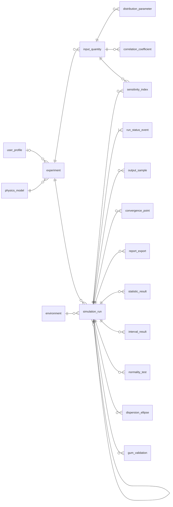

<a id="diagram-erd-config"></a>

### 2.7.2. Підобласть «Конфігурація експерименту»

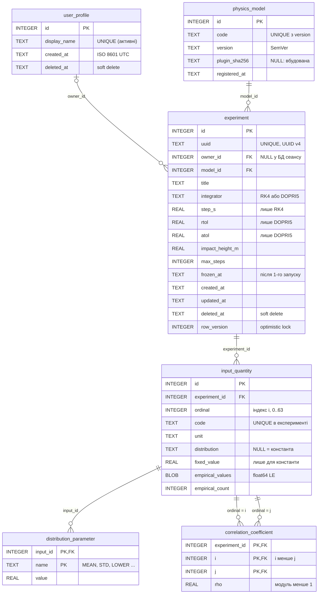

**user_profile** — локальний профіль користувача (лише БД профілю; персональні дані, крім імені, не зберігаються).

| Поле | Тип | Обмеження | Опис |
| --- | --- | --- | --- |
| id | INTEGER | PK | Внутрішній ключ |
| display_name | TEXT | NOT NULL, 1–64 символи, COLLATE NOCASE; UNIQUE серед активних (частковий індекс) | Ім'я профілю |
| created_at | TEXT | NOT NULL, ISO 8601 UTC | Час створення |
| deleted_at | TEXT | NULL, ISO 8601 UTC | Soft delete |

**physics_model** — зареєстровані версії фізичних моделей, зокрема плагінів.

| Поле | Тип | Обмеження | Опис |
| --- | --- | --- | --- |
| id | INTEGER | PK | Внутрішній ключ |
| code | TEXT | NOT NULL, `^[a-z]\[a-z0-9_]{1,63}$`; UNIQUE (code, version) | `m1_vacuum`, `m2_drag`, `m3_isa_wind` або ім'я плагіна |
| version | TEXT | NOT NULL, 5–32 символи | Версія SemVer |
| plugin_sha256 | TEXT | NULL, 64 hex | SHA-256 модуля плагіна (allow-list, [SRS-FUN-12](./srs.md#srs-fun-12)) |
| registered_at | TEXT | NOT NULL, ISO 8601 UTC | Час реєстрації |

**experiment** — конфігурація експерименту; після першого запуску змінювані поля конфігурації заморожуються тригером.

| Поле | Тип | Обмеження | Опис |
| --- | --- | --- | --- |
| id | INTEGER | PK | Внутрішній ключ |
| uuid | TEXT | NOT NULL, UNIQUE, UUID v4 | Публічний ідентифікатор (`experiments/{uuid}`) |
| owner_id | INTEGER | FK → user_profile.id, ON DELETE RESTRICT, NULL у БД сеансу | Власник |
| model_id | INTEGER | NOT NULL, FK → physics_model.id, ON DELETE RESTRICT | Модель і версія |
| title | TEXT | NOT NULL, 1–200 символів | Назва |
| integrator | TEXT | NOT NULL, `RK4` або `DOPRI5` | Метод інтегрування |
| step_s | REAL | 0 < h ≤ 1; обов'язкове лише для RK4 | Крок h, с |
| rtol, atol | REAL | > 0; обов'язкові лише для DOPRI5 | Допуски Dormand–Prince |
| impact_height_m | REAL | NOT NULL, типово 0 | Висота площини падіння y_imp, м |
| max_steps | INTEGER | NOT NULL, 100…10^7 | Ліміт кроків n_max для траєкторії |
| frozen_at | TEXT | NULL, ISO 8601 UTC | Час першого запуску; після нього конфігурація незмінна |
| created_at, updated_at | TEXT | NOT NULL, ISO 8601 UTC; updated_at ≥ created_at | Аудит змін |
| deleted_at | TEXT | NULL | Soft delete (`DeleteExperiment`) |
| row_version | INTEGER | NOT NULL ≥ 1 | Оптимістичне блокування (`Experiment.etag`) |

**input_quantity** — вхідна величина моделі: стала або випадкова з розподілом.

| Поле | Тип | Обмеження | Опис |
| --- | --- | --- | --- |
| id | INTEGER | PK | Внутрішній ключ |
| experiment_id | INTEGER | NOT NULL, FK → experiment.id, ON DELETE CASCADE | Експеримент |
| ordinal | INTEGER | NOT NULL, 0…63; UNIQUE (experiment_id, ordinal) | Індекс i у векторі x |
| code | TEXT | NOT NULL, `^[a-z]\[a-z0-9_]{0,31}$`; UNIQUE (experiment_id, code) | Код величини (`v0`, `elevation`, …) |
| unit | TEXT | NOT NULL, 1–16 символів | Одиниця SI |
| distribution | TEXT | NULL або одне з 7 значень | Розподіл; NULL — стала величина |
| fixed_value | REAL | обов'язкове тоді й лише тоді, коли distribution IS NULL | Значення сталої |
| empirical_values | BLOB | лише для EMPIRICAL; довжина = 8 · empirical_count | Вибірка float64 little-endian |
| empirical_count | INTEGER | 2…10^6 | Кількість значень вибірки |

**distribution_parameter** — параметри розподілу (по одному рядку на параметр).

| Поле | Тип | Обмеження | Опис |
| --- | --- | --- | --- |
| input_id | INTEGER | PK, FK → input_quantity.id, ON DELETE CASCADE | Вхідна величина |
| name | TEXT | PK; MEAN, STD, LOWER, UPPER, MODE, SHAPE, SCALE, LOCATION, LOG_MEAN, LOG_STD | Ім'я параметра |
| value | REAL | NOT NULL | Значення |

Набори параметрів: NORMAL {MEAN, STD}; UNIFORM {LOWER, UPPER}; TRIANGULAR {LOWER, MODE, UPPER}; TRUNCATED_NORMAL {MEAN, STD, LOWER, UPPER}; LOGNORMAL {LOG_MEAN, LOG_STD}; WEIBULL {SHAPE, SCALE, LOCATION}; EMPIRICAL — без параметрів. Повноту набору та співвідношення меж перевіряє `RequestValidator` за правилами контракту ([2.5](#25-специфікація-міжсервісних-контрактів-та-топологія-api-маршрутів)).

**correlation_coefficient** — ненульові коефіцієнти верхнього трикутника кореляційної матриці (діагональ дорівнює 1).

| Поле | Тип | Обмеження | Опис |
| --- | --- | --- | --- |
| experiment_id | INTEGER | PK; FK (experiment_id, i) та (experiment_id, j) → input_quantity (experiment_id, ordinal) | Експеримент |
| i, j | INTEGER | PK; i < j | Індекси пари величин |
| rho | REAL | NOT NULL; −1 < rho < 1; rho ≠ 0 | Коефіцієнт кореляції |

Складені зовнішні ключі гарантують, що обидві величини пари належать тому самому експерименту. Додатну визначеність матриці перевіряє `RequestValidator` (розклад Холецького, [SRS-FUN-17](./srs.md#srs-fun-17)).

<a id="diagram-erd-run"></a>

### 2.7.3. Підобласть «Запуск»

#### Частина 1. Запуск і середовище

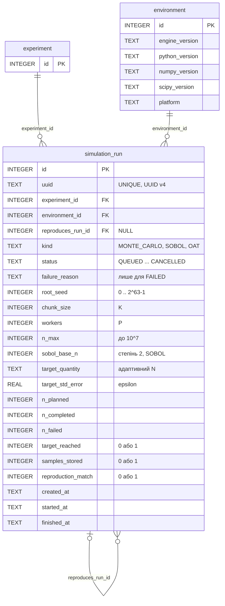

#### Частина 2. Сирі результати запуску

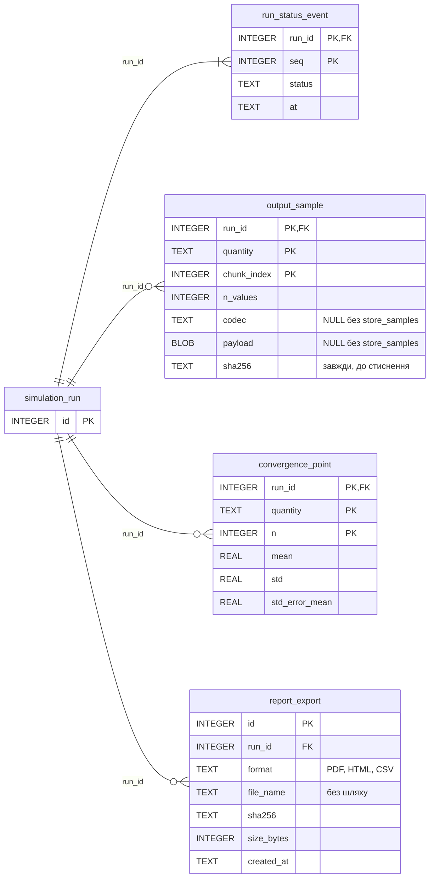

**environment** — версії середовища, в якому виконано запуск (нормалізовано; [SRS-FUN-46](./srs.md#srs-fun-46)).

| Поле | Тип | Обмеження | Опис |
| --- | --- | --- | --- |
| id | INTEGER | PK | Внутрішній ключ |
| engine_version, python_version, numpy_version, scipy_version | TEXT | NOT NULL, 5–32 символи | Версії компонентів |
| platform | TEXT | NOT NULL, 1–128 символів | ОС і архітектура |
| — | — | UNIQUE за всіма п'ятьма полями | Один рядок на унікальне середовище |

**simulation_run** — запуск Монте-Карло, Соболя або OAT.

| Поле | Тип | Обмеження | Опис |
| --- | --- | --- | --- |
| id | INTEGER | PK | Внутрішній ключ |
| uuid | TEXT | NOT NULL, UNIQUE, UUID v4 | `experiments/{e}/runs/{uuid}` |
| experiment_id | INTEGER | NOT NULL, FK → experiment.id, ON DELETE CASCADE | Експеримент |
| environment_id | INTEGER | NOT NULL, FK → environment.id, ON DELETE RESTRICT | Середовище |
| reproduces_run_id | INTEGER | NULL, FK → simulation_run.id, ON DELETE SET NULL | Запуск-джерело для `ReproduceRun` |
| kind | TEXT | NOT NULL: MONTE_CARLO, SOBOL, OAT | Тип запуску |
| status | TEXT | NOT NULL: QUEUED, RUNNING, SUCCEEDED, FAILED, CANCELLED; переходи контролює тригер | Статус |
| failure_reason | TEXT | обов'язкове тоді й лише тоді, коли status = FAILED | Причина відмови |
| root_seed | INTEGER | NOT NULL, 0…2^63 − 1 | Кореневий seed s |
| chunk_size | INTEGER | NOT NULL, 1…10^6 | K |
| workers | INTEGER | NOT NULL, 1…256 | P |
| n_max | INTEGER | NOT NULL, 1…10^7 | N_max |
| sobol_base_n | INTEGER | степінь 2; обов'язкове тоді й лише тоді, коли kind = SOBOL | Базовий об'єм n |
| target_quantity, target_std_error | TEXT, REAL | обидва NULL або обидва задані; ε > 0 | Параметри адаптивного N |
| n_planned, n_completed, n_failed | INTEGER | n_failed ≤ n_completed ≤ n_planned ≤ n_max | Лічильники траєкторій |
| target_reached | INTEGER | NULL, 0 або 1; лише для адаптивного запуску | Досягнення порогу ε |
| samples_stored | INTEGER | NOT NULL, 0 або 1 | Наявність payload у output_sample |
| reproduction_match | INTEGER | NULL, 0 або 1; лише якщо reproduces_run_id задано | Бітовий збіг із джерелом |
| created_at, started_at, finished_at | TEXT | ISO 8601 UTC; finished_at задано тоді й лише тоді, коли статус термінальний | Часові мітки |

**run_status_event** — журнал змін статусу (заповнюється тригерами).

| Поле | Тип | Обмеження | Опис |
| --- | --- | --- | --- |
| run_id | INTEGER | PK, FK → simulation_run.id, ON DELETE CASCADE | Запуск |
| seq | INTEGER | PK, ≥ 1 | Порядковий номер події |
| status | TEXT | NOT NULL, ті самі 5 значень | Новий статус |
| at | TEXT | NOT NULL, ISO 8601 UTC | Час зміни |

**output_sample** — вибірка вихідної величини по чанках.

| Поле | Тип | Обмеження | Опис |
| --- | --- | --- | --- |
| run_id | INTEGER | PK, FK → simulation_run.id, ON DELETE CASCADE | Запуск |
| quantity | TEXT | PK: RANGE, TIME_OF_FLIGHT, MAX_HEIGHT, IMPACT_X, IMPACT_Z | Вихідна величина |
| chunk_index | INTEGER | PK, ≥ 0 | Індекс чанка k |
| n_values | INTEGER | NOT NULL, 1…10^6 | Кількість значень (NaN для невдалих траєкторій) |
| codec | TEXT | NULL або ZLIB_F64LE, RAW_F64LE; NULL тоді й лише тоді, коли payload NULL | Кодування |
| payload | BLOB | NULL без `store_samples` | Значення float64 little-endian |
| sha256 | TEXT | NOT NULL, 64 hex | Дайджест нестиснених байтів; записується завжди для `ReproduceRun` |

**convergence_point** — точки кривих збіжності ([SRS-FUN-42](./srs.md#srs-fun-42)).

| Поле | Тип | Обмеження | Опис |
| --- | --- | --- | --- |
| run_id, quantity, n | INTEGER, TEXT, INTEGER | PK; n ≥ 2 | Запуск, величина, об'єм кумулятивної вибірки |
| mean, std, std_error_mean | REAL | std ≥ 0; std_error_mean ≥ 0 | Оцінки на об'ємі n |

**report_export** — журнал експортованих звітів.

| Поле | Тип | Обмеження | Опис |
| --- | --- | --- | --- |
| id | INTEGER | PK | Внутрішній ключ |
| run_id | INTEGER | NOT NULL, FK → simulation_run.id, ON DELETE CASCADE | Запуск |
| format | TEXT | NOT NULL: PDF, HTML, CSV | Формат |
| file_name | TEXT | 1–255 символів без `/` та `\` | Ім'я файлу (шлях не зберігається) |
| sha256, size_bytes | TEXT, INTEGER | 64 hex; ≥ 0 | Цілісність файлу |
| created_at | TEXT | NOT NULL, ISO 8601 UTC | Час експорту |

<a id="diagram-erd-results"></a>

### 2.7.4. Підобласть «Результати аналізу»

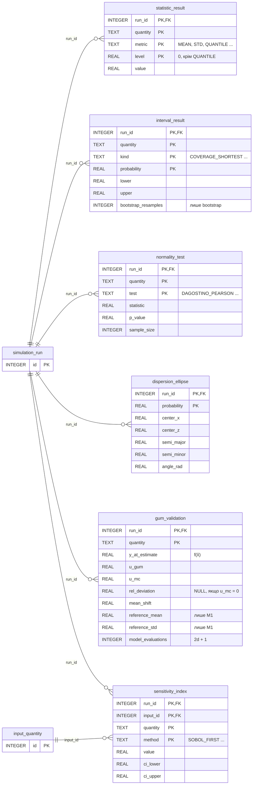

| Таблиця | Ключ | Поля даних | Обмеження | Вимоги |
| --- | --- | --- | --- | --- |
| statistic_result | (run_id, quantity, metric, level) | value REAL | metric: MEAN, MEDIAN, VARIANCE, STD, SKEWNESS, KURTOSIS, STD_ERROR_MEAN, QUANTILE; level > 0 тоді й лише тоді, коли metric = QUANTILE (інакше 0) | [SRS-FUN-30…32](./srs.md#srs-fun-30) |
| interval_result | (run_id, quantity, kind, probability) | lower, upper REAL; bootstrap_resamples INTEGER | kind: COVERAGE_SHORTEST, CI_MEAN_STUDENT, CI_BOOTSTRAP_PERCENTILE; lower ≤ upper; 0 < p < 1; B ∈ [100; 10^5] лише для bootstrap | [SRS-FUN-33…35](./srs.md#srs-fun-33) |
| normality_test | (run_id, quantity, test) | statistic, p_value REAL; sample_size INTEGER | test: DAGOSTINO_PEARSON, SHAPIRO_WILK; 0 ≤ p ≤ 1; n ≥ 8; для SHAPIRO_WILK n ≤ 5000 | [SRS-FUN-37](./srs.md#srs-fun-37) |
| dispersion_ellipse | (run_id, probability) | center_x, center_z, semi_major, semi_minor, angle_rad REAL | semi_minor ≤ semi_major; кут у (−π/2; π/2] | [SRS-FUN-36](./srs.md#srs-fun-36) |
| sensitivity_index | (run_id, input_id, quantity, method) | value, ci_lower, ci_upper REAL | method: SOBOL_FIRST, SOBOL_TOTAL, SRC, OAT, GUM_COEFFICIENT; межі CI обидві NULL або lower ≤ upper; тригер перевіряє, що input_id належить експерименту запуску | [SRS-FUN-39…41](./srs.md#srs-fun-39), [SRS-FUN-43](./srs.md#srs-fun-43) |
| gum_validation | (run_id, quantity) | y_at_estimate, u_gum, u_mc, rel_deviation, mean_shift, reference_mean, reference_std REAL; model_evaluations INTEGER | u ≥ 0; rel_deviation та mean_shift NULL тоді й лише тоді, коли u_mc = 0; reference_* лише для M1 | [SRS-FUN-43…45](./srs.md#srs-fun-43) |
| schema_migration | version | applied_at TEXT, checksum TEXT | checksum — SHA-256 скрипту міграції; дублюється в `PRAGMA user_version` | [SRS-FUN-50](./srs.md#srs-fun-50) |

### 2.7.5. Обґрунтування типів даних

| Рішення | Обґрунтування |
| --- | --- |
| STRICT-таблиці | SQLite за замовчуванням дозволяє зберегти рядок у колонці INTEGER; STRICT відхиляє невідповідний тип (перевірено: seed 2^63 відхилено) |
| UUID як TEXT(36), а не BLOB(16) | Читабельність у журналах і SQL-консолі; кількість експериментів і запусків — тисячі рядків, економія 20 байт на рядок не суттєва |
| Час як TEXT ISO 8601 з `CHECK (strftime(...) = значення)` | SQLite не має типу дати; лексикографічний порядок збігається з хронологічним, тому індекс за created_at придатний для сортування й пагінації |
| root_seed INTEGER 0…2^63 − 1 | Діапазон signed int64 SQLite і int64 контракту; ентропію генерує `secrets.randbits(63)` |
| Вибірки float64 BLOB по чанках | 10^7 значень = 80 МБ на величину; рядок на чанк обмежує пам'ять при читанні ([SRS-NFR-RES-01](./srs.md#srs-nfr-res-01)) і дає SHA-256 на чанк для порівняння при відтворенні |
| Параметри розподілу окремою таблицею, а не JSON | Атомарні значення (1NF), CHECK на імена параметрів, без парсингу JSON у шарі даних |
| Результати статистики у «довгому» форматі | Нові метрики та рівні квантилів додаються рядками без міграції схеми |

<a id="index-plan"></a>

### 2.7.6. План індексування

SQLite підтримує лише індекси B-tree (зокрема часткові та за виразами); індекси PRIMARY KEY та UNIQUE створюються автоматично. План запитів перевірено командою `EXPLAIN QUERY PLAN` на схемі з тестовими даними.

| Індекс | Колонки | Операція (метод контракту) | План запиту |
| --- | --- | --- | --- |
| ux_user_profile_active_name | display_name WHERE deleted_at IS NULL (UNIQUE, частковий) | Унікальність імені серед активних профілів | — (обмеження) |
| ix_experiment_owner_created | owner_id, created_at DESC, id DESC | `ListExperiments`, keyset-пагінація; FK owner_id | SEARCH USING INDEX (owner_id=? AND created_at<?) |
| sqlite_autoindex (experiment.uuid) | uuid | `GetExperiment`, розбір імені ресурсу | SEARCH USING INDEX (uuid=?) |
| ix_experiment_model | model_id | FK RESTRICT при видаленні моделі | — |
| ix_run_experiment_created | experiment_id, created_at DESC | Перелік запусків експерименту | SEARCH USING INDEX (experiment_id=?) |
| ix_run_active | status WHERE status IN ('QUEUED', 'RUNNING') (частковий) | Обмеження «один активний запуск» (`CreateRun`), відновлення після аварії | SEARCH USING COVERING INDEX (status=?) |
| ix_run_environment, ix_run_reproduces | environment_id; reproduces_run_id (частковий) | FK RESTRICT / SET NULL | — |
| PK output_sample | run_id, quantity, chunk_index | Потокове читання вибірки по чанках (GUI, звіти) | SEARCH USING INDEX (run_id=? AND quantity=?) |
| PK statistic_result та інших таблиць результатів | run_id, … | `GetRunResult` | SEARCH USING PRIMARY KEY (run_id=?) |
| ix_sensitivity_input, ix_report_run | input_id; run_id | FK CASCADE | — |

### 2.7.7. Цілісність і нормалізація

| Тригер | Подія | Правило |
| --- | --- | --- |
| trg_run_freeze_experiment | AFTER INSERT simulation_run | Записує experiment.frozen_at при першому запуску |
| trg_experiment_frozen, trg_input_frozen_*, trg_param_frozen_*, trg_corr_frozen_* | BEFORE INSERT/UPDATE конфігурації | Забороняє зміну конфігурації після першого запуску (умова відтворюваності, [SRS-NFR-REPR-02](./srs.md#srs-nfr-repr-02)) |
| trg_sensitivity_same_experiment | BEFORE INSERT sensitivity_index | Вхідна величина належить експерименту запуску |
| trg_run_status_event_ins, trg_run_status_event_upd | AFTER INSERT / UPDATE OF status | Журнал змін статусу |
| trg_run_status_transition | BEFORE UPDATE OF status | Дозволені переходи: QUEUED → RUNNING, CANCELLED, FAILED; RUNNING → SUCCEEDED, FAILED, CANCELLED |

Схема відповідає 3NF: неключові атрибути залежать лише від повного ключа; похідні величини (тривалість запуску, x̂ та u(x) вхідних величин, обсяг вибірки величини = n_completed − n_failed) не зберігаються. Перевірку обмежень виконано скриптом на 30 некоректних вставках: усі відхилені; каскадне видалення експерименту видаляє запуски, вибірки, результати та кореляції; `PRAGMA integrity_check = ok`, `PRAGMA foreign_key_check` порожній.

---

## 2.8. Інтеграційний аудит та висновок про готовність архітектури до реалізації

**Обсяг.** Перехресна перевірка трьох артефактів: схеми даних ([2.7](#27-проєктування-та-документування-моделей-даних-erd), [schema.sql](./data/schema.sql)), контрактів ([2.5](#25-специфікація-міжсервісних-контрактів-та-топологія-api-маршрутів), [api/](./api/)) і алгоритмів ([2.3.3](#233-логіка-критичних-вузлів-ядра)), а також їх відповідності [srs.md](./srs.md).

**Метод.** (1) Автоматична звірка: скрипт порівнює множини значень 14 пар «колонка `CHECK IN` ↔ enum / oneof контракту» та 7 числових діапазонів «`CHECK BETWEEN` ↔ правило `buf.validate`»; (2) ручна звірка змінних алгоритмів з полями БД та повідомлень; (3) повторний запуск тестів схеми (30 некоректних вставок) і контрактів (27 повідомлень) після виправлень.

### 2.8.1. Виявлені розбіжності та їх усунення

| ID | Тип | Розбіжність | Виправлення | Файли |
| --- | --- | --- | --- | --- |
| IM-01 | Logic → Data | A1 встановлював status := FAILED без причини, а `simulation_run` вимагає `failure_reason` для FAILED (CHECK) | Блок відмови A1 присвоює reason := cause(j, ρ): WORKER_CRASHED, CHUNK_TIMEOUT або FAILURE_RATE_EXCEEDED | 2_design.md (A1) |
| IM-02 | API → Data | `root_seed`: SeedSequence за замовчуванням генерує 128-бітну ентропію, SQLite INTEGER і int64 вміщують 63 біти | Діапазон [0; 2^63 − 1] у SRS, БД і контракті; генерація `secrets.randbits(63)` | srs.md (FUN-23), schema.sql, compute_engine.proto |
| IM-03 | Logic → API | Прогрес як «частка завершених чанків» невизначений при адаптивному N: знаменник змінюється | `RunProgress` містить completed_chunks, planned_chunks, max_chunks; A1 публікує прогрес після кожного чанка | srs.md (FUN-25), compute_engine.proto |
| IM-04 | Architecture → Data | Режим «Гість» забороняв запис у БД, але GUI читає результати лише з БД (C4, рівень 2) — гостьові результати не можна було б показати | Тимчасова БД сеансу з тією самою схемою; `owner_id` NULL; `EngineInfo.database_uri` вказує файл для GUI | srs.md (FUN-51), schema.sql, compute_engine.proto |
| IM-05 | Logic → Data | `ReproduceRun` порівнює вибірки за SHA-256, але при `store_samples = FALSE` рядки `output_sample` не записувались | `payload` і `codec` допускають NULL; `sha256` записується завжди | srs.md (FUN-48), schema.sql |
| IM-06 | SRS → API/Data | Для пучка траєкторій ([SRS-FUN-54](./srs.md#srs-fun-54)) не було ні таблиці, ні методу | RPC `GetTrajectoryBundle`: детермінований перерахунок за root_seed і індексом чанка без зберігання | srs.md (FUN-54), compute_engine.proto |
| IM-07 | API → Logic | `CorrelationEntry` використовує ordinal усіх величин, а множник Холецького будується лише для випадкових (d_r × d_r) | Правило відображення в контракті: рядок r — r-та випадкова величина за зростанням ordinal; відсутні пари мають r = 0 | chunk_executor.proto |
| IM-08 | API → Data | Для SOBOL бюджет 2^m · (d + 2) може перевищити n_max, що порушує CHECK n_planned ≤ n_max | Помилка INVALID_ARGUMENT / SOBOL_BUDGET_EXCEEDS_N_MAX у `CreateRun` | compute_engine.proto |
| IM-09 | Logic → Data | A2 присвоював NaN лише дальності R, а `output_sample` зберігає 5 величин | Для невдалих траєкторій R, T, H, X, Z := NaN | 2_design.md (A2) |
| IM-10 | API → Data | Timestamp у контракті має наносекундну точність, БД — мілісекундну | Усічення до мс при записі; порівняння часу не використовується для логіки (етаг — row_version) | 2_design.md (2.7) |

### 2.8.2. Відображення сутностей між шарами

| Алгоритм (2.3.3) | Контракт (2.5) | БД (2.7) |
| --- | --- | --- |
| s, K, P, N_max, ε, q\* | Run.root_seed, chunk_size, workers, n_max, adaptive.target_std_error, adaptive.quantity | simulation_run.root_seed, chunk_size, workers, n_max, target_std_error, target_quantity |
| C_plan, completed, n_ok + n_f, n_f | RunProgress.planned_chunks, completed_chunks, n_completed, n_failed | simulation_run.n_planned (= C_plan · K, обмежено N_max), n_completed, n_failed |
| status, reason, target_reached | Run.status, failure_reason, target_reached | simulation_run.status, failure_reason, target_reached; run_status_event |
| Y[k] (R, T, H, X, Z) | ExecuteChunkResponse.outputs[].values_f64le (Quantity) | output_sample (quantity, chunk_index, payload, sha256) |
| x̂[i], u[i] | InputQuantity.distribution (oneof параметрів) | input_quantity, distribution_parameter |
| r[i]\[j] | Experiment.correlations[] (i < j, rho) | correlation_coefficient (i < j, rho) |
| c[i]\[q] | SensitivityIndex (method = GUM_COEFFICIENT) | sensitivity_index |
| u_GUM, δ, shift, evals | GumValidation.u_gum, rel_deviation, mean_shift, model_evaluations | gum_validation.u_gum, rel_deviation, mean_shift, model_evaluations |
| h, y_imp, n_max (A2) | Rk4Settings.step_s, Experiment.impact_height_m, max_steps | experiment.step_s, impact_height_m, max_steps |

### 2.8.3. Production Readiness Report

| Критерій | Стан |
| --- | --- |
| Перелічення БД ↔ контракт (14 пар) | Збігаються повністю |
| Числові діапазони БД ↔ правила валідації (7 полів) | Збігаються |
| Змінні алгоритмів A1–A3 ↔ поля контракту та БД | Відображення повне (2.8.2) |
| Стани NULL і виняткові ситуації (EC-01…EC-13) ↔ обмеження БД | Узгоджено (CHECK для FAILED, u_mc = 0, payload NULL) |
| Вимоги SRS, зачеплені змінами | SRS оновлено до версії 1.1 |
| Компіляція, лінтинг, валідація контрактів | protoc — OK; buf lint — 0 зауважень; protovalidate — 31 / 31 (після ЛР №7) |
| Тести схеми | 30 / 30 некоректних вставок відхилено; integrity_check = ok |
| Діаграми | ER-діаграми та блок-схеми відрендерено в Notion і Mermaid 11 (dagre, як на GitHub): 0 накладань, 0 ребер через вузли, 0 переносів тексту в блоках, 0 перетинів ребер у блок-схемах; ширина кожної діаграми в Notion ≤ 891 px |

**Висновок.** Критичних блокерів (showstoppers) для передачі специфікацій у реалізацію (Розділ 3) не виявлено; 10 розбіжностей усунено до фіксації. Залишкові ризики, що не блокують реалізацію: (1) значення T_c = 300 с і K підлягають калібруванню бенчмарками ([ADR-001](./adr/0001-choice-of-technology.md), наслідок 3); (2) аналітичні reference_mean / reference_std для M1 існують лише для частини комбінацій розподілів; (3) прискорення ≥ 1,8× потребує повторного вимірювання з коректною базовою лінією ([SRS-NFR-PERF-02](./srs.md#srs-nfr-perf-02)).

### 2.8.4. Аудит ЛР №7: узгодження обґрунтування, сценаріїв, топології та безпеки

Чотири ШІ-аудити ЛР №7 (обґрунтування стилю, сценарії прецедентів, топологія API, AppSec) виявили 14 розбіжностей між текстом, діаграмами, контрактами та схемою. Усі усунено до фіксації розділу.

| ID | Аудит | Розбіжність | Виправлення | Артефакти |
| --- | --- | --- | --- | --- |
| AU7-01 | Стиль | Текст називав робочі процеси «мікросервісами» і згадував «подієву шину», що суперечить C4 (дочірні процеси, синхронний Mediator) | Стиль описано як модульний моноліт із гексагональною архітектурою; Observer — лише для прогресу | 2.1 |
| AU7-02 | Стиль | GUI читає ту саму схему БД, яку пише ядро (спільна БД) | Читання лише через `mcunc.readmodel`, звірка версії схеми, постачання одним релізом | 2.1.2 |
| AU7-03 | Сценарії | Після аварії ядра запуск залишався у статусі RUNNING назавжди | Відновлення під час старту: QUEUED / RUNNING → FAILED / INTERNAL | 2.3.2, EF-02E |
| AU7-04 | Сценарії | Ключ `request_id` не мав місця зберігання | Кеш ідемпотентності сеансу (1024 ключі) | 2.5.6, AF-02I |
| AU7-05 | Сценарії | Переповнення диска виявлялося лише після обчислень | Попередня перевірка місця, `STORAGE_INSUFFICIENT` | `compute_engine.proto`, AF-02G |
| AU7-06 | Сценарії | Відтворення не розрізняло зміну моделі, пошкоджені дайджести і технічний збій | `MODEL_VERSION_MISMATCH`, `SOURCE_DIGESTS_INCOMPLETE`; `reproduction_match = NULL` при збої | `compute_engine.proto`, 2.6.3 |
| AU7-07 | Топологія | Чернетка описувала неіснуючі HTTP-маршрути; 9 з 13 RPC не мали компонента-обробника | Карта 21 маршруту 1:1 з контрактами; компоненти `ExperimentCatalogService`, `RunQueryService` | 2.5.4, 2.3.1 |
| AU7-08 | Топологія | Не обмежено розмір кадру, відповіді `GetTrajectoryBundle`, запиту IF-B і пам'ять чанків у роботі | 16 МіБ, 16 МіБ, 64 МіБ; CEL `run.in_flight_memory` (workers × chunk_size ≤ 3 355 443) | `compute_engine.proto`, `chunk_executor.proto`, 2.5.6 |
| AU7-09 | Топологія | Повільний GUI міг блокувати публікацію прогресу | Черга підписника на 1 подію, ≤ 10 подій/с, ≤ 4 підписники | 2.5.5, `compute_engine.proto` |
| AU7-10 | AppSec | Клієнт міг передати вихідні поля (`status`, `etag`) — Mass Assignment | Вихідні поля в запиті → `INVALID_ARGUMENT` | `compute_engine.proto`, 2.4.2 |
| AU7-11 | AppSec | Вікно TOCTOU між перевіркою SHA-256 плагіна та імпортом; allow-list без захисту | Імпорт із перевірених байтів; зміна allow-list лише командою з підтвердженням; перевірка прав каталогу | 2.4.2 |
| AU7-12 | AppSec | Path traversal і неатомарний запис звіту; XSS у HTML і formula injection у CSV | Канонізація шляху, `os.replace`, права 0600; `autoescape`, CSP, нейтралізація формул | `compute_engine.proto`, 2.4.2, 2.5.5 |
| AU7-13 | AppSec | Новий RPC без опції режиму був би доступний за замовчуванням | Default deny: метод без опції блокує старт ядра | 2.3.2, 2.4.2 |
| AU7-14 | AppSec | Події безпеки не журналювалися | 6 типів подій у JSON Lines без значень вхідних даних | 2.4.2 |

**Готовність після ЛР №7.** Контракти: protoc — OK, buf lint — 0 зауважень, protovalidate — 31 / 31. Діаграма прецедентів (StarUML, 5 акторів, 15 прецедентів, 6 «include», 5 «extend»): 0 накладань і 0 перетинів зв'язків. Діаграми C4 (5 представлень), ER-діаграми та блок-схеми відрендерено в Notion і Mermaid 11 без накладань і переносів тексту. Документи `docs/` проходять `markdownlint` (конфігурація `.markdownlint.json`). Критичних блокерів для переходу до реалізації (Розділ 3) немає; залишкові ризики — калібрування *T_c* і *K* бенчмарками та виконання коду дозволених плагінів без пісочниці.

### 2.8.5. Матриця трасування вимоги → архітектура

| Вимоги SRS | Контейнер (рівень 2) | Компоненти (рівень 3) | Дані (2.7) | API (2.5) | Алгоритм (2.3) |
| --- | --- | --- | --- | --- | --- |
| [SRS-FUN-01…08](./srs.md#srs-fun-01) | Compute Engine, Worker Pool | TrajectoryModels, OdeIntegrators | experiment (integrator, step_s, max_steps) | IntegratorSettings, ExecuteChunk | A2 |
| [SRS-FUN-09…13](./srs.md#srs-fun-09) | Compute Engine, Worker Pool | PluginRegistry, PluginLoader | physics_model | GetEngineInfo, ModelRef | — |
| [SRS-FUN-14…18](./srs.md#srs-fun-14) | Compute Engine, Worker Pool | SampleGenerator, RequestValidator | input_quantity, distribution_parameter, correlation_coefficient | Distribution, CorrelationEntry (buf.validate) | — |
| [SRS-FUN-19…29](./srs.md#srs-fun-19) | Compute Engine, Worker Pool | MonteCarloCoordinator, SeedManager, ExecutorPort, ProcessPoolExecutorAdapter, ProgressPublisher, GlobalErrorHandler | simulation_run, run_status_event, output_sample | CreateRun, CancelRun, WatchRun, ExecuteChunk | A1, A1.1 |
| [SRS-FUN-30…42](./srs.md#srs-fun-30) | Compute Engine | StatisticsAnalyzer, SensitivityAnalyzer | statistic_result, interval_result, normality_test, dispersion_ellipse, sensitivity_index, convergence_point | GetRunResult | — |
| [SRS-FUN-43…45](./srs.md#srs-fun-43) | Compute Engine | GumValidator, ValidateAgainstGumUseCase | gum_validation, sensitivity_index (GUM_COEFFICIENT) | GumValidation | A3 |
| [SRS-FUN-46…51](./srs.md#srs-fun-46) | Compute Engine, SQLite Database | RepositoryPort, SqliteExperimentRepository, ReproduceExperimentUseCase, AccessPolicyGuard | environment, schema_migration, тригери заморожування | ReproduceRun, AccessMode | A1 (SHA-256 чанків) |
| [SRS-FUN-52…56](./srs.md#srs-fun-52) | Desktop GUI, SQLite Database | — (поза рівнем 3 Compute Engine) | читання `mode=ro` | GetExperiment, ListExperiments, GetTrajectoryBundle | A2 (перерахунок траєкторій) |
| [SRS-FUN-57](./srs.md#srs-fun-57) | Compute Engine | CliController | — | ті самі use cases | — |
| [SRS-FUN-58…60](./srs.md#srs-fun-58) | Compute Engine | ExportReportUseCase, ReportRendererPort, ReportRenderers | report_export | ExportReport | — |
| [SRS-FUN-61](./srs.md#srs-fun-61), [SRS-NFR-OBS-01](./srs.md#srs-nfr-obs-01) | Compute Engine | StructuredLogger | run_status_event | — | A1 (publish) |
| [SRS-NFR-PERF-01…04](./srs.md#srs-nfr-perf-01), [SRS-NFR-RES-01…02](./srs.md#srs-nfr-res-01) | Compute Engine, Worker Pool | MonteCarloCoordinator, ProcessPoolExecutorAdapter | output_sample по чанках | ExecuteChunk (bytes f64le) | A1 (вікно W := 2·P) |
| [SRS-NFR-UI-01](./srs.md#srs-nfr-ui-01) | Desktop GUI, Compute Engine | RpcServer (виділення обчислень в окремий процес) | — | WatchRun (нотифікації) | — |
| [SRS-NFR-ACC-01…05](./srs.md#srs-nfr-acc-01) | Compute Engine, Worker Pool | OdeIntegrators, GumValidator, SensitivityAnalyzer | — | — | A2 (Ерміт), A3 |
| [SRS-NFR-REPR-01…02](./srs.md#srs-nfr-repr-01) | Compute Engine, Worker Pool | SeedManager, MonteCarloCoordinator | root_seed, chunk_size, environment, output_sample.sha256 | Run.root_seed, ReproduceRun | A1, A1.1 |
| [SRS-NFR-SEC-01…07](./srs.md#srs-nfr-sec-01) | Compute Engine, SQLite Database | SqliteExperimentRepository, PluginLoader, RequestValidator, AccessPolicyGuard | CHECK-обмеження, параметризовані запити | buf.validate, required_access_mode | — |
| [SRS-NFR-REL-01…02](./srs.md#srs-nfr-rel-01), [SRS-NFR-DATA-01](./srs.md#srs-nfr-data-01) | Compute Engine, SQLite Database | SqliteExperimentRepository, ProcessPoolExecutorAdapter | WAL, транзакції, schema_migration | — | A1 (EC-02, EC-03) |
| [SRS-NFR-EXT-01](./srs.md#srs-nfr-ext-01) | Compute Engine | PluginRegistry, CompositionRoot | physics_model | GetEngineInfo | — |

---

## Висновки до розділу 2

Для системи оцінювання невизначеності та розсіювання траєкторій обрано модульний моноліт із гексагональною архітектурою, розгорнутий як процес Desktop GUI, процес Compute Engine і пул із *P* робочих процесів. Вибір обґрунтовано вимогами, а не загальними перевагами стилю: окремі процеси обходять GIL і забезпечують продуктивність (10^6 траєкторій за ≤ 60 с на двох ядрах), окремий процес ядра звільняє event loop GUI, єдиний координатор із незалежними потоками `SeedSequence` для кожного чанка гарантує бітову відтворюваність, а відсутність мережевих портів і розподілених компонентів знімає потребу в розподілених транзакціях. Мікросервіси, класичну шарову та подієву архітектури відхилено з технічних причин, наведених у 2.1.

Архітектуру специфіковано на всіх рівнях, необхідних для реалізації: модель C4 (контекст, контейнери, три представлення компонентів) з описом шляху запиту Inbound → Core → Outbound; контур безпеки з 15 механізмами, прив'язаними до OWASP Top 10 і компонентів; контракти proto3 з 13 RPC та картою 21 маршруту з мережевими інваріантами; діаграма прецедентів у StarUML і транзакційні специфікації UC-02 та UC-05 з альтернативними і винятковими потоками; фізична схема SQLite із 19 таблиць; алгоритми паралельного методу Монте-Карло, інтегрування з подією падіння та валідації проти GUM.

Інтеграційні аудити ЛР №6 і ЛР №7 усунули 24 розбіжності між текстом, діаграмами, контрактами й схемою; контракти перевірено компіляцією, лінтером і 31 тестом валідації, документацію — автоматичним лінтером у CI. Критичних блокерів не виявлено, тому Розділ 3 може переходити до реалізації ядра, GUI та конвеєра CI/CD. Відкритими для реалізації залишаються калібрування розміру чанка *K* і тайм-ауту *T_c* бенчмарками, повторне вимірювання прискорення з коректною базовою лінією та підтвердження цільових значень NFR, позначених у SRS як «Ціль».
