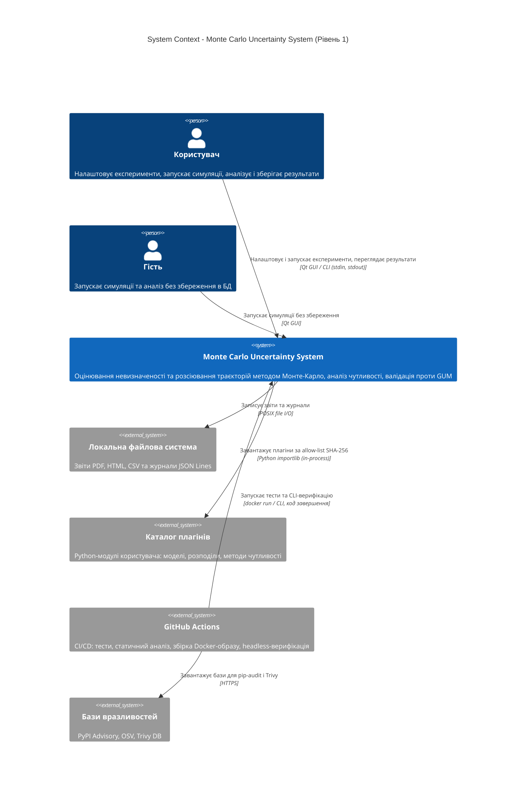
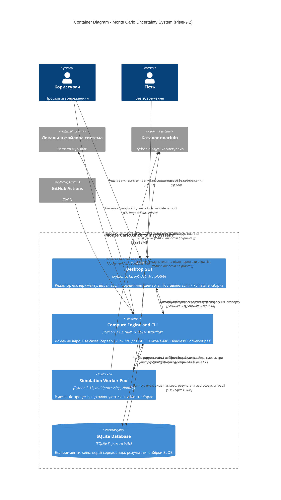

# Розділ 2. Проєктування архітектури системи

Документ містить архітектурні діаграми C4 Model (рівні 1–3) у форматі Mermaid, їхній опис та трасування до вимог [srs.md](./srs.md) і рішення [ADR-001](./adr/0001-choice-of-technology.md).

**Навігація:** [2.1 Context та Container](#21-контекстне-та-контейнерне-моделювання-системи-c4-model) · [2.2 Component](#22-компонентне-моделювання-критичного-сервісу-системи) · [2.3 ADR](#23-документування-архітектурних-рішень-architecture-decision-records) · [2.4 Матриця трасування](#24-матриця-трасування-вимоги--архітектура)

**Архітектурні принципи:** Hexagonal (Ports & Adapters): доменне ядро не залежить від GUI, СУБД, файлової системи та механізму паралелізму; залежності спрямовані до ядра (Dependency Inversion). Один процес Compute Engine обслуговує GUI та CLI; обчислення виконуються у відокремлених робочих процесах.

---

## 2.1 Контекстне та контейнерне моделювання системи (C4 Model)

### Рівень 1. System Context

**Опис елементів**

| Елемент | Тип | Опис | Вимоги |
| --- | --- | --- | --- |
| Користувач | Person | Локальний профіль; збереження та відтворення експериментів | [SRS-FUN-46](./srs.md#srs-fun-46), [SRS-FUN-49](./srs.md#srs-fun-49), [SRS-FUN-51](./srs.md#srs-fun-51) |
| Гість | Person | Режим без запису в БД | [SRS-FUN-51](./srs.md#srs-fun-51) |
| Monte Carlo Uncertainty System | System | Усі функції [розділу 2 SRS](./srs.md#2-functional-requirements-функціональні-вимоги) | SRS-FUN-01…61 |
| Локальна файлова система | System_Ext | Приймач звітів PDF / HTML / CSV та журналів | [SRS-FUN-58](./srs.md#srs-fun-58), [SRS-FUN-59](./srs.md#srs-fun-59), [SRS-FUN-60](./srs.md#srs-fun-60), [SRS-FUN-61](./srs.md#srs-fun-61) |
| Каталог плагінів | System_Ext | Джерело користувацьких моделей, розподілів, методів чутливості | [SRS-FUN-09…13](./srs.md#srs-fun-09), [SRS-NFR-SEC-04](./srs.md#srs-nfr-sec-04) |
| GitHub Actions | System_Ext | Автоматична верифікація NFR | [SRS-NFR-DEPL-01](./srs.md#srs-nfr-depl-01), [SRS-NFR-PORT-01](./srs.md#srs-nfr-port-01), [SRS-NFR-QUAL-04](./srs.md#srs-nfr-qual-04) |
| Бази вразливостей | System_Ext | Дані для `pip-audit` і Trivy | [SRS-NFR-SEC-02](./srs.md#srs-nfr-sec-02), [SRS-NFR-SEC-06](./srs.md#srs-nfr-sec-06) |

**Опис зв’язків**

| № | Зв’язок | Протокол | Призначення |
| --- | --- | --- | --- |
| 1 | Користувач → Система | Qt GUI (події вводу) або CLI (argv, stdout) | [SRS-IF-01](./srs.md#1-system-context-контекст-системи), SRS-IF-02 |
| 2 | Гість → Система | Qt GUI | [SRS-FUN-51](./srs.md#srs-fun-51) |
| 3 | Система → Файлова система | Файловий ввід-вивід POSIX / Win32 | [SRS-IF-05](./srs.md#1-system-context-контекст-системи) |
| 4 | Система → Каталог плагінів | `importlib` (in-process) | [SRS-IF-06](./srs.md#1-system-context-контекст-системи) |
| 5 | CI → Система | `docker run`, код завершення | [SRS-IF-07](./srs.md#1-system-context-контекст-системи) |
| 6 | CI → Бази вразливостей | HTTPS | Сканування залежностей (поза межами системи) |

### Рівень 2. Container

**Опис контейнерів**

| Контейнер | Технологія | Відповідальність | Розгортання | Вимоги |
| --- | --- | --- | --- | --- |
| Desktop GUI | Python 3.13, PySide6, Matplotlib | Редактор експерименту, гістограми, пучок траєкторій, порівняння сценаріїв, діаграма tornado і криві збіжності; не містить обчислювальної логіки; читає БД у режимі read-only | PyInstaller (Windows, Linux) | [SRS-FUN-52…56](./srs.md#srs-fun-52), [SRS-NFR-UI-01](./srs.md#srs-nfr-ui-01), [SRS-NFR-PORT-01](./srs.md#srs-nfr-port-01) |
| Compute Engine and CLI | Python 3.13, NumPy, SciPy, structlog | Єдина точка входу до доменного ядра: use cases, оркестрація Монте-Карло, аналіз, валідація проти GUM, збереження, експорт. Працює в двох режимах: `serve` (JSON-RPC для GUI) та `run` (CLI). Окремий процес ізолює GUI від GIL, відповідальність за [SRS-NFR-UI-01](./srs.md#srs-nfr-ui-01) | Docker-образ (non-root), процес поруч із GUI | [SRS-FUN-01…51](./srs.md#2-functional-requirements-функціональні-вимоги), [SRS-FUN-57…61](./srs.md#srs-fun-57), [SRS-NFR-SEC-06](./srs.md#srs-nfr-sec-06) |
| Simulation Worker Pool | Python 3.13, `ProcessPoolExecutor` (start method `spawn`), NumPy | Виконання чанків: генерація вибірки, інтегрування, повернення вихідних величин; не має доступу до БД | Дочірні процеси Compute Engine | [SRS-FUN-20…22](./srs.md#srs-fun-20), [SRS-NFR-PERF-01…02](./srs.md#srs-nfr-perf-01), [ADR-001](./adr/0001-choice-of-technology.md) |
| SQLite Database | SQLite 3, WAL | Сховище експериментів, seed, версій середовища, результатів; запис виконує лише Compute Engine | Файл у каталозі профілю користувача | [SRS-FUN-46…50](./srs.md#srs-fun-46), [SRS-NFR-REL-01](./srs.md#srs-nfr-rel-01), [SRS-NFR-SEC-01](./srs.md#srs-nfr-sec-01) |

Пакет `mcunc-core` (доменне ядро) є бібліотекою всередині контейнерів Compute Engine та Worker Pool і не є окремим контейнером; його внутрішня структура наведена на рівні 3.

**Опис зв’язків**

| № | Зв’язок | Протокол | Призначення | Вимоги |
| --- | --- | --- | --- | --- |
| 1 | Користувач → GUI, Гість → GUI | Qt GUI | Взаємодія з редактором і візуалізаціями | [SRS-IF-01](./srs.md#1-system-context-контекст-системи) |
| 2 | Користувач → Engine | CLI (argv, stdout, stderr) | Пакетні запуски | [SRS-FUN-57](./srs.md#srs-fun-57) |
| 3 | CI → Engine | `docker run`, код завершення | Автоматична верифікація | [SRS-IF-07](./srs.md#1-system-context-контекст-системи) |
| 4 | GUI → Engine | JSON-RPC 2.0 / stdio | Керування запуском | [SRS-FUN-24](./srs.md#srs-fun-24), [SRS-IF-03](./srs.md#1-system-context-контекст-системи) |
| 5 | Engine → GUI | JSON-RPC 2.0 notifications / stdio | Прогрес і статус | [SRS-FUN-25](./srs.md#srs-fun-25) |
| 6 | GUI → БД | SQL / `sqlite3`, `mode=ro` | Читання результатів для графіків | [SRS-FUN-53…56](./srs.md#srs-fun-53) |
| 7 | Engine → БД | SQL / `sqlite3`, WAL | Запис експериментів, міграції | [SRS-FUN-46…50](./srs.md#srs-fun-46) |
| 8 | Engine ↔ Workers | `multiprocessing`, pickle через pipe ОС | Розподіл чанків і збір результатів | [SRS-FUN-21](./srs.md#srs-fun-21), [ADR-001](./adr/0001-choice-of-technology.md) |
| 9 | Workers → Плагіни | `importlib` | Імпорт моделі-плагіна у кожному робочому процесі | [SRS-NFR-SEC-04](./srs.md#srs-nfr-sec-04) |
| 10 | Engine → Плагіни | `importlib` | Завантаження та реєстрація | [SRS-FUN-12](./srs.md#srs-fun-12) |
| 11 | Engine → Файлова система | Файловий ввід-вивід | Експорт звітів, журнали | [SRS-FUN-58…61](./srs.md#srs-fun-58) |

**Архітектурні рішення рівня 2:** вибір механізму паралелізму зафіксовано в [ADR-001](./adr/0001-choice-of-technology.md); результати великих вибірок передаються до GUI через БД, а не через JSON-RPC; JSON-RPC передає лише керуючі повідомлення та прогрес.

---

## 2.2 Компонентне моделювання критичного сервісу системи

Критичний контейнер — **Compute Engine and CLI**: містить усі обчислювальні та аналітичні алгоритми й визначає виконання [SRS-NFR-PERF-01…03](./srs.md#srs-nfr-perf-01), [SRS-NFR-REPR-01](./srs.md#srs-nfr-repr-01), [SRS-NFR-ACC-01…06](./srs.md#srs-nfr-acc-01).

### Рівень 3. Component

```mermaid
C4Component
  title Component Diagram - Compute Engine and CLI (Рівень 3)

  System_Ext(ci, "GitHub Actions", "Запуск CLI у Docker")
  Container(gui, "Desktop GUI", "PySide6", "Клієнт JSON-RPC")
  Container(workers, "Simulation Worker Pool", "multiprocessing", "Виконує чанки")
  ContainerDb(db, "SQLite Database", "SQLite 3, WAL", "Експерименти та результати")
  System_Ext(fs, "Локальна файлова система", "Звіти та журнали")
  System_Ext(plug, "Каталог плагінів", "Python-модулі")

  Container_Boundary(engine, "Compute Engine and CLI") {
    Component(cli, "CliController", "argparse", "Команди run, reproduce, validate, export")
    Component(rpc, "RpcServer", "JSON-RPC 2.0 / stdio", "Запити GUI, нотифікації прогресу")
    Component(val, "RequestValidator", "Middleware, dataclasses", "Валідація DTO: N, P, діапазони, матриця кореляцій")
    Component(guard, "AccessPolicyGuard", "Middleware", "Режим Гість: заборона запису в БД")
    Component(bus, "CommandBus", "Command, Mediator", "Маршрутизація команд до use cases")
    Component(err, "GlobalErrorHandler", "Exception mapping", "Доменні винятки до кодів помилок")
    Component(root, "CompositionRoot", "Dependency Injection", "Складання об'єктів і впровадження залежностей")
    Component(loader, "PluginLoader", "importlib, hashlib", "Allow-list SHA-256, перевірка інтерфейсу")

    Component(ucRun, "RunExperimentUseCase", "Application service", "Конвеєр: вибірка, MC, аналіз, GUM, збереження")
    Component(ucRepro, "ReproduceExperimentUseCase", "Application service", "Відтворення за збереженим seed")
    Component(ucVal, "ValidateAgainstGumUseCase", "Application service", "Окрема валідація проти GUM")
    Component(ucExp, "ExportReportUseCase", "Application service", "Експорт PDF, HTML, CSV")
    Component(logger, "StructuredLogger", "structlog", "Журнал JSON Lines")
    Component(prog, "ProgressPublisher", "Observer", "Прогрес і статус підписникам")

    Component(reg, "PluginRegistry", "Registry, Strategy", "Моделі, розподіли, методи чутливості")
    Component(gen, "SampleGenerator", "Factory, Strategy", "Розподіли та гауссова копула")
    Component(seed, "SeedManager", "numpy SeedSequence", "Потік випадкових чисел на чанк")
    Component(mc, "MonteCarloCoordinator", "Domain service", "Чанки, адаптивний N, скасування, невдалі траєкторії")
    Component(models, "TrajectoryModels", "Strategy", "M1, M2, M3")
    Component(integ, "OdeIntegrators", "Strategy", "RK4, Dormand-Prince, подія падіння")
    Component(stats, "StatisticsAnalyzer", "scipy.stats", "Статистики, інтервали, нормальність, збіжність")
    Component(sens, "SensitivityAnalyzer", "scipy.stats.sobol_indices", "Соболь, SRC, one-at-a-time")
    Component(gum, "GumValidator", "Domain service", "Лінеаризація JCGM 100, аналітика M1")

    Component(pExec, "ExecutorPort", "Interface", "submit(chunks), cancel()")
    Component(pRepo, "RepositoryPort", "Interface", "save, load, list")
    Component(pRep, "ReportRendererPort", "Interface", "render(experiment, format)")

    Component(exec, "ProcessPoolExecutorAdapter", "concurrent.futures, spawn", "Реалізація ExecutorPort")
    Component(repo, "SqliteExperimentRepository", "sqlite3, WAL", "Реалізація RepositoryPort, міграції")
    Component(rend, "ReportRenderers", "ReportLab, Jinja2, csv", "Реалізація ReportRendererPort")
  }

  Rel(ci, cli, "Команди run, reproduce, validate, export", "CLI argv / код завершення")
  Rel(gui, rpc, "Запити run, cancel, reproduce, export", "JSON-RPC 2.0 / stdio")
  Rel(rpc, gui, "Нотифікації прогресу та статусу", "JSON-RPC 2.0 / stdio")

  Rel(cli, val, "Передає DTO запиту", "in-process call")
  Rel(rpc, val, "Передає DTO запиту", "in-process call")
  Rel(val, guard, "Передає валідний запит", "middleware chain")
  Rel(guard, bus, "Передає дозволену команду", "interface call")
  Rel(val, err, "Повідомляє про відхилений запит", "exception")
  Rel(bus, err, "Передає необроблені винятки", "exception")
  Rel(err, logger, "Логує виняток", "in-process call")
  Rel(err, rpc, "Формує JSON-RPC error", "in-process call")
  Rel(err, cli, "Повертає код завершення та stderr", "in-process call")

  Rel(bus, ucRun, "Dispatch RunExperiment", "Mediator, interface call")
  Rel(bus, ucRepro, "Dispatch Reproduce", "Mediator, interface call")
  Rel(bus, ucVal, "Dispatch Validate", "Mediator, interface call")
  Rel(bus, ucExp, "Dispatch Export", "Mediator, interface call")

  Rel(ucRun, reg, "Отримує модель, розподіли, методи за іменем", "lookup")
  Rel(ucRun, gen, "Будує генератор вибірки", "Factory")
  Rel(ucRun, mc, "Запускає Монте-Карло", "interface call")
  Rel(ucRun, stats, "Запитує статистичний аналіз", "interface call")
  Rel(ucRun, sens, "Запитує аналіз чутливості", "interface call")
  Rel(ucRun, gum, "Запитує валідацію проти GUM", "interface call")
  Rel(ucRun, pRepo, "Зберігає експеримент і результати", "DIP, interface call")
  Rel(ucRun, prog, "Публікує прогрес і статус", "Observer")
  Rel(ucRun, logger, "Логує запуск", "in-process call")
  Rel(ucRepro, ucRun, "Повторний запуск за збереженим seed", "interface call")
  Rel(ucRepro, pRepo, "Читає збережений експеримент", "DIP, interface call")
  Rel(ucVal, gum, "Запитує валідацію", "interface call")
  Rel(ucVal, pRepo, "Читає та оновлює результати валідації", "DIP, interface call")
  Rel(ucExp, pRepo, "Читає експеримент", "DIP, interface call")
  Rel(ucExp, pRep, "Рендерить звіт", "DIP, interface call")

  Rel(mc, seed, "Отримує потік для індексу чанка", "spawn(chunk_index)")
  Rel(mc, pExec, "Передає чанки та скасування", "DIP, interface call")
  Rel(mc, models, "Передає модель для чанка", "Strategy")
  Rel(models, integ, "Інтегрує рівняння руху", "Strategy")
  Rel(gen, seed, "Бере генератор для чанка", "interface call")
  Rel(sens, mc, "Запитує оцінювання матриць A, B, AB_i", "interface call")
  Rel(gum, models, "Похідні та аналітика M1", "Strategy")
  Rel(prog, rpc, "Нотифікації прогресу", "Observer callback")

  Rel(exec, pExec, "Реалізує", "DIP")
  Rel(repo, pRepo, "Реалізує", "DIP")
  Rel(rend, pRep, "Реалізує", "DIP")
  Rel(exec, workers, "Submit чанків, збір результатів", "multiprocessing / pickle через pipe ОС")
  Rel(repo, db, "Запис і читання експериментів", "SQL / sqlite3, WAL")
  Rel(rend, fs, "Запис PDF, HTML, CSV", "POSIX file I/O")
  Rel(logger, fs, "Запис журналу", "structlog JSON Lines")

  Rel(loader, reg, "register(plugin)", "in-process call")
  Rel(loader, plug, "Завантаження модуля після перевірки хешу", "Python importlib")
  Rel(root, cli, "Створює та впроваджує залежності", "DI")
  Rel(root, rpc, "Створює та впроваджує залежності", "DI")
  Rel(root, loader, "Ініціалізує завантаження плагінів", "DI")

  UpdateLayoutConfig($c4ShapeInRow="4", $c4BoundaryInRow="1")
```

**Шари та правила залежностей**

| Шар | Компоненти | Правило |
| --- | --- | --- |
| Inbound (адаптери входу) | CliController, RpcServer | Не містять бізнес-логіки; передають DTO у ланцюг middleware |
| Middleware | RequestValidator, AccessPolicyGuard, GlobalErrorHandler | Валідація та дозволи виконуються до виклику use case; помилки перетворюються централізовано |
| Application | CommandBus, RunExperimentUseCase, ReproduceExperimentUseCase, ValidateAgainstGumUseCase, ExportReportUseCase, ProgressPublisher, StructuredLogger | Оркеструють домен; залежать лише від доменних сервісів і портів |
| Domain | PluginRegistry, SampleGenerator, SeedManager, MonteCarloCoordinator, TrajectoryModels, OdeIntegrators, StatisticsAnalyzer, SensitivityAnalyzer, GumValidator | Не імпортують `sqlite3`, `concurrent.futures`, PySide6, ReportLab |
| Ports | ExecutorPort, RepositoryPort, ReportRendererPort | Інтерфейси належать доменному / прикладному шару |
| Outbound (адаптери виходу) | ProcessPoolExecutorAdapter, SqliteExperimentRepository, ReportRenderers | Реалізують порти; єдині компоненти, що знають про технології |
| Bootstrap | CompositionRoot, PluginLoader | Єдине місце створення конкретних адаптерів і завантаження плагінів |

**Опис компонентів**

| Компонент | Роль | Патерн / технологія | Взаємодія | Вимоги |
| --- | --- | --- | --- | --- |
| CliController | Розбір команд `run`, `reproduce`, `validate`, `export`; код завершення | `argparse` | Викликає RequestValidator; отримує код від GlobalErrorHandler | [SRS-FUN-57](./srs.md#srs-fun-57) |
| RpcServer | Приймає запити GUI та надсилає нотифікації | JSON-RPC 2.0 / stdio | RequestValidator; підписується на ProgressPublisher | [SRS-FUN-24](./srs.md#srs-fun-24), [SRS-FUN-25](./srs.md#srs-fun-25) |
| RequestValidator | Перевіряє *N* ∈ [1; 10^7], *P*, діапазони параметрів, матрицю кореляцій | Middleware, dataclasses | Передає запит до AccessPolicyGuard; помилки — до GlobalErrorHandler | [SRS-FUN-17](./srs.md#srs-fun-17), [SRS-FUN-18](./srs.md#srs-fun-18), [SRS-FUN-19](./srs.md#srs-fun-19), [SRS-NFR-ROB-01](./srs.md#srs-nfr-rob-01) |
| AccessPolicyGuard | У режимі «Гість» відхиляє команди із записом у БД | Middleware | Передає команду до CommandBus | [SRS-FUN-51](./srs.md#srs-fun-51) |
| CommandBus | Маршрутизує команду до use case за типом | Command, Mediator | Викликає use cases через інтерфейс | — |
| GlobalErrorHandler | Відображає винятки на коди помилок JSON-RPC / CLI, логує | Exception mapping | StructuredLogger, RpcServer, CliController | [SRS-FUN-28](./srs.md#srs-fun-28), [SRS-FUN-29](./srs.md#srs-fun-29), [SRS-NFR-ROB-01](./srs.md#srs-nfr-rob-01) |
| CompositionRoot | Створює адаптери, впроваджує залежності через конструктори | Dependency Injection | Єдиний компонент, що імпортує конкретні адаптери | [SRS-NFR-EXT-01](./srs.md#srs-nfr-ext-01) |
| PluginLoader | Перевіряє SHA-256 за allow-list та інтерфейс; реєструє плагін | `importlib`, `hashlib` | Викликає `PluginRegistry.register`; ті самі перевірки виконуються у робочих процесах | [SRS-FUN-12](./srs.md#srs-fun-12), [SRS-FUN-13](./srs.md#srs-fun-13), [SRS-NFR-SEC-04](./srs.md#srs-nfr-sec-04) |
| RunExperimentUseCase | Конвеєр: вибірка → MC → статистика → чутливість → GUM → збереження | Application service | Домен, RepositoryPort, ProgressPublisher, StructuredLogger | [SRS-FUN-19…23](./srs.md#srs-fun-19), [SRS-FUN-30…45](./srs.md#srs-fun-30), [SRS-FUN-46…48](./srs.md#srs-fun-46) |
| ReproduceExperimentUseCase | Завантажує експеримент, повторює за seed, порівнює | Application service | RepositoryPort, RunExperimentUseCase | [SRS-FUN-49](./srs.md#srs-fun-49), [SRS-NFR-REPR-02](./srs.md#srs-nfr-repr-02) |
| ValidateAgainstGumUseCase | Окрема валідація проти GUM для збереженого експерименту | Application service | GumValidator, RepositoryPort | [SRS-FUN-43…45](./srs.md#srs-fun-43) |
| ExportReportUseCase | Експорт PDF, HTML, CSV | Application service | RepositoryPort, ReportRendererPort | [SRS-FUN-58…60](./srs.md#srs-fun-58) |
| StructuredLogger | Записи JSON Lines з обов’язковими полями | `structlog` | Викликається use cases та GlobalErrorHandler | [SRS-FUN-61](./srs.md#srs-fun-61), [SRS-NFR-OBS-01](./srs.md#srs-nfr-obs-01) |
| ProgressPublisher | Публікує прогрес і статус | Observer | RpcServer підписаний; CLI виводить прогрес у stderr | [SRS-FUN-25](./srs.md#srs-fun-25) |
| PluginRegistry | Реєстр моделей, розподілів, методів чутливості за іменем | Registry, Strategy | Наповнюється PluginLoader; читається use cases | [SRS-FUN-09…11](./srs.md#srs-fun-09) |
| SampleGenerator | Генерує вибірки розподілів; гауссова копула | Factory, Strategy | SeedManager | [SRS-FUN-14…16](./srs.md#srs-fun-14), [SRS-NFR-ACC-05](./srs.md#srs-nfr-acc-05) |
| SeedManager | Породжує потік випадкових чисел на чанк | `numpy.random.SeedSequence.spawn` | Викликається MonteCarloCoordinator та SampleGenerator | [SRS-FUN-22](./srs.md#srs-fun-22), [SRS-FUN-23](./srs.md#srs-fun-23) |
| MonteCarloCoordinator | Ділить *N* на чанки, керує адаптивним *N*, скасуванням, невдалими траєкторіями | Domain service | ExecutorPort, SeedManager, TrajectoryModels | [SRS-FUN-19…21](./srs.md#srs-fun-19), [SRS-FUN-24](./srs.md#srs-fun-24), [SRS-FUN-26…29](./srs.md#srs-fun-26), [ADR-001](./adr/0001-choice-of-technology.md) |
| TrajectoryModels | M1, M2, M3 за єдиним інтерфейсом моделі | Strategy | OdeIntegrators | [SRS-FUN-01…05](./srs.md#srs-fun-01) |
| OdeIntegrators | RK4, Dormand–Prince, подія перетину площини падіння | Strategy | Використовується моделями | [SRS-FUN-06…08](./srs.md#srs-fun-06) |
| StatisticsAnalyzer | Статистики, інтервали, еліпс, нормальність, покриття, збіжність | `scipy.stats` | Чисті функції над масивами | [SRS-FUN-30…38](./srs.md#srs-fun-30), [SRS-FUN-42](./srs.md#srs-fun-42) |
| SensitivityAnalyzer | Індекси Соболя, SRC, one-at-a-time | `scipy.stats.sobol_indices` | Використовує MonteCarloCoordinator для оцінювань моделі | [SRS-FUN-39…41](./srs.md#srs-fun-39), [SRS-NFR-ACC-04](./srs.md#srs-nfr-acc-04) |
| GumValidator | Лінеаризація JCGM 100; порівняння з MC; аналітика M1 | Domain service | TrajectoryModels | [SRS-FUN-43…45](./srs.md#srs-fun-43), [SRS-NFR-ACC-02](./srs.md#srs-nfr-acc-02) |
| ExecutorPort | Інтерфейс виконання чанків і скасування | Port | Реалізується ProcessPoolExecutorAdapter | [ADR-001](./adr/0001-choice-of-technology.md) |
| RepositoryPort | Інтерфейс збереження та читання експериментів | Port, Repository | Реалізується SqliteExperimentRepository | [SRS-FUN-46…48](./srs.md#srs-fun-46) |
| ReportRendererPort | Інтерфейс рендерингу звітів | Port | Реалізується ReportRenderers | [SRS-FUN-58…60](./srs.md#srs-fun-58) |
| ProcessPoolExecutorAdapter | Пул процесів зі start method `spawn`, скасування, завершення робочих процесів | `concurrent.futures` | Pickle через pipe ОС | [SRS-FUN-21](./srs.md#srs-fun-21), [SRS-FUN-29](./srs.md#srs-fun-29), [SRS-NFR-PERF-04](./srs.md#srs-nfr-perf-04), [SRS-NFR-RES-02](./srs.md#srs-nfr-res-02) |
| SqliteExperimentRepository | Параметризовані запити, транзакції, міграції, режим WAL | `sqlite3` | SQL / локальний файл SQLite (без мережевого сервера) | [SRS-FUN-46…50](./srs.md#srs-fun-46), [SRS-NFR-SEC-01](./srs.md#srs-nfr-sec-01), [SRS-NFR-REL-01](./srs.md#srs-nfr-rel-01), [SRS-NFR-DATA-01](./srs.md#srs-nfr-data-01) |
| ReportRenderers | PDF (ReportLab), HTML (Jinja2), CSV | ReportLab, Jinja2, `csv` | Файловий ввід-вивід | [SRS-FUN-58…60](./srs.md#srs-fun-58) |

**Примітки до рівня 3**

- Компоненти SampleGenerator, TrajectoryModels, OdeIntegrators і SeedManager є частиною того самого Python-пакета та імпортуються також у робочих процесах Worker Pool; вони не мають станів і доступу до портів БД та файлової системи.
- Залежності спрямовані до домену: адаптери (`exec`, `repo`, `rend`) реалізують порти, а не навпаки; CompositionRoot — єдиний компонент із залежністю на конкретні адаптери.
- Контролери (CliController, RpcServer) не мають прямих зв’язків з RepositoryPort і доменом; будь-який запит проходить ланцюг RequestValidator → AccessPolicyGuard → CommandBus.

---

## 2.3 Документування архітектурних рішень (Architecture Decision Records)

| ID | Рішення | Статус | Документ |
| --- | --- | --- | --- |
| ADR-001 | Механізм паралельного виконання Монте-Карло: `ProcessPoolExecutor` + векторизація NumPy | Approved | [0001-choice-of-technology.md](./adr/0001-choice-of-technology.md) |

Рішення визначає контейнер Simulation Worker Pool ([рівень 2](#diagram-level2)) та компоненти MonteCarloCoordinator, ExecutorPort, ProcessPoolExecutorAdapter, SeedManager ([рівень 3](#diagram-level3)), а також вимоги [SRS-FUN-20…22](./srs.md#srs-fun-20), [SRS-NFR-PERF-01…02](./srs.md#srs-nfr-perf-01), [SRS-NFR-REPR-01](./srs.md#srs-nfr-repr-01).

---

## 2.4 Матриця трасування вимоги → архітектура

| Вимоги SRS | Контейнер (рівень 2) | Компоненти (рівень 3) |
| --- | --- | --- |
| [SRS-FUN-01…08](./srs.md#srs-fun-01) | Compute Engine, Worker Pool | TrajectoryModels, OdeIntegrators |
| [SRS-FUN-09…13](./srs.md#srs-fun-09) | Compute Engine, Worker Pool | PluginRegistry, PluginLoader |
| [SRS-FUN-14…18](./srs.md#srs-fun-14) | Compute Engine, Worker Pool | SampleGenerator, RequestValidator |
| [SRS-FUN-19…29](./srs.md#srs-fun-19) | Compute Engine, Worker Pool | MonteCarloCoordinator, SeedManager, ExecutorPort, ProcessPoolExecutorAdapter, ProgressPublisher, GlobalErrorHandler |
| [SRS-FUN-30…42](./srs.md#srs-fun-30) | Compute Engine | StatisticsAnalyzer, SensitivityAnalyzer |
| [SRS-FUN-43…45](./srs.md#srs-fun-43) | Compute Engine | GumValidator, ValidateAgainstGumUseCase |
| [SRS-FUN-46…51](./srs.md#srs-fun-46) | Compute Engine, SQLite Database | RepositoryPort, SqliteExperimentRepository, ReproduceExperimentUseCase, AccessPolicyGuard |
| [SRS-FUN-52…56](./srs.md#srs-fun-52) | Desktop GUI, SQLite Database | — (поза рівнем 3 Compute Engine) |
| [SRS-FUN-57](./srs.md#srs-fun-57) | Compute Engine | CliController |
| [SRS-FUN-58…60](./srs.md#srs-fun-58) | Compute Engine | ExportReportUseCase, ReportRendererPort, ReportRenderers |
| [SRS-FUN-61](./srs.md#srs-fun-61), [SRS-NFR-OBS-01](./srs.md#srs-nfr-obs-01) | Compute Engine | StructuredLogger |
| [SRS-NFR-PERF-01…04](./srs.md#srs-nfr-perf-01), [SRS-NFR-RES-01…02](./srs.md#srs-nfr-res-01) | Compute Engine, Worker Pool | MonteCarloCoordinator, ProcessPoolExecutorAdapter |
| [SRS-NFR-UI-01](./srs.md#srs-nfr-ui-01) | Desktop GUI, Compute Engine | RpcServer (виділення обчислень в окремий процес) |
| [SRS-NFR-SEC-01…07](./srs.md#srs-nfr-sec-01) | Compute Engine, SQLite Database | SqliteExperimentRepository, PluginLoader, RequestValidator |
| [SRS-NFR-REL-01…02](./srs.md#srs-nfr-rel-01), [SRS-NFR-DATA-01](./srs.md#srs-nfr-data-01) | Compute Engine, SQLite Database | SqliteExperimentRepository, ProcessPoolExecutorAdapter |
| [SRS-NFR-EXT-01](./srs.md#srs-nfr-ext-01) | Compute Engine | PluginRegistry, CompositionRoot |
